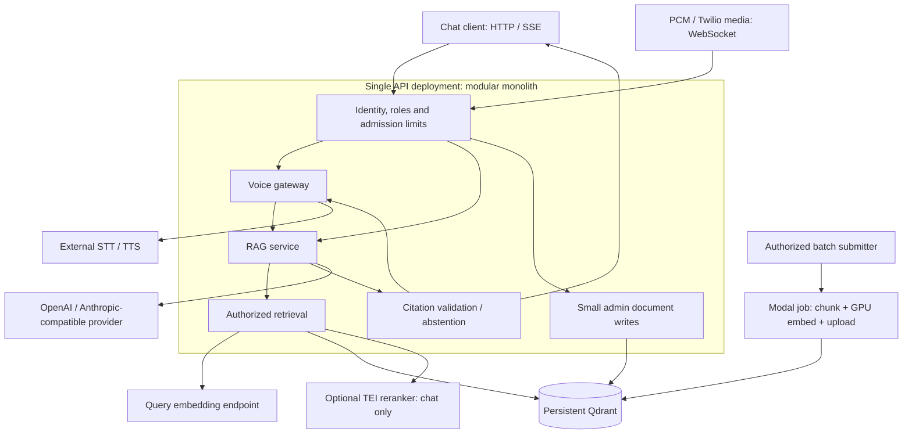
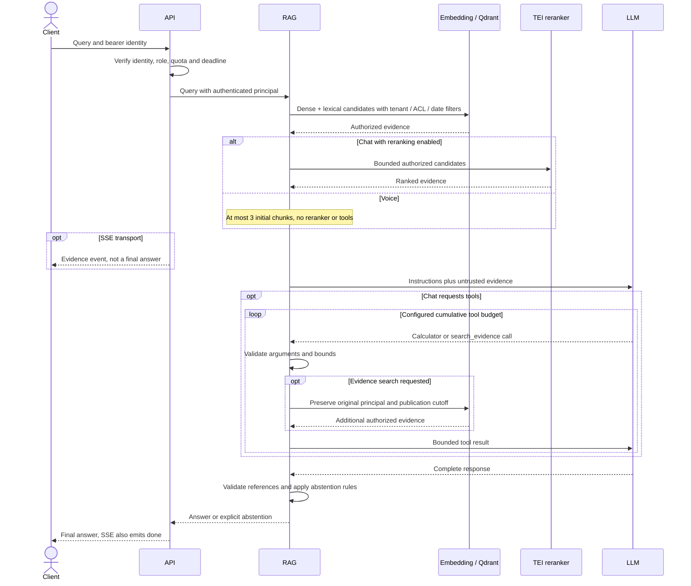
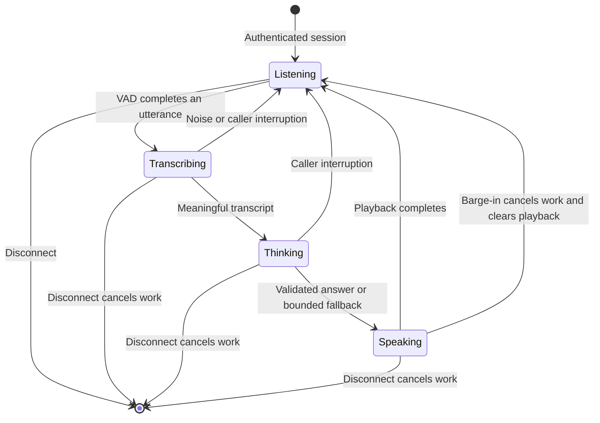

# Architecture

Ledger is an evidence-first financial-disclosure backend shared by chat and
voice. The design optimizes correctness, isolation, latency and operating cost,
not the number of frameworks.

**Implemented** means code exists, not that a cloud deployment or SLO has been
validated. [Validation](VALIDATION.md) records measured evidence.
[Architecture choices](research/2026-10-31-decisions.md#architecture-choice-review)
compare alternatives and define when to revisit them.

## 1. Current system boundaries

These are implemented code paths, **not a diagram of an already deployed cloud
service**. Memory retrieval and an extractive provider remain the keyless local
demo. Production configuration requires persistent Qdrant and an explicit LLM.

The synchronous request path stays in one API process. GPU indexing is an
independently scheduled batch workload; speech/model endpoints and Qdrant are
external dependencies, not a requirement to split every domain into microservices.
Postgres, Valkey, a durable job orchestrator and GraphQL are **not deployed parts
of this topology**.

**Important exception:** `POST /v1/documents` remains a synchronous, authorized
small-write path sharing the API's admission capacity and in-process retriever
lock. It can block queries during replacement. It is not a durable asynchronous
ingestion API; use [Modal ingestion](INGESTION.md) for bulk builds.

## 2. Query execution and evidence boundary

The diagram abbreviates the optional reranker wrapper around retrieval. Tool
searches go through that same configured retrieval path; they do not bypass
authorization. Failures return sanitized errors rather than silent provider or
index fallbacks. SSE failures emit `error`, not a success-shaped final answer.

Citation validation checks references and required citation structure. It does
**not** prove semantic entailment, correct financial units or truthful arithmetic
inputs. The calculator bounds Decimal expressions; the LLM still has to select
the correct cited operands. A full semantic faithfulness gate remains unimplemented.

Sources: [API](../src/ledger_rag/api/app.py),
[RAG service](../src/ledger_rag/orchestration/service.py),
[reranking](../src/ledger_rag/retrieval/reranking.py).

## 3. Retrieval and index contracts

| Boundary | Current behavior | Limitation / release condition |
|---|---|---|
| Chunking | Preserve paragraphs, table rows/headers and bounded neighboring context; embed title plus chunk text | No LLM-generated context, late chunking or visual table encoder yet |
| Identity | Production chunker hashes tenant/document/ordinal/content; Qdrant uses deterministic UUIDs and ownership checks | Generic chunk callers must still obey the ownership contract |
| Hybrid retrieval | Dense cosine plus hashed lexical sparse vectors, fused with RRF | Fixed reference length 256 and hashed terms are a BM25 approximation, not exact corpus-wide BM25 |
| Permissions | Tenant, group ACL and publication-day filters apply before ranking, with post-retrieval checks | `as_of` is disclosure publication date, not fiscal year |
| Index compatibility | Legacy schema 2 binds embeddings to endpoint/model/dimensions/rendering; opt-in schema 3 uses explicit embedding-space identity | A logical ID is not proof of served weights; validate the pinned query model and precision |
| Reranking | Optional TEI cross-encoder; configurable candidate count, voice bypass | Measure quality/latency tradeoff; an extra network hop is not free |
| Compression | Optional scalar/binary vector quantization with dense rescoring; `none` bypasses it | Distinct from CPU INT8 model inference; neither has demonstrated corpus-wide uplift here |
| Bulk builds | One Modal GPU container writes a new collection, creates filter indexes and verifies counts before committing a manifest | No automatic resume, online cutover, distributed write lock or production release |
| Small replacements | Upload all new chunks before tenant/document-scoped stale deletion; uncertain writes quarantine that instance | Not transactional across processes; a restart is not reconciliation |

See [ingestion and release boundaries](INGESTION.md),
[Qdrant implementation](../src/ledger_rag/retrieval/qdrant.py) and
[evaluation methodology](EVALUATION.md). Keep prior indexes for rollback.
Do not share a float16-built space with an INT8 query encoder merely because
their model names match.

## 4. Voice lifecycle

The implemented gateway supports generic PCM and Twilio Media Streams,
OpenAI-compatible STT/TTS, energy VAD, resampling and cancellation. Real carrier
interoperability and mouth-to-ear latency remain unverified.

This is the principal lifecycle, not an exhaustive exception transition table.
STT/RAG/TTS work is cancellable; task/permit release and stale-audio prevention
are correctness requirements. Twilio's playback `mark` is different from the
server finishing TTS generation.

- Authenticate before processing media. Twilio's custom-parameter token requires
  a separately implemented signed-webhook minting flow for production.
- Bound frame size, session/utterance length, transcript, generated speech and
  provider deadlines. Reject browser-origin WebSocket requests.
- Streaming TTS does not mean streaming unvalidated LLM tokens. The evidence
  gate precedes speech. Offered human transfer is not an implemented call transfer.
- Measure end-of-user-speech to first playable audio, including VAD endpointing,
  cold starts, STT, retrieval, generation, TTS and transport. Stage targets are
  not additive guarantees or measurements.

Sources: [gateway](../src/ledger_rag/voice/gateway.py),
[transport](../src/ledger_rag/voice/transport.py),
[operating targets](OPERATIONS.md#health-capacity-and-failure-handling).

## 5. Identity, secrets and operations

OIDC signature/issuer/audience/expiry validation and tenant/group claims are
implemented. Demo credentials are local-only. Postgres RLS is **not** the
authorization system currently running; it is a future control-plane option.

Service secrets are loaded from Vault-rendered files at startup. Explicit
environment values can override those files; the application does not source
shell templates or implicitly read dotenv files. The production waiter requires
LLM, embedding, Qdrant and OTLP-header files. Rotation needs a controlled restart.
Modal platform credentials, the batch database secret and serving TEI keys are
separate credentials with different consumers.

The application emits JSON logs, metrics, and HTTP/RAG/rerank/voice spans. The
Collector restricts exported attributes. Its OTLP logs receiver is configured,
but an application-to-Collector log shipper is **not** wired. Grafana, Prometheus,
Tempo and Loki have reference configuration; dashboards, alert rules and
validated GenAI/Langfuse semantics remain gaps. See the
[operations diagrams](OPERATIONS.md#observability-data-flow), not a hypothetical
complete observability stack.

## 6. Release and scaling constraints

| Before doing this | Required evidence / capability |
|---|---|
| Publish a batch-built collection | Complete manifest, correct model identity, ACL/date fixtures, indexing health, retrieval quality and rollback |
| Serve an exported fine-tune | Float/dev gate plus successful export, target-runtime metrics and query/index parity; `PROMOTED` alone is insufficient |
| Add API replicas or concurrent writers | Durable coordination/reconciliation and shared admission quotas; process-local locks do not become distributed locks |
| Add continuous source updates | Explicit source-of-truth, idempotency, deletion/ACL propagation, checkpoint/retry semantics and audit trail |
| Add GraphQL | A real admin metadata use case with authorization, pagination and query-cost limits; not media or token transport |
| Claim SOTA, accuracy or IVR SLOs | Reproducible real-data/provider/telephony measurements with failure denominators and uncertainty |

These gates are engineering constraints, not an argument to ship every proposed
service immediately. Evidence-backed review priorities and alternative designs
are maintained in the [decision ledger](research/2026-10-31-decisions.md).
