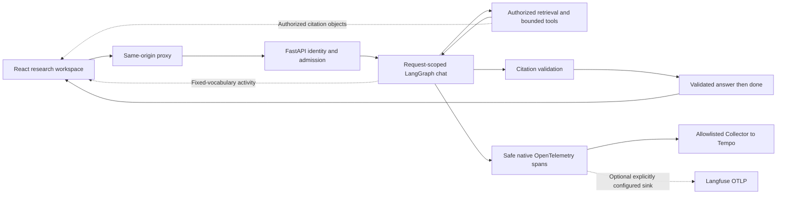

# Chat research workspace

Ledger's browser client is a financial research desk, not a general-purpose
code-execution canvas. Its three surfaces keep the question, the answer and the
supporting evidence in view without conflating them with model reasoning.

## Run it

Requires Node 22.12+ and the existing Python backend prerequisites:

```bash
npm ci --prefix web --ignore-scripts
npm --prefix web run dev
```

Open `http://127.0.0.1:5173`. The initial **design preview** uses curated answers
over the original fictional Aurora disclosures. It makes no LLM calls, shows no
invented execution timings and does not search the web. Only its three explicit
example questions are supported; other preview questions explain this limit.

For live queries, start the API with the [README instructions](../README.md#start-locally).
The development server proxies `/v1/` to `http://127.0.0.1:8080`. Set the
server-only, non-secret `LEDGER_API_ORIGIN` before starting Vite to change that
upstream. Do **not** put provider keys in any `VITE_*` variable or frontend file.
Use **Connect API** to enter the local Ledger demo token or an OIDC access token.
This is an API connection form, not an implemented identity-provider sign-in.
The first query verifies access; merely filling the form is not an auth test.

Connecting/disconnecting clears the current conversations. Access tokens and
chat state exist only in tab memory: no localStorage, sessionStorage, cookies,
cross-tab sharing or browser analytics. Reloading clears them. Live questions
and bounded conversation context are sent to the backend and its configured
model providers; "tab-only" does not mean offline inference.

## Architecture



- **React + TypeScript + Vite:** a static client for an existing Python API.
  No SSR/SEO requirement justifies adding a second full-stack application
  server. API transport is small and typed; SSE payloads receive runtime
  validation. Markdown rendering and live transport load in separate chunks.
- **LangGraph:** explicit model, bounded-tool and validation nodes for chat.
  Voice keeps its direct fast path. No checkpointer, cross-request graph state,
  durable workflow or persistent memory is claimed. See the
  [chat API contract](CHAT_API.md).
- **OpenTelemetry, with optional Langfuse:** reuse one deliberate telemetry
  path rather than double-exporting to competing vendor SDKs. LangSmith is a
  transitive LangGraph dependency, but automatic export is explicitly disabled.
  No live Langfuse integration or GenAI token/cost accounting has been validated.

## Interaction and trust contracts

| Surface | Behavior |
|---|---|
| Answer | Markdown, headings, lists, tables and fenced code. No raw HTML, executable code, iframe or remote image loading. |
| References | Numbered inline citations open an exact excerpt with title, document ID, source identifier and publication date. Only credential-free HTTP(S) URLs become outbound links. |
| Artifacts | Tables and code extracted from the Markdown AST, inspectable independently and downloadable. CSV export neutralizes formula-like cells. Code is always inert text. |
| Activity | Actual server retrieval/model/tool/validation events. No private chain-of-thought, simulated typing, fake progress percentages or fabricated tool traces. |
| Run details | Request ID, model, retrieval and generation/tool time, browser elapsed time, tool count and abstention status. Missing values stay missing; previews never masquerade as measurements. |
| Conversations | At most 20 per tab, 40 turns per conversation. Up to 12 bounded user/assistant messages are sent as untrusted history, never authorization or evidence. |
| Failures | Authentication, rate/capacity, malformed/truncated streams and deadlines have explicit errors. `answer` without `done` is not accepted. Stop cancels fetch; late results cannot populate another conversation. |
| Access | Tenant/group permissions come from the server identity. The UI cannot choose an arbitrary upstream URL or supply tenant claims. Provider/database/platform keys remain server-side. |

Publication cutoff means disclosure publication date, not fiscal year. Initial
retrieval remains latest-question driven; the UI does not claim a history-aware
query-rewriting system. Citation validity is not semantic entailment. Artifact
extraction does not independently verify financial calculations or units.

There is no upload UI, persistent artifact version store, executable HTML/
Mermaid sandbox, voice UI, hosted authentication flow or multi-user conversation
database yet. These require explicit contracts and evaluation, not dead controls.

## Design research and rationale

The visual direction is an original, restrained research desk: warm paper,
forest/sage accents, editorial headings, tabular financial figures and a
persistent source inspector on wide screens. Narrow screens use native modal
drawers with focus trapping and Escape/return-focus behavior.

- [Claude Artifacts](https://support.claude.com/en/articles/17153992-what-are-artifacts-and-how-do-i-use-them):
  borrow the **separation of reusable output from the transcript**, not artwork,
  branding or a claim that Ledger implements artifact versioning.
- [assistant-ui Sources](https://www.assistant-ui.com/elements/sources) and
  [AI Elements Sources](https://elements.ai-sdk.dev/components/sources):
  compact reference markers expand to evidence. Ledger retains its existing
  Citation wire contract rather than introducing a second chat protocol.
- [MDN reduced motion](https://developer.mozilla.org/en-US/docs/Web/CSS/@media/prefers-reduced-motion)
  and [live regions](https://developer.mozilla.org/en-US/docs/Web/Accessibility/ARIA/Guides/Live_regions):
  brief state announcements, no repeated reading of the entire transcript,
  no automatic focus theft and a user-controlled jump to latest.
- [LangGraph streaming](https://docs.langchain.com/oss/python/langgraph/streaming)
  and [Langfuse native OTEL](https://langfuse.com/integrations/native/opentelemetry):
  deliberate safe event projection and optional tracing, not private reasoning
  export or redundant instrumentation. [LangSmith self-hosting](https://docs.langchain.com/langsmith/self-hosted)
  introduces separate product/governance decisions, not a prerequisite.

Animations use short opacity/transform transitions rather than layout animation.
`prefers-reduced-motion` removes nonessential motion; state remains visible.
Bounded transcripts and memoized answer rendering precede any virtualization
dependency. The client does not invent charts from untyped numeric prose.

## Local container deployment

```bash
# Configure the backend demo token as in README before running.
docker compose -f compose.yaml -f deploy/compose.chat.yaml \
  --profile chat up --build -d api web
```

Open `http://127.0.0.1:3001`. A pinned, non-root Nginx image serves the static
build and proxies `/v1/` to `api:8080` without buffering SSE. CSP disallows inline
scripts, raw HTML execution, framing and off-origin connections. The reference
binds only to localhost. Public hosting still requires TLS, OIDC deployment,
approved provider configuration and the existing operational release gates.
Vite's dev/preview servers are **not production servers**.

Nginx JSON access logs contain method, status, duration and request ID, not
queries, token headers or user/IP identifiers. Backend metrics and redacted
logs remain the source of service-wide performance measurements.

## Reproducible checks

```bash
npm --prefix web run lint
npm --prefix web test
npm --prefix web run build
npm --prefix web run check:budget
npm --prefix web exec -- playwright install --with-deps chromium
npm --prefix web run test:e2e
# Uses the repository .venv; starts and stops isolated local API/UI processes.
npm --prefix web run test:live
```

Unit cases cover event framing/UTF-8, payload bounds, completion/error semantics,
history limits, reference parsing, safe links and spreadsheet exports. Browser
cases cover desktop/mobile citation and artifact flows, download, explicit live
mode, mocked authenticated SSE/history, cancellation, truncation, secret
non-persistence, reduced motion and axe accessibility checks.

Mocked browser streams test UI contracts, not model quality or production SLOs.
The live smoke test uses the real authenticated API, same-origin proxy, graph
and fictional extractive provider; it never calls an external model. The build
gate caps total compressed JavaScript/CSS at 200 KiB and each uncompressed
JavaScript chunk at 450 KiB. These are asset budgets, not real-user latency SLOs.
The [validation record](VALIDATION.md) records actual checks separately.
For quality promotion, use [the evaluation methodology](EVALUATION.md), dev
selection and a frozen held-out test run. Never infer financial correctness
from a polished interface or a green request trace.
