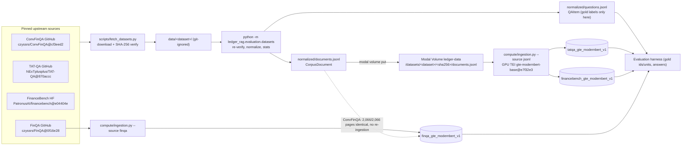

# Evaluation datasets

Ledger evaluates beyond single-turn FinQA with three additional financial QA
datasets. All of them are **pinned to an exact upstream revision, verified by
SHA-256 and normalized offline** into one schema. No dataset file is committed:
`data/convfinqa/`, `data/tatqa/` and `data/financebench/` are git-ignored.
Every number below was measured from the pinned artifacts with the adapters in
[`src/ledger_rag/evaluation/datasets/`](../src/ledger_rag/evaluation/datasets/)
on 2026-10-31.

| Dataset | License (verified) | Usage | Ledger corpus | Qdrant collection |
|---|---|---|---|---|
| ConvFinQA | MIT | `train_ok` | FinQA pages (100% reuse) | `finqa_gte_modernbert_v1` (existing, untouched) |
| TAT-QA | CC-BY-4.0 (attribution) | `train_ok` | 2,756 hybrid contexts | `tatqa_gte_modernbert_v1` |
| FinanceBench open 150 | CC-BY-NC-4.0 | **`eval_only`** | 168 evidence pages | `financebench_gte_modernbert_v1` |

> **FinanceBench is evaluation-only.** Its CC-BY-NC-4.0 license forbids
> commercial use; Ledger never trains, distills, mines hard negatives or tunes
> prompts on it. Every FinanceBench `QAItem` carries `usage: "eval_only"`, and
> training code must refuse such items. Dataset licenses cover the annotations;
> they do not automatically clear rights to the underlying issuer filings.

## Data lineage



## Provenance and pinned artifacts

Licenses were checked at the pinned revision on 2026-10-31.

### ConvFinQA

- Source: <https://github.com/czyssrs/ConvFinQA>, commit
  `cf3eed2d5984960bf06bb8145bcea5e80b0222a6`.
- License: MIT. The repository `LICENSE` file is MIT, and the GitHub API reports `spdx_id: MIT`.
- Paper: Chen et al., EMNLP 2022, <https://arxiv.org/abs/2210.03849>.

| Artifact | SHA-256 |
|---|---|
| `data.zip` | `d764271fae60d81b62e6d58dfc481807ebc8cfbcd633811241723c4a2101072a` |

The archive contains `train.json`, `dev.json` and `test_private.json`
(conversation-level), plus `*_turn.json` turn-level expansions that the adapter
does not need.

### TAT-QA

- Source: <https://github.com/NExTplusplus/TAT-QA>, commit
  `870accc41953dcde885aabeb963d94aabdc0fbc3`.
- License: the README "License" section states **CC BY 4.0** for the dataset.
  The repository's `LICENSE` file is MIT and covers code. Attribute Zhu et al.,
  ACL 2021, <https://aclanthology.org/2021.acl-long.254/>.
- The test split uses `tatqa_dataset_test_gold.json` (public test labels). The
  unlabeled `tatqa_dataset_test.json` is not fetched.

| Artifact | SHA-256 |
|---|---|
| `dataset_raw/tatqa_dataset_train.json` | `2df6e722cdbaaa37efcbfb280f5c9a15be29a6ec18f618ef936fe63cc6d07c69` |
| `dataset_raw/tatqa_dataset_dev.json` | `8da095a819af6db3c14877c6df2d4d29960e41d1a63dd1fa853507bd2a616af5` |
| `dataset_raw/tatqa_dataset_test_gold.json` | `c4d08418359c1d76468dec420ee748a37f48c06b63cb8ec2766f19d5d314b597` |

### FinanceBench (open-source 150)

- Source: <https://huggingface.co/datasets/PatronusAI/financebench>, revision
  `e04404e3a97f69f79c14d42f24981a1c9c3bcd18` (not gated).
- License: the dataset card front matter states `license: cc-by-nc-4.0`. The
  maintainer GitHub repository (<https://github.com/patronus-ai/financebench>,
  HEAD `cc39aeb4afdf33909ee1412188bf89035950c2eb`) has **no license file**. Ledger
  therefore fetches the Hugging Face artifact, whose license is declared.
- Paper: Islam et al., 2023, <https://arxiv.org/abs/2311.11944>. The full
  10,231-question set is not public. Ledger has only the open 150-question sample.

| Artifact | SHA-256 |
|---|---|
| `financebench_merged.jsonl` | `7a1c81789e0fd2f1c37057a7ec0097756d726b05e7228e68e57db8e18c54fd0b` |

The merged file joins the GitHub `financebench_open_source.jsonl` questions with
`financebench_document_information.jsonl` metadata (sector, doc type, period, link).

## Fetch and normalize

```bash
uv run --frozen python scripts/fetch_datasets.py            # all, or: tatqa convfinqa financebench
uv run --frozen python -m ledger_rag.evaluation.datasets convfinqa --finqa-dir data/finqa
uv run --frozen python -m ledger_rag.evaluation.datasets tatqa
uv run --frozen python -m ledger_rag.evaluation.datasets financebench
```

The fetcher uses only the standard library. It writes to a `.partial` file and
moves it into place only after the SHA-256 check passes, so mismatched downloads
are never kept. If an existing file already verifies, it is not downloaded again.
Normalization checks the digests again, then writes
`data/<dataset>/normalized/{documents,questions}.jsonl` and `stats.json`. The
stats record the source revision, artifact digests, output digests and measured
counts. Outputs are deterministic: rebuilding gives byte-identical files.

| Output | `documents.jsonl` SHA-256 | `questions.jsonl` SHA-256 |
|---|---|---|
| ConvFinQA | `84a5891e93ec3226b2d770604ab50a52c0a8e5a753fa72ff35d75ffcec493231` | `b840c22424baad67a3db499789aedde9edc38c4abbab03487d24223113b468d9` |
| TAT-QA | `3e513b5a28cb224d7a422f8aa15204a66a82c0d3df8fc58f8d2758d1abe422f1` | `615588aa90f6ceb0ce7d93d9d0c8aaf03f720223e44fd4db0d430ebe655ead65` |
| FinanceBench | `7e6c4fa1a8c5a7e7834cf327a8fd1f6428dc3237d5acb5681cdc2d329eacd212` | `6f10edceeaabfbe9cf054b87aecff9308ff0e1b24de2636ea197163adb6e986d` |

These digests are for adapter version 1. A change to an adapter changes them.

## Normalized schema

The schema is defined in [`schema.py`](../src/ledger_rag/evaluation/datasets/schema.py).

**`CorpusDocument`** subclasses [`Document`](../src/ledger_rag/core/models.py)
(`id`, `tenant_id`, `title`, `text`, `source`, `published_at`, `allowed_groups`)
and adds `dataset`, `company`, `fiscal_year` and `units`. The JSONL can be ingested
as is: `jsonl_documents` ignores the extra fields, so the bytes uploaded to Modal
are the `documents.jsonl` bytes. A unit is `{unit_id, kind: text|table, text, rows,
header_rows}`. Table units keep the original cell grid in `rows`, and the first
`header_rows` rows are headers. Unit ids are `<document_id>#<key>`.

The indexed `text` renders tables as markdown. Multi-row headers are merged
column by column into one header row, so the table-aware chunker repeats the full
column labels on every continuation chunk.

**`QAItem`** has these fields:

| Field | Meaning |
|---|---|
| `id` | Deterministic, namespaced: `convfinqa/<split>/<conversation id>/turn_<i>`, `tatqa/<split>/<question uid>`, `financebench/<financebench_id>` |
| `dataset`, `split` | Native upstream split names; FinanceBench uses `open_source` |
| `turns` | Earlier conversation messages as `{role: user\|assistant, content}`; empty for single-turn questions |
| `question`, `answer` | Current question and gold answer as a string |
| `answers` | Individual gold spans for `span`/`multi_span` answers (`answer` joins them with ` \| `) |
| `answer_type` | `number`, `percent`, `span`, `multi_span`, `yes_no` or `text` |
| `scale` | TAT-QA scale (`thousand`, `million`, `billion`, `percent`), otherwise `null` |
| `gold_document_ids`, `gold_unit_ids` | Gold evidence documents and units |
| `program` | ConvFinQA turn program or TAT-QA arithmetic derivation |
| `license`, `usage` | `train_ok` or `eval_only` |
| `metadata` | Dataset-specific fields: original ids, question types, justification, evidence spans and so on |

Gold answers, programs, derivations, justifications and evidence spans appear
**only** in `questions.jsonl`. They never appear in indexed text.

## Dataset mappings and measured statistics

### ConvFinQA: conversations over FinQA pages

Upstream stores each conversation once. Its `annotation` holds parallel per-turn
lists:

- `dialogue_break`: the user questions.
- `turn_program`: the complete program for each turn. Later turns repeat earlier
  steps, for example `subtract(60.94, 25.14), divide(#0, 25.14)`.
- `exe_ans_list`: the executed gold answers. Ratios stay ratios (`1.42403`, not `142.4%`).
- `qa_split`: which source FinQA question (`qa`, or `qa_0`/`qa_1` for "Double"
  conversations) the turn decomposes.

Each turn becomes one `QAItem`. Its `turns` field contains every earlier user
question, each followed by that turn's gold executed answer as the assistant
message. This is teacher-forced history. `program` is the turn's `turn_program`. Gold units
come from the `gold_inds` of the FinQA question selected by `qa_split`. Keys
missing from the page are dropped, not invented. `answer_type` is `number`, or
`yes_no` for string answers. The private test split has no answers, so it adds
pages but no questions.

| Split | Conversations (Single / Double) | Turns = QAItems | Multi-turn items | Unique pages |
|---|---|---|---|---|
| train | 3,037 (2,109 / 928) | 11,104 (11,068 number, 36 yes/no) | 8,067 | 1,588 |
| dev | 421 (300 / 121) | 1,490 (1,486 number, 4 yes/no) | 1,069 | 218 |
| test (private) | 434 (306 / 128) | 1,521 turns, **no labels**, not emitted | — | 260 |

Train conversations have 1 to 9 turns (mean 3.66). Dev conversations have 2 to 8
turns (mean 3.54). Every emitted turn has at least one gold unit, with a mean of
1.65 (train) and 1.70 (dev).

**FinQA coverage:** 2,066 of 2,066 unique ConvFinQA pages (100.00%) exist in the
2,789-document FinQA corpus. All 2,066 rebuild to a FinQA `Document` that is
**field-for-field identical**. The adapter uses FinQA's own `page_document`, and
document ids are the FinQA filenames, for example `MRO/2007/page_134.pdf`. Splits
also line up: every ConvFinQA train, dev and test page is in the same FinQA
split, so splits do not leak into each other. ConvFinQA therefore **reuses
`finqa_gte_modernbert_v1` without re-ingestion**. It indexes 6,356 chunks under
the production chunker. The other 723 FinQA pages act as distractors.

### TAT-QA: hybrid table + text contexts

Each upstream context becomes one document with id `tatqa/<table uid>` in tenant
`tatqa`. It contains one structured `table` unit and `paragraph_<order>` units.
TAT-QA has **no company, filing or date metadata**, so `company` is `null` and
`allowed_groups` is empty (public within the tenant). `fiscal_year` is the
latest year found in the detected header rows. `published_at` approximates it as
31 December, following the FinQA convention. Contexts without a header year use
1970-01-01, so `as_of` filters never hide them.

- 2,392 of 2,756 contexts have a header year. 2,203 of them are 2019.
- 15 contexts get a year of 2021 or later. These are probably maturity-schedule
  columns, so treat their dates as heuristic.

Question mapping:

- `answer_type`: `span` → `span`, `multi-span` → `multi_span`, `arithmetic` and
  `count` → `number`, and `number` becomes `percent` when `scale == "percent"`.
- Gold units: the table unit when `answer_from` includes `table`, plus each
  `rel_paragraphs` unit.
- `program` is the arithmetic `derivation`. Count derivations stay in `metadata`.

| Split | Contexts | Questions | span / multi_span / number / percent | table / table-text / text |
|---|---|---|---|---|
| train | 2,201 | 13,215 | 5,722 / 1,645 / 3,799 / 2,049 | 5,920 / 4,170 / 3,125 |
| dev | 278 | 1,668 | 701 / 217 / 489 / 261 | 772 / 507 / 389 |
| test (gold) | 277 | 1,663 | 714 / 210 / 455 / 284 | 736 / 546 / 381 |
| **total** | **2,756** | **16,546** | | |

The upstream README advertises 16,552 questions and 2,757 contexts. The pinned
files contain the counts shown above. Table uids and question uids are unique
across splits. The corpus has 2,756 table units, 13,154 paragraph units and
4,334 production chunks.

### FinanceBench open 150: evidence-page pool (eval only)

Each evidence item includes `evidence_text_full_page`, the full text of its
page. Every unique `(doc_name, evidence_page_num)` page becomes one document with
id `<doc_name>/page_<n>`. Here `n` is **one-based**, and upstream
`evidence_page_num` is zero-based. Each document is in tenant `financebench`
with `allowed_groups=["company:<company>"]`. Its `source` is the original filing
URL (`doc_link`), and `published_at` is 31 December of `doc_period`, which is an
approximation. Only page text is indexed. Answers, justifications and evidence
spans stay in the `QAItem` metadata. `answer_type` is `number` or `percent` for
purely numeric answers and `text` otherwise.

| Measure | Value |
|---|---|
| Questions | 150: 50 metrics-generated, 50 domain-relevant, 50 novel-generated |
| Answer types | 37 number, 15 percent, 98 text |
| Filings / companies | 84 / 32 |
| Doc types (questions) | 112 10-K, 15 10-Q, 14 earnings, 9 8-K |
| Evidence items per question | 1 (115), 2 (31), 3 (4) |
| Unique gold pages per question | 1 (115), 2 (33), 3 (2) |
| Indexed pages / chunks | 168 / 338 |

**Limitation:** every indexed page is gold for at least one question. This
collection measures **page localization within a 168-page evidence pool**. It is
not FinanceBench's full-filing "shared vector store" setting, and its scores are
optimistic. They are not comparable with the paper's retrieval numbers.

**Plan for full filings:** use the 368 PDFs in the maintainer GitHub repository
at `cc39aeb4afdf33909ee1412188bf89035950c2eb`. Pin them by commit and SHA-256,
extract them page by page on Modal CPU workers with a pinned PDF extractor, and
emit `<doc_name>/page_<n>` documents with the same id scheme. The current gold
ids then stay valid, and every non-gold page becomes a distractor. Ingest them
into a new `financebench_fullfilings_gte_modernbert_v1` collection. The existing
[`prepare_financebench.py`](../scripts/prepare_financebench.py) document-level
converter remains the path for independently prepared filing corpora.

## Modal ingestion runs (2026-10-31)

Both runs used the same configuration:

- Command: `compute/ingestion.py --source jsonl`.
- Embedding space: `tei-1.8-float16:Alibaba-NLP/gte-modernbert-base@e7f32e3c00f91d699e8c43b53106206bcc72bb22`.
- Image: TEI image `ghcr.io/huggingface/text-embeddings-inference:89-1.8`.
- Quantization: `none`.
- Code: git `924d4f69dc1c08aa62aa9b247cea84a68d074a25`.

Inputs were uploaded to content-addressed Volume paths:

```bash
uv run --locked --group compute modal volume put ledger-data \
  data/tatqa/normalized/documents.jsonl \
  /datasets/tatqa/3e513b5a28cb224d7a422f8aa15204a66a82c0d3df8fc58f8d2758d1abe422f1/documents.jsonl
uv run --locked --group compute modal run compute/ingestion.py --source jsonl \
  --input-path /data/datasets/tatqa/3e513b5a28cb224d7a422f8aa15204a66a82c0d3df8fc58f8d2758d1abe422f1/documents.jsonl \
  --tenant-id tatqa --collection tatqa_gte_modernbert_v1 \
  --model-revision e7f32e3c00f91d699e8c43b53106206bcc72bb22
```

| Collection | Modal app | Run id | Docs | Chunks (expected) | Batches | Ingest s | CLI wall s | Corpus fingerprint |
|---|---|---|---|---|---|---|---|---|
| `tatqa_gte_modernbert_v1` | `ap-vI9d5j3w8uSOLMsO3vv1SZ` | `e2fdb5ef94ee420da1868c44c28f42ec` | 2,756 | 4,334 (4,334) | 35 | 192.51 | 220 | `3e688b890ce8bb96495046539c3509be94a211fd08712325750fc1c269ee5623` |
| `financebench_gte_modernbert_v1` | `ap-BNuGLYjAkM7b37Eq1HfWMp` | `aa350ca78ffc46078e89d5c45f9617cb` | 168 | 338 (338) | 3 | 7.61 | 31 | `5a616956c0b97f5fe1565aff3b74681ecb13d2ad4a7933e1f3d59e3af63ecf98` |

Both reports have `status: verified`, meaning the Qdrant point count exactly
matches the uploaded chunk count. Each report's `input_sha256` equals the local
`documents.jsonl` digest. The reports are stored at
`/data/ingestion/<run id>.json` in `ledger-data`. "Ingest s" is the report's
ingest and verification time. "CLI wall s" is the local end-to-end `modal run` time, including startup.

The first TAT-QA attempt, run `2f79a2ecd4a249c7b111c909412fff0e`
(`ap-ouvljyNiq4vcZXp3rnsLYS`), failed before claiming a collection. Modal mounts
`/data` through a symlink, so the JSONL path guard rejected every input. The guard
now compares resolved paths. `finqa_gte_modernbert_v1` was not written to,
recreated or deleted.

## Integration notes for the evaluation harness

- **Retrieval labels:** score page or document hits against `gold_document_ids`.
  For unit-level evidence recall, match `gold_unit_ids` to the unit `text`/`rows`
  in `documents.jsonl`. Chunks do not carry unit ids, so match on contained text,
  as FinQA `evidence_recall` does.
- **ConvFinQA:**
  - Query `finqa_gte_modernbert_v1` with tenant `finqa` and
    `QueryRequest.history = turns`. `HistoryMessage` accepts the same
    `{role, content}`. Its limits are 12 messages and 32,000 characters. The
    longest conversation (9 turns) produces 16 history messages, so trim to the
    most recent 12.
  - Company scope is `company:<id prefix>`, as in FinQA.
  - To score answers, reuse FinQA numeric tolerance. Gold ratios are not
    percentages, so FinQA's ×100 tolerance applies.
  - For a non-teacher-forced setting, replace the assistant turns with model outputs.
- **TAT-QA:**
  - Use tenant `tatqa` and collection `tatqa_gte_modernbert_v1`. No company
    scope exists, so only global retrieval is meaningful.
  - Combine `scale` and `answer_type` for numeric checks. For example, `percent`
    with answer `2` means 2%, and `million` scales magnitudes.
  - For `multi_span`, use set-based scoring over `answers`. The official
    TAT-QA EM/F1 should run separately.
- **FinanceBench:**
  - Use tenant `financebench`, collection `financebench_gte_modernbert_v1`, and
    group `company:<company>` for company scope.
  - Most answers are free-form `text` and need semantic or judge-based scoring.
  - Assert `usage == "eval_only"` in any training or data-mining path.
- **Splits:** select architectures on `dev`, keep `test` for reporting only, and
  treat FinanceBench as a held-out test-only set.
- Load with `read_jsonl(path, QAItem)` / `read_jsonl(path, CorpusDocument)` from
  `ledger_rag.evaluation.datasets.schema`. Point the harness at a collection
  through `LEDGER_QDRANT_COLLECTION` and `LEDGER_EMBEDDING_SPACE_ID`, using the
  embedding space id above.
