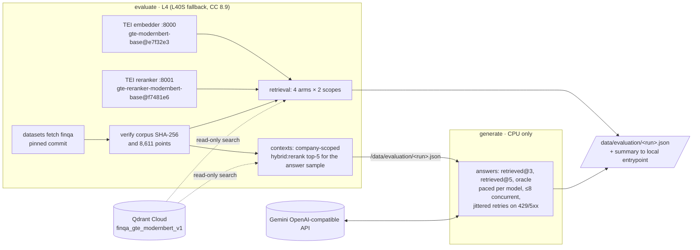

# Evaluation: evidence, uncertainty, and operating envelopes

This repository ships **synthetic regression data** and publishes separately labeled
real-data measurements below, not evidence of state-of-the-art performance. The local baseline is a
deterministic lexical retriever and extractive provider. It exists to exercise
contracts without keys, network traffic, model downloads, or benchmark redistribution.
Do not relabel its scores as FinanceBench, FinQA, or TAT-QA results.

## Raw model vs Ledger backend (program-of-thought reasoning, 2026-11-09)

Design and evidence: [ADR 0008](adr/0008-program-of-thought-reasoning.md). Every run
answers the **same questions with the same model and generation settings** in two
or more arms, in the standard gold-evidence setting of each benchmark:

| Arm | What the model gets and does |
|---|---|
| `raw` | The evidence and question; free reasoning; one `ANSWER:` line (plus `SCALE:` for TAT-QA). Parsed leniently. |
| `ledger` | The same evidence plus 4 BM25-retrieved solved *training* problems; writes a program (or a typed answer with scale); literals must be grounded; a deterministic executor computes; 5 samples vote on the executed result. |
| `ledger-refine` | `ledger`, plus execution-feedback refinement when no answer wins a strict majority. |
| `ledger-zero-shot` | `ledger` without exemplars (ablation). |

Metrics are the official ones: FinQA/ConvFinQA execution accuracy with the
vendored official executor (`official`, exact), the Program-of-Thoughts tolerant
comparison (`tolerant`) and its percentage-tolerant variant (`lenient`, which
gives free-text raw answers every benefit of the doubt); TAT-QA exact match and F1
with the vendored official metric. Intervals are 95% report-cluster bootstraps;
`ledger-minus-raw` is a paired difference on identical questions. Offline gold
replay scores 100% (FinQA), 99.9% (ConvFinQA) and 99.7% raw / 99.1% Ledger (TAT-QA)
on dev, which bounds parser and scorer losses.

```bash
# Offline pipeline check (no model, no spend):
uv run --group scoring python -m ledger_rag.evaluation.benchmarks.reasoning \
  --benchmark tatqa --reader replay-gold
# Any registered models, in parallel on Modal (config/models/<id>.toml):
ledgerctl modal -- run compute/reasoning.py --models qwen3.5-4b,phi-4-mini \
  --benchmarks finqa,convfinqa,tatqa --limit 300 --output matrix.json
uv run python -m ledger_rag.evaluation.benchmarks.reasoning_table matrix.json
```

Results are dev selections until a configuration is frozen; held-out test runs
need `--split test --unseal-test`. Results are recorded below as they are measured.

### Dev matrix: 8 open models x 3 benchmarks (measured 2026-11-09)

300 seeded dev questions per benchmark (seed 13), identical across models and arms;
Ledger = 5 samples, 4 exemplars, prompt `pot-expression-v4`; thinking off (gpt-oss:
low). Aggregates: [`results/2026-11-09-matrix-expression-v4.json`](results/2026-11-09-matrix-expression-v4.json).
Cells are % with 95% report-cluster CIs; deltas are paired on identical questions.

**Official metrics** (FinQA/ConvFinQA execution accuracy, TAT-QA exact match):

| Model | FinQA raw → Ledger (Δ) | ConvFinQA raw → Ledger (Δ) | TAT-QA EM raw → Ledger (Δ) |
|---|---|---|---|
| Qwen3.5-4B | 25.7 → **72.7** (+47.0 [39.7, 53.8]) | 58.7 → **75.0** (+16.3 [10.5, 22.4]) | 18.3 → **70.7** (+52.3 [45.3, 58.5]) |
| Phi-4-mini 3.8B | 21.7 → 54.7 (+33.0 [25.6, 40.6]) | 45.3 → 55.7 (+10.3 [4.0, 16.3]) | 27.7 → 39.0 (+11.3 [3.6, 18.6]) |
| Granite-4.0-micro 3.4B | 20.0 → 62.7 (+42.7 [36.0, 49.3]) | 51.3 → 68.0 (+16.7 [11.0, 22.4]) | 30.7 → 56.0 (+25.3 [18.4, 32.0]) |
| Qwen3.5-9B | 25.3 → **74.7** (+49.3 [42.4, 56.0])¹ | 61.0 → **80.3** (+19.3 [14.4, 24.3])¹ | 47.7 → 71.7 (+24.0 [17.5, 30.5]) |
| Ministral-3 8B | 31.3 → 73.0 (+41.7 [33.8, 49.5]) | 61.3 → **83.3** (+22.0 [17.0, 27.0]) | 32.0 → 69.0 (+37.0 [30.3, 43.9]) |
| Qwen3.6-35B-A3B (3B active) | 29.0 → **76.7** (+47.7 [40.6, 54.6]) | 62.7 → **82.3** (+19.7 [14.6, 24.6]) | 45.7 → **79.0** (+33.3 [27.2, 39.6]) |
| gpt-oss-20b (3.6B active) | 27.7 → 73.3 (+45.7 [38.9, 51.8]) | 59.3 → 78.7 (+19.3 [14.2, 24.3]) | 12.7 → 69.3 (+56.7 [50.3, 63.0]) |
| Qwen3.8-27B | 31.7 → **77.7** (+46.0 [39.2, 52.4])¹ | 66.0 → **85.7** (+19.7 [15.0, 24.6])¹ | 60.0 → **81.0** (+21.0 [15.5, 26.9]) |

¹ Raw arm re-measured without client timeouts and merged (see Corrections below).

**Fairest view for raw answers** (FinQA/ConvFinQA percentage-tolerant `lenient`,
TAT-QA F1): Ledger still wins on every model and benchmark, by +4.7 to +24.0 on
FinQA, 0.0 to +10.3 on ConvFinQA and +10.7 to +47.9 F1 on TAT-QA (full table in
the aggregates file). Most of the official-metric gap is raw models giving rounded
or reformatted numbers; Ledger answers are exact by construction.

Further measured findings:

- **One sample captures most of the gain.** Vote-at-k (k = 1 to 5) adds 0 to 4
  points for most models (Qwen3.5-4B FinQA 70.7 → 72.7; Qwen3.8-27B flat), up to
  +16 for Phi-4-mini on TAT-QA. Execution-feedback refinement changed results by
  at most ±2 points, so it stays optional.
- **What fixed the first matrix** (prompt `pot-dsl-v3`, same subsets; kept in
  [`results/2026-11-09-matrix-dsl-v3.json`](results/2026-11-09-matrix-dsl-v3.json)):
  small models misnumbered FinQA step references, and ConvFinQA programs reusing
  earlier answers were wrongly rejected as ungrounded. Expressions compiled to the
  DSL and history-aware grounding turned ConvFinQA from -21 to +16 points for
  Qwen3.5-4B (lenient view: -20.7 to 0.0) and lifted FinQA by 8 to 13 points.
- OLMo-3-7B could not be measured: its chat template crashes vLLM 0.32 at startup.
- Batch latencies under 1,800 concurrent requests are not per-request latency.

These are **dev** results on 300-question subsets, selected before any test run.
They are not test-set or SOTA claims.

### Frozen configuration for held-out test runs

Frozen on 2026-11-09 at commit `6f65953` after the dev matrix above, before any
test split was opened: prompt `pot-expression-v4` (SHA-256 prefixes: FinQA Ledger
`7bbfad68faf1616c`, TAT-QA Ledger `3a22da8dd75b8978`, FinQA raw
`7e25e2e12d013bd4`, TAT-QA raw `cb9cd5d35d65da4f`), 5 samples at temperature 0.7,
4 BM25 exemplars from train, seed 13, each model's default registry mode, arms
`raw` and `ledger-refine` (whose first round is the `ledger` arm). Test splits are
run once with this configuration; no change is made after seeing them.

### Held-out test results with the frozen configuration (measured 2026-11-09)

Run once each, after the configuration above was frozen; nothing was changed after
seeing them. Official metrics with 95% report-cluster CIs; paired deltas on
identical questions. Aggregates (no question text):
[`results/2026-11-09-test-retrieved-reruns.json`](results/2026-11-09-test-retrieved-reruns.json).

**FinQA test** (all 1,147 questions; execution accuracy with the official executor):

| Model | Raw model | Ledger | Ledger − raw | Lenient raw → Ledger (Δ) |
|---|---|---|---|---|
| Qwen3.8-27B | 29.6 [26.1, 33.0] | **79.3 [76.6, 82.0]** | +49.8 [45.9, 53.7] | 74.5 → 80.9 (+6.5 [4.3, 8.7]) |
| Qwen3.6-35B-A3B (3B active) | 25.9 [22.6, 29.0] | **77.3 [74.4, 80.0]** | +51.4 [47.9, 54.9] | 71.9 → 79.4 (+7.5 [5.3, 9.7]) |
| Qwen3.5-9B | 22.2 [19.2, 25.2] | **74.7 [71.8, 77.5]** | +52.5 [48.7, 56.0] | 70.0 → 76.3 (+6.3 [4.0, 8.8]) |
| Qwen3.5-4B | 22.8 [19.7, 25.7] | **72.8 [69.8, 75.6]** | +50.0 [46.4, 53.7] | 68.7 → 74.6 (+5.9 [3.5, 8.4]) |
| Ministral-3 8B | 25.2 [22.1, 28.3] | **71.1 [67.8, 74.3]** | +46.0 [42.2, 49.8] | 61.3 → 72.8 (+11.5 [8.8, 14.2]) |

Published FinQA test execution accuracy for context (not run here): FINDER with
GPT-4 75.32 (EMNLP 2025, best peer-reviewed found), APOLLO 71.07, ENCORE 69.40,
PoT with GPT-4 69.38 (reproduced in FINDER), FinQANet 61.24, human experts 91.16.
Qwen3.8-27B with Ledger is above FINDER's point estimate with its whole interval;
Qwen3.5-4B with Ledger is above APOLLO, ENCORE and PoT-GPT-4.

**TAT-QA test** (all 1,663 questions; official exact match / F1):

| Model | Raw EM / F1 | Ledger EM / F1 | Ledger − raw (EM) |
|---|---|---|---|
| Qwen3.6-35B-A3B | 46.1 / 57.2 | **74.7 [72.3, 77.0] / 82.5** | +28.6 [25.5, 31.6] |
| Qwen3.5-4B | 20.4 / 37.6 | **68.8 [65.9, 71.6] / 76.2** | +48.4 [45.0, 51.5] |
| Ministral-3 8B | 30.1 / 41.2 | **66.1 [63.5, 68.6] / 73.8** | +36.0 [32.7, 39.1] |

The TAT-QA leaderboard's best is TAT-LLM 70B (fine-tuned) at 81.4 / 88.4 and GPT-4
zero-shot reaches 79.7 F1: Ledger does **not** reach TAT-QA state of the art; the
3B-active Qwen3.6 exceeds GPT-4's zero-shot F1. Qwen3.8-27B and Qwen3.5-9B TAT-QA
test containers failed with an unexplained remote error after finishing FinQA and
were not re-run (budget); their TAT-QA test results are **not measured**.

Caveats: these models were released in 2026 and FinQA/TAT-QA test sets have been
public since 2021, so pretraining contamination cannot be excluded (raw-model
scores do not suggest memorized answers). Execution-feedback refinement moved test
results by -0.4 to +1.2 points. Gold evidence is given, as in every compared result.

### FinQA from retrieved evidence: the end-to-end RAG setting

All 883 dev questions answered from the saved company-scoped hybrid + rerank top-5
chunks of the 2026-11-01 run (contexts SHA-256 `be337ed3...`, recall@5 0.90), not
the gold page. Gold replay bounds Ledger at 91.1% (evidence the retriever missed).

| Model | Raw model | Ledger | Ledger − raw | Lenient raw → Ledger (Δ) |
|---|---|---|---|---|
| Qwen3.8-27B | 23.3 | **62.1 [57.8, 66.2]** | +38.7 [34.7, 42.6] | 54.1 → 63.5 (+9.4 [6.6, 12.0]) |
| Qwen3.6-35B-A3B | 20.2 | **59.9 [55.7, 64.1]** | +39.8 [35.5, 44.0] | 52.2 → 61.7 (+9.5 [6.2, 12.9]) |
| Qwen3.5-4B | 18.3 | **57.6 [53.4, 61.8]** | +39.3 [34.9, 43.5] | 52.1 → 59.5 (+7.4 [4.1, 10.8]) |
| gpt-oss-20b | 20.5 | **55.9 [51.9, 60.0]** | +35.4 [31.6, 39.2] | 48.5 → 57.6 (+9.2 [5.8, 12.6]) |

For reference, the same Qwen3.8-27B on the same contexts with the 2026-11-01
single-shot reader scored 58.9% (its own heuristic exact score, not the official
executor). The retrieval ceiling (91.1%) leaves the larger remaining gap in
reasoning over retrieved chunks rather than retrieval itself.

### Corrections and accounting

- **Timeouts scored as wrong answers.** Batch runs first used a 120 s client read
  timeout; long raw answers queued behind ~1,800 concurrent requests timed out
  (5% of raw FinQA answers for Qwen3.5-9B and Qwen3.8-27B in the dev matrix, ~18%
  in the first retrieved run). Timeouts were raised (commit `18eb769`), the
  affected raw arms were re-run on identical questions and merged
  (`reasoning_merge`), and every number above uses timeout-free raw arms
  (0 provider errors). Corrected dev deltas: Qwen3.8-27B FinQA lenient +9.0
  [4.9, 12.9] (reported +10.0 before), Qwen3.5-9B +6.7 [2.2, 11.4] (+8.3);
  ConvFinQA lenient +4.0 [0.7, 7.4] and +3.7 [-0.4, 7.8].
- A first test launch was stopped before producing any result to apply that fix.
- **Spend.** Modal's metered summary for November reported $28.56 of ephemeral-app
  usage after these runs, including about $2.07 from 2026-11-01; about $26.5 for
  this session against a $25 authorization (about $1.5 over, covered by credits;
  billed $0). The overrun came from the aborted test launch and the two failed
  test containers. No further GPU jobs were launched.

## Verified prior full-dev retrieval measurement

Verified read-only from `ledger-data:/evaluation/c17d398f34f24efd874e29bb641d9738.json`
on 2026-11-01; this is an existing measurement, not a new run. Report SHA-256:
`fc43ba58a76e99e0b2fce113b46cf873f6b7a3f3d929afebd9983d1779f3a980`.
Git `ed862324838213af255a7597748c93c4820b791b`, Python 3.12.1, L40S,
2,949.8 recorded GPU-seconds; TEI startup 12.7 seconds. Collection
`finqa_gte_modernbert_v1` had exactly 8,611 chunks from 2,789 report pages.
FinQA commit `0f16e2867befa6840783e58be38c9efb9229d742`, corpus SHA-256
`9b455b1b21167b4fee7592f9cc2a68e5d12a336473156137b5ef0692e442ae9d`.
All 883 dev questions / 224 company-year report clusters were evaluated; test
questions remain sealed. All 1,513 gold units mapped; zero unknown retrieved chunks.

Embedding: `Alibaba-NLP/gte-modernbert-base` at
`e7f32e3c00f91d699e8c43b53106206bcc72bb22`,
space `tei-1.8-float16:Alibaba-NLP/gte-modernbert-base@e7f32e3c00f91d699e8c43b53106206bcc72bb22`.
Reranker: `Alibaba-NLP/gte-reranker-modernbert-base` at
`f7481e6055501a30fb19d090657df9ec1f79ab2c`; TEI `89-1.8`, top-k 10,
20 rerank candidates. Seed 13, 2,000 report-cluster bootstrap replicates.

Below, @k is **all-evidence recall**, and MRR is **evidence MRR**, not page MRR.

| Arm | @1 | @3 | @5 | @10 | Evidence MRR@10 |
| --- | ---: | ---: | ---: | ---: | ---: |
| sparse/company | .494 | .749 | .841 | .900 | .688 |
| sparse/global | .311 | .502 | .592 | .679 | .467 |
| dense/company | .386 | .639 | .735 | .847 | .579 |
| dense/global | .238 | .376 | .456 | .529 | .362 |
| hybrid/company | .479 | .770 | .845 | .922 | .684 |
| hybrid/global | .331 | .514 | .605 | .699 | .487 |
| hybrid+rerank/company | .607 | .845 | .904 | .947 | .781 |
| hybrid+rerank/global | .462 | .658 | .721 | .763 | .616 |

Headline company hybrid+rerank 95% cluster-bootstrap intervals: @1
[.5651, .6465], @3 [.8113, .8766], @5 [.8762, .9286], @10 [.9239, .9674],
evidence MRR [.7509, .8097]. Against company hybrid, paired evidence-recall@5
delta +.0566 [.0356, .0785], evidence-MRR delta +.0970 [.0742, .1197].
Sparse and hybrid company scores are close; no superiority claim is made for that pair.

**Limitations:** dev selection is optimistic and not held-out quality. Retrieval
evidence matching is normalized text containment, not entailment, official program
execution, or answer accuracy. Company p50 latency was 3.30–7.20 s versus global
0.41–0.68 s; filtered-search/indexing and concurrency effects are unresolved
hypotheses, not demonstrated causes. These batch timings are not voice latency.
At current list rates, recorded L40S + requested 4 CPU / 16 GiB time is approximately
$1.86; this is a retrospective estimate, not an invoice, and excludes unrecorded
startup/idle and actual resource overages. It is not new-session spending.

Reusable contexts: `b29513c36fbf477cbf83ea3981bc41fa` contains all 883 dev cases,
company hybrid:rerank top-5, source Git
`59470ea45c78cf67b5ebc3224699ea25952f40ef`, the same corpus/model identities,
and approximately 865 recorded GPU-seconds. Report SHA-256:
`be337ed346c960c2f1249cb4fdc725b868d8ea06f76875138a205bd48f492748`.
Answer runs record that report's hash and original retrieval lineage; do not
re-embed, rerank, or ingest again for the open-model arms.

## Measured bounded open-model pilot (2026-11-01)

One approved, attached ephemeral App ran from 12:35 UTC to 12:48 UTC:
`ap-GCf2INahj5pM2PghWo9I1j`, source Git
`52b5f96787b71d5d2f7657f534fb4da852705284` after merging current main.
Elapsed time including startup and shutdown: **786.634 seconds**, within the
4,500-second cap. One H100 and one active 2-core/8-GiB CPU client were observed.
The persistent serving App remained idle and was not invoked or redeployed.

### Pilot quality and lineage

FinQA report `4810c0ba57554f509f6301f388a80f35`:
`ledger-data:/evaluation/4810c0ba57554f509f6301f388a80f35.json`.
SHA-256 `ef7cb2c36fe2387e3780578d6fe3f1b85a93d96ccc19f3006b7d89105ab9b219`.
Exactly 200 proportional-stratified dev questions / 126 report clusters, seed 13,
were shared across all six arms. Sample-ID SHA-256:
`35e862f3930af842f9ff08f1af79d4d07e12767d9eaaa4588ba738b998ea8097`.
Corpus and source-context identities match the verified baseline above, including
context report hash `be337ed346c960c2f1249cb4fdc725b868d8ea06f76875138a205bd48f492748`.
Test questions stayed sealed. No new retrieval, embedding, ingestion or migration ran.

| Arm | Exact | Tolerant | Format failure | Coverage | Generation p50 / p95, seconds |
| --- | ---: | ---: | ---: | ---: | ---: |
| thinking off / retrieved@3 | .595 | .610 | .055 | .935 | 4.383 / 29.476 |
| thinking off / retrieved@5 | .605 | .630 | .040 | .940 | 4.868 / 31.717 |
| thinking off / oracle | .745 | .775 | .005 | .970 | 3.988 / 15.426 |
| low / retrieved@3 | .620 | .640 | .000 | .945 | 4.450 / 13.363 |
| low / retrieved@5 | .635 | .650 | .005 | .960 | 5.329 / 15.341 |
| low / oracle | .775 | .790 | .000 | .980 | 3.858 / 9.277 |

Headline 95% report-cluster bootstrap intervals: low/retrieved@5 exact
[.5644, .7005], tolerant [.5805, .7163]; low/oracle exact [.7194, .8280],
tolerant [.7336, .8429]. Paired **exact-accuracy** deltas:

- low versus off at retrieved@5: +.0300 [0, .0635]; not a strict superiority result.
- low versus off at oracle: +.0300 [-.0043, .0642]; no demonstrated superiority.
- low oracle minus low retrieved@5: +.1400 [.0821, .2030].

There were **1,200 completions / 1,200 HTTP requests / zero retries**. One stream
raised `ReadTimeout` after HTTP 200 headers; partial output was discarded and that
case remained in the denominator. Thus status counters contain 1,200 HTTP 200
events plus one transport-error event, not 1,201 requests. This is not a zero-failure
run. CPU answer-worker time was 288.2 seconds.

**At pilot completion, selection required separate approval:** recommend the best retrieved
point-estimate arm, `qwen:low/retrieved@5`, plus the best oracle diagnostic arm,
`qwen:low/oracle`. Literal top-two raw scores would instead select both oracle
arms; that would not measure end-to-end retrieved QA. Conservative admission for
the recommended 1,766 full-dev completions is approximately 2,346.648 seconds
using the larger pilot p95, concurrency 32, 1,200-second readiness allowance and
300-second cleanup allowance. That separately authorized full-dev measurement is
reported below; the pilot itself did not include a full-dev run.

These are dev-pilot heuristic numeric scores, not official FinQA program-execution
accuracy, entailment, financial-advice certification or held-out results. Arm order
was not randomized; shared server load/prefix caching may affect latency. Oracle
rendering differs from retrieved context, so the oracle gap is diagnostic, not proof
that retrieval alone causes every error. Batch timings are not voice latency.

### Measured serving and shutdown

Benchmark `c0c06effb57e4581b86518d6c7e9803b`, stored at
`ledger-data:/llm-serve/bench-c0c06effb57e4581b86518d6c7e9803b.json`:
CPU worker 458.612 seconds, cold wait **207.6 seconds** with existing weight/compile
caches; exact model/revision aliases and vLLM 0.32.0 were verified before generation.
Single-stream p50 TTFT **1.047 s**, decode **197.1 token/s** (5/5 successful samples).
Aggregate output throughput was **119.3 / 601.9 / 1,138.8 token/s** at concurrency
1/8/32, with 6/6, 32/32 and 128/128 successful requests respectively.
The 30,000-token stream completed in **162.194 s**, beyond the 150-second HTTP
window. Benchmark cumulative MTP acceptance was **.738**, mean acceptance length
**3.214**. These are synthetic serving measurements, separate from FinQA quality.

Normal-completion cancellation and App-context shutdown were observed, not just
assumed. Read-only App status reports **stopped**, timestamp **12:48:18 UTC**, zero
tasks; `serve`, `measure`, and `generate` current stats all report zero runners and
zero running inputs. The existing deployed serving App also has zero tasks.
Deadline-expiry and workstation-loss paths remain locally tested/documented,
not separately exercised by an additional paid fault-injection run.

### Accrued cost, discrepancy and retained reservation

Accounting snapshot/summary captured **2026-11-01T12:53:37Z**. Modal's per-App
accrued billing report shows H100 **$0.83169462**, CPU **$0.09944496**, memory
**$0.12118050**, egress **$0.00065714**, total **$1.05297722**. However the workspace
monthly metered summary reports **$1.36065714**, with its ephemeral-App breakdown
**$1.36050446**. These views do not fully reconcile; their discrepancy/cause and
settlement remain unresolved. Use **$1.37** as conservative observed accounting
pending reconciliation, not a final settled invoice. Zero billed cost after
workspace adjustments is not zero gross compute spending.

The elapsed/request-resource base estimate was **$1.091722**, or **$2.183444** at
the 2x admission rate; it is an estimate, not a replacement for accrued usage.
Workspace rates expose H100 $3.95/hour, CPU $0.04730/core-hour, memory
$0.00800/GiB-hour and egress $0.04/GiB; public per-second rates are truncated.
No final settled per-run invoice is exposed by these CLI views.

The persistent ledger is **unchanged**: 4,500 seconds and **$12.4906** remain
reserved, with **no refund/reset** after the early successful finish.
Remaining cumulative admission capacity is **4,500 seconds / $15.5094**,
including contingency. This is not authorization for another phase.
Local retained manifest, sanitized summary, full report and billing/shutdown
evidence are under `.scratch`; the manifest is `open-model-pilot.json`, summary
`open-model-pilot-summary.json`, reports `approved-pilot-report.json` and
`approved-benchmark.json`. Reports are retained, never printed with raw questions,
documents, prompts or replies.

## Measured selected full-dev arms (2026-11-01)

Selection was explicitly approved **after** the pilot, at
**2026-11-01T12:57:44Z**: best real-retrieved point estimate (`qwen:low/retrieved@5`)
plus best oracle diagnostic (`qwen:low/oracle`), not literal top-two raw oracle
scores. This is post-pilot **dev selection**, not a preregistered or test-tuned result.
All **883 dev questions / 224 report clusters** were then evaluated for each arm,
not just the pilot subset. The held-out test split remains sealed.

The second attached ephemeral App, `ap-OKgsunQIvScWNfjyKiAVqm`, ran from 12:58 UTC
until **13:06:57 UTC**, elapsed **517.879 seconds** versus a 4,500-second cap and
2,346.648-second conservative forecast. Source Git:
`e6766556dbb35eff0b4f6d89610bbd30d4b93619`. Evaluation-source hash and all model,
prompt, corpus and saved-context identities match the pilot; intervening changes
were documentation/tests. No benchmark rerun, ingestion, retraining, migration,
deployment or extra account was used.

| Selected arm | Exact [95% CI] | Tolerant [95% CI] | Format failure | Coverage |
| --- | --- | --- | ---: | ---: |
| low / retrieved@5 | .5889 [.5469, .6296] | .6127 [.5718, .6532] | .0034 | .9570 |
| low / oracle | .7248 [.6885, .7596] | .7463 [.7129, .7785] | .0011 | .9694 |

Both have exactly **883 completions / 883 HTTP requests / zero provider failures /
zero retries**; combined total 1,766. Numeric/format failures remain in the
denominators. There were three format failures in retrieved@5 and one in oracle.
Generation p50/p95 was **5.708 / 18.782 seconds** for retrieved@5 and
**4.474 / 11.153 seconds** for oracle. CPU worker times were 331.5 and 159.2 seconds;
readiness waits were 110.2 seconds for the first cold arm and 0.7 seconds for the
second warm arm. These batch timings do not establish voice latency.

Paired **oracle minus retrieved@5** differences over identical cases, using
2,000 report-cluster bootstrap replicates, seed 13:

- **Exact:** +.1359, 95% CI [.0979, .1712].
- **Tolerant:** +.1336, 95% CI [.0981, .1683].

This leaves a material retrieved-to-oracle gap, but oracle quality itself is
imperfect. Context rendering and generation differ between the modes; the gap
does not prove a retrieval-only cause. The selected full-dev scores are lower
than the pilot point estimates, reinforcing the limitation of pilot/dev selection.
These heuristic numeric scores are **not official FinQA program-execution scores,
held-out test evidence, SOTA evidence, entailment or financial-advice certification**.

### Full-dev report identities and shutdown

- Retrieved@5 run `84cf8232546e457397d40f48e04b75ce`, stored at
  `ledger-data:/evaluation/84cf8232546e457397d40f48e04b75ce.json`;
  report SHA-256 `1110ffca344b71adb8d0b41ed2595b09550f79208964bdb543c7ed646137af34`.
- Oracle run `dcdfd41f28794c1182bc92be1ea77819`, stored at
  `ledger-data:/evaluation/dcdfd41f28794c1182bc92be1ea77819.json`;
  report SHA-256 `69fa1f5f3e356f1243bd6ae1fd671001b88ef0cd2e1812e78a38423b748c0113`.
- Shared full-dev sample-ID SHA-256:
  `5af3147bb99c17a94dc99510fff26f525d6393ffa4dde7058f1fe0fea6a59642`.
  Both record the corpus hash `9b455b1b21167b4fee7592f9cc2a68e5d12a336473156137b5ef0692e442ae9d`
  and source-context hash `be337ed346c960c2f1249cb4fdc725b868d8ea06f76875138a205bd48f492748`.

Read-only App status verified **stopped / zero tasks**, and all three registered
functions verified **zero runners / zero running inputs** after cancellation and
App-context exit. Both session Apps are stopped; the untouched persistent serving
App also remains at zero tasks. This is measured normal-completion cleanup, not
an additional paid failure-injection/deadline-expiry test.

### Final session accounting and reservation

Snapshot captured **2026-11-01T13:11:25Z**. Second-App accrued resource costs:
H100 **$0.54641617**, CPU **$0.06537907**, memory **$0.07964439**, egress
**$0.00088541**, total **$0.69232504**. Combined per-App accrued reports:
**$1.74530226**. The workspace monthly metered summary instead reports
**$2.07154255**, with ephemeral-App breakdown **$2.07103178**. The views still do
not fully reconcile; use **$2.08** as conservative observed session accounting
pending reconciliation. This is accrued usage, **not a settled per-run invoice**;
credit adjustments do not redefine gross spending authorization.

Actual elapsed time across both phases was **1,304.513 seconds**. The second
phase deliberately added **$1.37 prior observed spending** on top of the retained
pilot reservation, conservatively double-counting it rather than refunding.
The unchanged cumulative admission ledger now records:

- reserved elapsed caps **9,000 seconds**;
- reserved spending **$24.9812** plus prior allowance **$1.37**;
- committed admission exposure **$26.3512**, leaving **$1.6488 contingency**;
- **zero remaining elapsed admission** and **no further paid jobs authorized**.

Reservations are not actual billed expenditure. Neither early finish caused a
ledger reset/refund. Further training, deployments, account switching or test
unsealing require a new explicit scope; these measurements do not justify
unbounded spending or a SOTA claim.

Retained artifacts: `.scratch/open-model-full-dev.json` (manifest),
`.scratch/open-model-full-dev-summary.json` (sanitized summary),
`.scratch/full-dev-retrieved-report.json`, `.scratch/full-dev-oracle-report.json`,
`.scratch/full-dev-paired-statistics.json`, selection/admission metadata and
timestamped billing/shutdown snapshots. The pilot artifacts and
`.scratch/modal-budget-session.json` are also retained unchanged.

## Bounded open-model workflow

Read-only auth/status on 2026-11-01 verified locked Modal **1.6.3** and a deployed
`ledger-llm-serve` with zero tasks, one H100, and a 300-second idle tail.
During read-only preflight no endpoint request was made: even `/health` can start
paid GPU compute. The separately approved ephemeral pilot is measured above.
Pinned Qwen `Qwen/Qwen3.8-27B-FP8` revision
`017b9c7af6b5689d5dd426a76e0bc077eb5ca20a` was previously served by vLLM 0.32.0.
Prior report `6e847a9130e84fe7aef31ccc3ef972e2` verifies its model alias,
459.7-second cold start, thinking-off and low support. `high` returned HTTP 400;
use `chat_template_kwargs.reasoning_effort=low`. Its short synthetic 200–220
decode-token/s measurements are not a full throughput benchmark.

`scripts/run_eval_session.py` defaults to **dry-run**, never deploys or detaches,
and composes server, CPU benchmark, and CPU answer worker into **one attached
ephemeral App**. It does not invoke the existing persistent serving App.
Only `serve`, `measure`, and `generate` are registered: GPU retrieval and weight
download functions are excluded from the session App entirely.
Explicit execution requires separate approval; the CLI flag is not authorization.

Guardrails:

- A locked, fsync'd `.scratch/modal-budget-session.json` reserves spending and
  elapsed caps cumulatively across runs, with no automatic refund after early exit.
  Do not delete/reset it during this session. Its lock spans App shutdown,
  preventing concurrent supervisors.
- Total new-session authorization is **$28**, not a credit balance. Maximum
  cumulative reservation is **9,000 seconds** including builds, cold starts,
  requests, idle and client time. One H100 server and at most one active 2-CPU /
  8-GiB benchmark/evaluation worker; no data downloads beyond pinned FinQA,
  no weight redownload, ingestion, or index changes.
  Session-only CPU limits are explicitly 8/2 cores (Modal soft throttling), and
  hard memory limits 64/8 GiB; worker timeouts are reduced to remaining session time.
- An absolute server deadline is injected before App startup. A container-side
  timer exits at it, including during cold start; restarts reject expired deadlines.
  CPU generation and benchmark workers also check absolute deadlines before work
  and cancel their asynchronous workload at expiration.
  Local `.spawn().get(timeout=remaining)` always calls
  `.cancel(terminate_containers=True)` on completion, failure or interruption.
  The attached App context stops **all** remote functions on exit; Modal also
  stops ephemeral Apps after detecting client disconnection. No detached jobs.
- Modal 1.6.3 signatures for App inclusion/run, call cancellation and timed get
  were inspected locally. Cancellation/expiry/admission tests are mocked/local,
  **not live proof** of platform termination latency. Allow the contingency for
  cleanup/heartbeat lag; verify stopped App and zero tasks after every paid phase.
- Official current rates: H100 $0.001097/s, CPU $0.0000131/core/s, memory
  $0.00000222/GiB/s. Server 8-core/64-GiB plus client 2-core/8-GiB totals
  $0.00138784/s; reserve **2x** for actual-use billing and overhead.
  4,500 seconds reserves **$12.49**; 9,000 reserves **$24.98**, leaving **$3.02**
  contingency. A 1,200-second cold-start allowance costs about $1.67 at base
  rate; a 300-second idle tail about $0.40 for the server. Rates/CPU/memory are
  estimates, not a platform-enforced dollar cap. If observed actual-use billing
  or cleanup delay exceeds these assumptions, reject further admission.

First approval scope: 4,500-second pilot. Benchmark phases
`cold,single,throughput,long,metrics` share at most 1,200 seconds including first cold
start; the remaining time covers 200 proportional-stratified dev cases, seed 13,
thinking off/low × retrieved@3/@5/oracle = **1,200 completions**. Concurrency 32,
temperature 0, max 2,048 completion tokens, request timeout 120 s, completion
deadline 180 s. Benchmark or pilot timeout/failure ends the App, not another paid retry.
The pilot caps generation at one HTTP attempt per completion; readiness GET probes
are separately bounded by the cold-start budget. Endpoint aliases, startup revision
and vLLM version are checked before synthetic benchmark generation.

```sh
# Read-only admission; no remote calls.
uv run --locked --group compute python scripts/run_eval_session.py \
  --prior-session-spend-usd 0 --elapsed-cap-seconds 4500 \
  --manifest .scratch/open-model-pilot.json
# ONLY after approval of this exact scope, append --execute-approved-plan.
```

Second approval scope, only if pilot reports are complete, source/sample hashes
match and remaining reservation admits it: **two selected label/mode pairs** on
all 883 dev cases, exactly 1,766 completions (not a cross product of winners).
Store a two-object JSON list, e.g. `{"label":"qwen:off","mode":"retrieved@5"}`,
in an approved selection file. Use `--selected-pairs <file>` and a fresh manifest;
the persistent ledger counts the first reservation too. Re-admit with measured
conservative runtime `2 * 883 * pilot_p95_seconds / 32 + 1200 + 300` within the
remaining elapsed/spend allowance; otherwise defer. No automatic pilot selection
or test unsealing is implemented. This two-arm scope was separately approved and
completed as measured above; no further elapsed admission remains in this session.

**Remaining release gates:** official-scoring/held-out reporting under a separately
frozen configuration, billing-view/invoice reconciliation and remote validation
of failure/deadline shutdown paths if independently authorized. Pilot and selected
full-dev measurements are complete; no further paid phase is authorized here.
Composed endpoint hydration and normal-completion container shutdown were verified.
The Modal Secrets delivered by `ledgerctl push` are the execution
prerequisite; runtimes receive copies, not keyless workload identity.

Sources (retrieved 2026-11-01):
[Modal pricing](https://modal.com/pricing),
[ephemeral App lifecycle](https://modal.com/docs/guide/apps),
[idle billing](https://modal.com/docs/guide/cold-start),
[actual-use resource billing](https://modal.com/docs/guide/resources),
[FunctionCall cancellation](https://modal.com/docs/sdk/py/latest/FunctionCall).

## Decision and release workflow

```mermaid
flowchart LR
    Source["Pin source, rights and corpus identity"] --> Splits["Keep train / dev / test roles separate"]
    Splits --> Train["Train only on training examples"]
    Train --> Dev["Compare baselines and one-variable ablations on dev"]
    Dev --> Freeze["Freeze model, prompts, retrieval and thresholds"]
    Freeze --> Test["Held-out test: final reporting only"]
    Test --> Evidence["Metrics, failures, lineage, latency and cost"]
    Evidence --> Review["Human review of safety and quality gates"]
    Review --> Release["Explicit release or no-go decision"]
```



This is the evaluation methodology, not an automated deployment orchestrator.
Use `--split dev` for FinQA comparisons; selecting a question split never removes
other splits' report pages from the retrieval corpus. A test-set failure must not
become another round of test-driven tuning while retaining a held-out claim.

## 1. Executable evaluation contract

Run from the repository root:

```sh
uv run python -m ledger_rag.evaluation.harness --smoke
uv run python -m ledger_rag.evaluation.harness \
  --corpus data/examples.jsonl --cases data/eval.jsonl \
  --repeats 3 --top-k 5 --seed 42 --bootstrap-samples 2000 \
  --output evaluation.json
uv run python -m pytest services/engine/tests/unit/test_evaluation.py -q
```

The default CLI reports measurements; it does **not** demand perfection.
`--smoke` explicitly gates the bundled synthetic labels at document recall,
abstention correctness, and labeled answer-substring accuracy of 1. These are
regression invariants, not realistic deployment targets. `--thresholds PATH`
replaces smoke gates with a preregistered JSON policy. Failed gates exit 1;
configuration/data/runtime failure exits 2 without printing exception contents
that could include credentials. A run fails fast on runtime errors rather than
silently censoring failed queries and averaging only successes. Evaluation is
sequential, and each retrieval/generation pair has the configured query deadline.
Latency begins after corpus loading/indexing; indexing, bootstrap, and report
serialization are not included.

### Case format (JSONL)

Required: unique `id`, nonempty `question`; answerable cases require
`relevant_document_ids`. Optional:

| Field | Contract |
|---|---|
| `as_of` | ISO date; enforces the service's publication cutoff |
| `relevant_chunk_ids` | Stable positive chunk IDs; omit if not annotated |
| `should_abstain` | Default false; true means insufficient authorized evidence |
| `answer_contains` | Nonempty strings, all required case-insensitive matches |
| `numerical_assertions` | Gold numbers, explicit tolerance, optional contextual regex |
| `slices` | Multiple labels, e.g. numerical, multi-document, temporal, ACL |
| `split` | Train/dev/test label used in duplicate-question leakage reporting |

Unknown label fields, empty substring assertions, unknown document/chunk IDs,
duplicate case IDs, duplicate corpus document IDs within a tenant, empty corpora,
and empty case sets are rejected. An empty chunk-positive list on an answerable
case is rejected: absence of annotation is **not** a negative judgment. Gold labels
can describe documents that become inaccessible under the chosen principal; a
deliberate negative ACL case should set `should_abstain=true`.

Example using **invented** content, not benchmark material:

```json
{
  "id": "synthetic-numeric",
  "question": "What was ExampleCo revenue?",
  "relevant_document_ids": ["example-report"],
  "numerical_assertions": [{
    "expected": 120,
    "absolute_tolerance": 0.01,
    "relative_tolerance": 0,
    "pattern": "Revenue was ([0-9.,]+) million"
  }],
  "slices": ["numerical", "single-document"],
  "split": "test"
}
```

Numerical assertions accept a finite matched value `x` when
`abs(x-gold) <= max(absolute_tolerance, relative_tolerance * max(abs(x), abs(gold)))`,
following `math.isclose`. A pattern may capture at most one group. The default
number matcher supports signs, commas, decimals, and scientific notation; it
does **not** interpret units, percentage scaling, accounting parentheses,
currencies, or the roles of different numbers. Use a contextual pattern with
gold-specified units; any matching number can otherwise satisfy the assertion.
All numerical assertions must pass. A matching number somewhere in an answer
does not prove the arithmetic, argument, or cited inputs are correct.
Patterns and cases are trusted evaluation inputs, not a public regex execution API.

## 2. Metrics and denominators

For a ranked list, remove duplicate identities **before** taking the first `k`.
Document identities are document IDs; chunk identities are chunk IDs. Multiple
chunks from the same document do not create multiple document true positives or
push down document ranks. Chunk evaluation still treats genuinely distinct
chunks as distinct evidence. Different IDs containing the same text require
dataset-side deduplication: the evaluator does not invent equivalence judgments.

For positive gold set `G` and unique ranked prefix `R_k`:

* **Recall@k:** `|R_k ∩ G| / |G|`.
* **Precision@k:** `|R_k ∩ G| / k`, including missing results as empty positions.
  Returning one correct document at `k=5` gives precision 0.2, not 1.
* **MRR@k:** reciprocal rank of the first positive, or zero when none appears.
* **nDCG@k:** binary-relevance `sum(1/log2(rank+1))` over positives divided by
  the ideal sum over `min(k, |G|)` positions. The ideal denominator does not
  shrink when the retriever returns too few items. No graded relevance is implied.

`document_*_at_k` and `chunk_*_at_k` are separately reported. An omitted
chunk annotation yields null chunk metrics. Empty positive gold is undefined
(`null`), never a perfect recall or nDCG score. Cases marked `should_abstain`
are excluded from **all positive retrieval aggregates**, even if they contain
document labels. Their retrieval rows remain inspectable.
Unjudged retrieved IDs count as nonrelevant under a closed-world gold assumption;
incomplete labels will underestimate relevance.

The cutoff is the requested `--top-k` for chat and `min(top_k, 3)` for voice,
recorded as `effective_k`. The service candidate budget counts chunks;
deduplication can leave fewer than `k` unique documents. The evaluator does
not secretly overfetch to fill missing document slots.
Retrieval metrics measure **initial retrieval**.
The chat corrective search tool may later retrieve additional evidence;
final citation-document precision measures the final cited document set instead.
Do not claim initial-retrieval recall measures the entire tool trajectory.

### Abstention and selective prediction

The positive class is **should abstain**:

| Gold / prediction | Abstains | Answers |
|---|---:|---:|
| Should abstain | TP | FN: unsupported answer |
| Answerable | FP: needless refusal | TN |

Sensitivity is `TP/(TP+FN)`; specificity is `TN/(TN+FP)`. Missing classes
yield null, not perfect sensitivity/specificity. Counts are run counts, including
repeats. `abstention_correct` reports both classes but can conceal imbalance,
so inspect the confusion table and each class-specific rate.

Coverage is the fraction of runs answering. Risk on labeled answered runs is
the fraction failing supplied answer assertions, including an answer on a
should-abstain case as a failure. Answered positive cases with no substring or
numeric labels have **unknown answer correctness**, not automatic success.
Report the labeled and unlabeled answered denominators beside risk.
All-abstain systems have zero coverage and undefined answered risk, not zero
risk. Do not optimize abstention correctness without minimum coverage and
answerable-specificity gates.

### Citation and answer checks: deliberately limited claims

`citation_document_precision` is the fraction of **unique cited documents**
in the gold document set. Duplicate citation markers/documents do not change it.
No citations yields null, not a reward for abstention. A cited wrong document
counts as nonrelevant, including on an unanswerable case with empty gold.
Its aggregate uses only runs with citations; consult that metric's eligible-case
count in the confidence interval report.

**Citation-document precision is NOT semantic faithfulness.** Even a relevant
document may not support a particular claim, quote, date, denominator, or unit.
Substring/numeric scores measure only explicit assertions. Missing assertions
are null, not vacuous passing tests. An asserted string can appear in a false,
negated, or contradictory answer. None of these metrics constitutes a semantic
judge, financial correctness certification, or grounded-answer accuracy.

## 3. Uncertainty, reproducibility, and leakage

Each metric first averages repeated runs within a case, then takes a macro
mean across eligible cases. The **seeded nonparametric percentile bootstrap**
resamples these case means with replacement and reports a 95% interval
(nearest-rank 2.5th/97.5th percentiles). Repeats are not independent questions;
they do not inflate bootstrap sample size. With a single case or identical
scores the interval degenerates; empty samples yield null.
Intervals describe this case sample, not uncertainty over all possible filings,
companies, production traffic, or model pretraining.

`--seed` seeds the bootstrap only. It does not control a remote model's sampler,
network scheduling, or indexing randomness. Repeated normalized questions under
different IDs are flagged, but are not silently removed or reweighted. Where
questions share reports/companies, case-level independence is optimistic.
Cases may set an optional `cluster` (for example the source report); the
bootstrap then resamples **whole clusters** and reports the cluster count.
Unclustered suites keep the case-level interval. The FinQA benchmark always
clusters by report (`company/year`) and reports paired cluster-bootstrap
differences between arms, modes and models (see [FinQA](#finqa)).

The manifest records exact input-byte SHA256 digests, installed package and
Python versions, package Python-source SHA256, model/provider identifiers, and an
allowlist of evaluation/model/retrieval configuration. It never serializes
`Settings.model_dump()`, tokens, keys, endpoint URLs, or exception bodies.
Model identifiers may be mutable aliases: the manifest explicitly marks model
revision as unreported. For audit-quality experiments independently attach
immutable provider revisions/checkpoint hashes, prompt fingerprints, extraction
and chunking revision, dependency lockfile digest, index snapshot/digest,
hardware/region, tokenizer, generation sampling parameters, budget/cost,
and dataset license/version ledger. These are requirements for the experiment
record, not fabricated runtime metadata.

The leakage report casefolds Unicode and collapses whitespace, lists duplicate
case IDs/splits using a question SHA256, and flags cross-split groups.
Repeats are excluded. It detects **exact normalized questions only**, not
semantic paraphrases, shared tables, duplicate disclosures, or pretraining
contamination. Split by issuer/report/time before question generation; audit
near duplicates and template families separately. Keep answer, rationale,
program, gold evidence labels, and expected outputs out of indexed documents.
Public benchmark test sets are potentially present in LLM pretraining. Report
that limitation and evaluate separately on a rights-cleared temporal holdout.

## 4. Remote evaluation and authorization boundaries

```sh
# Configure deployment settings/credentials through environment or secret files first.
uv run python -m ledger_rag.evaluation.harness --remote \
  --tenant YOUR_AUTHORIZED_TEST_TENANT --groups YOUR_AUTHORIZED_TEST_GROUP \
  --allow-index-write --corpus your-corpus.jsonl --cases your-cases.jsonl \
  --repeats 3 --output remote-evaluation.json
```

Remote uses the same environment/secret-file settings loader and retriever factory
as the service, including configured Qdrant/hybrid retrieval and optional TEI
reranking. It can incur embedding, generation, and reranking costs.
The local baseline explicitly overrides ambient remote/production/reranker
settings; it stays memory/extractive.

**This evaluator calls the service directly, not through HTTP authentication.**
`--tenant` is mandatory remotely; group IDs are explicit, with no anonymous or
all-access fallback. These are operator-supplied authorization test scopes, not
proof of JWT authentication or permission to impersonate a production identity.
Use only authorized test principals and a disposable isolated index.

Qdrant evaluation **upserts the corpus**, possibly replacing existing tenant/
document entries and creating embeddings. It requires `--allow-index-write`
before any index client is constructed. That flag is not an ACL bypass or a
license to alter a production collection. Other/stale documents can remain in
the collection, so a corpus hash alone is not an index snapshot; isolate and
version the collection. Offline ACL filtering checks do not certify HTTP auth,
OIDC JWKS handling, ingestion authorization, tenant-bound writes, or cache safety.

## 5. Preregister experiments and slice gates

Use identical corpora, chunk boundaries, gold judgments, as-of dates, principals,
profiles, and generation settings across configurations. Freeze a dev-selected
policy before running the test set:

| Experiment | What changes | What must be held/measured |
|---|---|---|
| Sparse baseline | Local lexical scoring | Tokenization, k, gold scope; not a production sparse-model result |
| Dense-only | External embedding retrieval without sparse fusion | Embedding revision, distance, index settings, candidate budget |
| Hybrid | Dense + sparse candidates/fusion | Same dense model, sparse model, fusion rule, filtered candidates |
| Hybrid + rerank | Cross-encoder reranker | Reranker revision, candidate count, timeout, final k, compute/cost |
| Corrective chat tools | Search/calculator rounds | Initial vs final evidence, tool budget, extra latency and failure rate |

Dense-only/alternative sparse ablations require an independently configured
retriever/index experiment; the CLI has no fictitious `--dense-only` switch.
The configured production factory determines the retrieval implementation.
The TEI reranker considers up to 10 candidates for chat and voice bypasses it;
report this asymmetry rather than calling chat and voice latency comparable.

Example **illustrative**, not certified, thresholds:

```json
{
  "minimum": {
    "document_recall_at_k": 0.80,
    "abstention_sensitivity": 0.90,
    "abstention_specificity": 0.85,
    "coverage": 0.60
  },
  "maximum": {"risk_on_labeled_answers": 0.10},
  "maximum_latency_ms": {"total_p95": 3000},
  "slices": {
    "numerical": {"minimum": {"numerical_assertions_pass": 0.90}},
    "acl-negative": {"minimum": {"abstention_sensitivity": 1.0}}
  }
}
```

Unknown metric keys and nonfinite bounds are rejected. A requested metric with
no eligible labels, or a missing slice, fails the gate. Gates use point estimates;
requiring lower-confidence-bound guarantees is an additional policy, not an
implemented guarantee. Averages can hide critical failures: require sufficient
slice sizes and inspect numerical, table+text, multi-document, ambiguous-period,
outdated/future disclosure, unanswerable, adversarial, ACL-positive/negative,
tenant collision, and voice/chat slices. Slice membership may overlap.

**Additional gold data/judges are necessary** for semantic faithfulness and
claim-level citation entailment, numeric consistency with units and derivations,
credible unanswerability labels, adversarial instruction resistance, and
production-grade ACL suites. Use blinded human financial-domain review with
rubric, adjudication, and inter-rater agreement; if using a model judge, pin it,
calibrate against human labels, disclose disagreement and judge cost, and avoid
same-model self-judging. Never report those suites as passing from substring
checks or fabricate SOTA comparisons. CI smoke verifies invariants only.

## 6. Financial benchmark adapters and extension design (no bundled data)

Adapters must be **offline, opt-in converters** for data acquired with
appropriate rights. They must write the corpus/Case JSONL contract, plus a
provenance sidecar of source revision, original example IDs, split, source-file
hashes, extraction/chunk mapping, table serialization rules, license/attribution,
and conversion version. Do not package benchmark questions, answers, filing
passages, or source PDFs in this repository. Dataset annotation licenses do
not automatically clear underlying issuer-authored disclosure copyrights.
Public accessibility on SEC EDGAR does not make privately authored filings
US-government-authored public-domain works.

### FinanceBench

Primary sources: [maintainer repository](https://github.com/patronus-ai/financebench),
[paper](https://arxiv.org/abs/2311.11944),
[maintainer dataset card](https://huggingface.co/datasets/PatronusAI/financebench).

The public repository describes an **open sample of 150 annotated examples**;
the full 10,231-question dataset is not the public sample. The maintainer dataset
card declares **CC BY-NC 4.0** for the released dataset: attribution and
non-commercial restrictions matter. Source-document rights need separate review.
Do not imply possession of the full benchmark or commercial clearance.

**Implemented retrieval-only preparation:**

```sh
uv run python -m ledger_rag.evaluation.datasets prepare-financebench \
  --input licensed-financebench.jsonl --corpus independently-prepared-filings.jsonl \
  --mapping financebench-document-mapping.json --output financebench-cases-v1.jsonl \
  --accept-dataset-terms
uv run python -m ledger_rag.evaluation.harness \
  --corpus independently-prepared-filings.jsonl --cases financebench-cases-v1.jsonl
```

This converter does not download data. It requires user-provided licensed
FinanceBench JSONL and an **independently prepared full-filing corpus**, not
gold evidence snippets. The mapping JSON contains
`{"document_ids":{"FINANCEBENCH_DOC_NAME":"CORPUS_DOCUMENT_ID"},"corpus_sha256":"64hex"}`;
the digest must match the exact corpus bytes. Output paths must be new, allowing
versioned cases and a `.manifest.json` sidecar. That sidecar records adapter
version and input/corpus/mapping SHA256 digests.

It maps `financebench_id`, `question`, and `doc_name` to
`Case{id,question,relevant_document_ids,should_abstain:false}`. It deliberately
does **not** copy gold answers, evidence, rationale, chunk labels, numerical
assertions, or publication dates into cases/corpus. Evaluation still invokes
the provider, but answer-assertion metrics remain null; document relevance
and citation-document precision are not semantic-answer scores. No unanswerable
cases means abstention sensitivity is undefined. The converter uses primary
`doc_name` relevance, not an audited union of all evidence documents. Its valid
claim is **document retrieval on the converted sample**, not complete
FinanceBench QA performance, page localization, or official benchmark scoring.
The accept-terms flag records explicit opt-in; it does not establish legal rights.

**A richer adapter remains extension design, not current implementation:**
map `financebench_id` to namespaced case ID, `question` to query, and each
`evidence_doc_name` to positive document ID. Join `doc_name` metadata to original
document links. Map zero-indexed `evidence_page_num` plus evidence spans to
generated chunk IDs with an audited page-offset map. Obtain publication dates
from filing metadata, not fiscal-year guesses. Keep annotated answers,
justifications, question types/reasoning labels, and evidence annotations in
gold sidecars, not in the corpus. Document-level positives alone are too weak
for page/span faithfulness. Use human/validated semantic assessment for free-form
answers; numerical assertions only where units and the target field are explicit.

### FinQA

Primary sources: [maintainer repository](https://github.com/czyssrs/FinQA),
[paper](https://arxiv.org/abs/2109.00122),
[repository license](https://github.com/czyssrs/FinQA/blob/main/LICENSE),
[IBM rehost card](https://huggingface.co/datasets/ibm-research/finqa).

The GitHub repository license is **MIT**, while the IBM dataset rehost card
declares **CC BY 4.0**. Record the artifact/revision acquired and resolve this
discrepancy for intended use; do not silently choose the most permissive label.
Neither claim automatically clears underlying source report rights.

Preserve native train/dev/test boundaries. Reconstruct report/page identity from
example IDs; serialize `pre_text`, `table`, and `post_text` consistently for both
positive and negative candidates, preserving row/column headers and units.
Keep `qa.program`, `qa.exe_ans`, and `qa.gold_inds` exclusively in gold labels.
Supporting fact indices are mapped to chunks as described under
[Gold labels and evidence mapping](#gold-labels-and-evidence-mapping). The answer
scorer compares the final value with `exe_ans`; it is **not** the official
program-execution scorer and gives no credit for programs. The private test has no
public reference labels; do not invent retrieval or execution accuracy there.

The maintainer changelog documents a May 2022 `table_row_to_text` formatting bug
that leaked labels and inflated results. Pin a corrected revision and test
positive/negative serialization parity. That construction leak is separate from
LLM-pretraining contamination; both require disclosure.

**Bulk baseline:** use [colocated Modal ingestion](INGESTION.md), then copy the
verified manifest's collection, model, dimensions and embedding-space ID into
the benchmark configuration. Both the benchmark CLI and clone helper accept
`--embedding-space-id` or `LEDGER_EMBEDDING_SPACE_ID`. Database credentials come
from the secret-managed environment; model credentials should not be supplied
as literal command arguments.

**Explicit local parity/debug experiment only (not the bulk default):**

The following legacy endpoint-bound commands are retained for approved local
experiments. They do not apply unchanged to a Modal-built schema-3 index.

```sh
# One complete, idempotent upsert into a dedicated local collection.
uv run --locked python -m ledger_rag.evaluation.benchmarks.finqa ingest \
  --data data/finqa --qdrant-url http://127.0.0.1:16333 \
  --collection finqa_bench --embedding-url http://127.0.0.1:18080/v1 \
  --embedding-key local --embedding-model Alibaba-NLP/gte-modernbert-base \
  --embedding-dimensions 768 --output benchmarks/results/finqa-ingest.json

# Copy stored vectors without another embedding pass; each destination must be new.
uv run --locked python scripts/clone_qdrant_benchmark.py \
  --qdrant-url http://127.0.0.1:16333 --source finqa_bench \
  --destination finqa_bench_scalar --quantization scalar
uv run --locked python scripts/clone_qdrant_benchmark.py \
  --qdrant-url http://127.0.0.1:16333 --source finqa_bench \
  --destination finqa_bench_binary --quantization binary

# Compare the same dev split, scopes and retrieval arms for each index.
uv run --locked python -m ledger_rag.evaluation.benchmarks.finqa retrieval \
  --data data/finqa --split dev --qdrant-url http://127.0.0.1:16333 \
  --collection finqa_bench --quantization none --oversampling 2 \
  --embedding-url http://127.0.0.1:18080/v1 --embedding-key local \
  --embedding-model Alibaba-NLP/gte-modernbert-base --embedding-dimensions 768 \
  --reranker-url http://127.0.0.1:18081 \
  --configs sparse dense hybrid hybrid:rerank --scopes company global \
  --output benchmarks/results/finqa-retrieval-none.json
```

Repeat the retrieval command with destination/quantization pairs
`finqa_bench_scalar`/`scalar` and `finqa_bench_binary`/`binary`. Keep the selected
split, model, `--configs`, scopes, top-k and hardware identical; record the
ingest/copy manifests and actual invocation. Collections are separate so search
never mutates the full-precision baseline. Vector copying preserves payloads and
original vectors; the helper refuses an existing destination, verifies the source
schema and exact point counts, and never deletes either collection.

#### Splits and the sealed test set

`--split` defaults to **dev**. The test split is sealed: `--split test` fails
unless `--unseal-test` is also passed, and unsealed reports carry
`dataset.test_split_unsealed: true` and a warning on stderr. Unseal only after the
configuration is frozen on dev, and report the result once. Fine-tuning follows
the same rule: `compute/training.py` promotes on dev and evaluates test only with
`--unseal-test`. Reports identify `question_split`, `split_questions` (the pool),
and `selected_questions` (after `--limit`, which takes the first N rows and is
only a smoke/pilot). Answer runs sample `--answer-samples` cases with `--seed`.

#### Scoring (answers)

The reader prompt (`finqa_answers.py`, version and SHA-256 in every report) asks
for short reasoning followed by three structured lines:

```text
ANSWER: <single value | yes | no | INSUFFICIENT>
CONFIDENCE: <0-100>
CITATIONS: C1, C3
```

Only the **last** `ANSWER:` line is parsed; there is no "first number in the text"
fallback. A missing line, several numbers, or an unparseable value is a
`format_error` and counts as wrong. `INSUFFICIENT` counts as an abstention. The
gold value is `qa.exe_ans` (the executed program result).

| Metric | Definition |
|---|---|
| `exact` | Numeric: prediction and gold agree after ROUND_HALF_UP to the gold's stated precision. The precision comes from `qa.answer` on the `exe_ans` scale (`12.6%` against `0.12574` gives 3 decimals). If the stated answer is inconsistent with `exe_ans`, it falls back to 3 significant figures. Yes/no and text: normalized exact match. |
| `tolerant` | `exact`, or within 1% relative tolerance. |
| `percent_scale_diagnostic` | `tolerant`, but also accepts ×100/÷100 scale slips. A diagnostic only, never a headline metric. |
| `selective_exact`, `coverage`, `abstention_rate` | Accuracy over answered cases; answered share; abstained share. |
| `risk_coverage` | Accuracy at fixed coverage (and AURC) when ranked by self-reported confidence or by the top retrieval score. |
| `citation_precision/recall` | Cited context chunks against the chunks that satisfy gold evidence units (below). |

A percentage is read as a ratio only when the model writes the `%` sign, so a bare
`12.6` against gold `0.126` is wrong under `exact` and `tolerant`.

#### Gold labels and evidence mapping

`qa.gold_inds` keys (`text_3`, `table_2`, ...) are audited before any retrieval
or answers run. Unknown keys (absent from the page) and missing `gold_inds` are
counted in `dataset.gold_labels` and **fail the run**; nothing is silently
dropped. dev: 883 questions, 1,513 gold units, 0 unknown. test: 0 unknown.
train: 1 unknown.

Retrieved chunks are scored against **gold units**, not substrings of
answer-bearing text. `Corpus.evidence(page)` rebuilds the page's chunks with the
production `chunk_document`. Chunk IDs are deterministic (tenant, document,
ordinal and text hash), so they match the IDs stored in Qdrant without
re-ingestion. Each unit is mapped in two steps:

1. **whole**: the unit's whitespace-normalized text is contained in one or more
   chunks; any of those chunks satisfies it.
2. **fragments**: otherwise the unit is split into sentences, each found in some
   chunk; the unit is satisfied only when every fragment's chunk is retrieved.

Units that match neither way are `unmapped`: they stay in the denominator and can
never be satisfied. All 1,513 dev and 1,903 test gold units map **whole**; train
has one unmapped unit (its unknown key). Across all 86,421 page units in the
corpus, 29 map by fragments and 7 are unmapped. Table rows are matched against the
rendered Markdown row of the same page.

| Retrieval metric | Definition |
|---|---|
| `page_recall@k`, `page_mrr@10` | The gold page appears in the top k (reciprocal rank of the first gold-page chunk). |
| `evidence_recall@k` | Share of gold units satisfied by the top-k chunks. |
| `all_evidence@k` | 1 if every gold unit is satisfied. |
| `evidence_precision@k` | Share of top-k chunks that satisfy at least one gold unit. |
| `evidence_mrr@10` | Reciprocal rank of the first chunk that satisfies a unit. |

Returned chunk IDs that are not in the rebuilt corpus are counted under
`integrity.unknown_retrieved_chunk_ids`.

#### Uncertainty and holdout views

Every metric reports `mean`, `ci95`, `n`, `clusters` and `ineligible` (rows where
the metric does not apply, for example no gold units). The 95% CI is a seeded
**cluster bootstrap over reports** (`company/year`, 224 reports across the 883 dev
questions); 2,000 resamples by default. Arm-versus-`hybrid` and mode/model
comparisons are **paired** cluster-bootstrap differences over shared questions.
Views:

- `all`
- `company_unseen_in_train`: only 2 dev questions, so reported but too small to use
- `report_unseen_in_train`: 77 questions
- `company_fold_holdout` and `company_fold_selection`: a deterministic 1-in-5
  company-hash fold, for company-disjoint selection versus confirmation

#### Lineage

Each report records:

- git SHA (with `-dirty` if applicable) and the SHA-256 of the evaluation source
- collection, embedding model, revision and `embedding_space_id`
- reranker model and revision
- corpus SHA-256 (the bulk-ingestion definition, verified against
  `--expected-corpus-sha256`)
- FinQA commit, seed and bootstrap settings
- for answers: model, `reasoning_effort`, temperature (or `default` when
  omitted), max tokens, LLM seed, prompt version and hash, pacing, latency
  percentiles, token usage (including reasoning tokens when returned), finish
  reasons, HTTP status counts and quota error samples

API keys and endpoint URLs are never recorded; only the LLM host is.

#### Modal evaluation job (read-only)

`compute/evaluation.py` runs the benchmark against the production Qdrant Cloud
collection without writing to it. It only calls `count` and `search`, both of
which open the collection with `create=False` and verify its embedding identity.



The answers stage is split from the GPU stage so GPU minutes are never spent
waiting on provider quotas. `retrieved@3` is a prefix of the same
`retrieved@5` ranking. `oracle` gives the model every chunk of the gold page.

```sh
# Smoke: 20 retrieval questions and 20 answer samples.
uv run --locked --group compute modal run compute/evaluation.py \
  --command all --limit 20 --answer-samples 20

# Full dev retrieval baseline (883 questions, 4 arms × 2 scopes).
uv run --locked --group compute modal run compute/evaluation.py --command retrieval \
  --retrieval-concurrency 8

# Answers: GPU contexts stage, then paced CPU generation.
uv run --locked --group compute modal run compute/evaluation.py --command answers \
  --models gemini-3.5-flash-lite,gemini-3.5-flash:low --answer-samples 200 \
  --llm-rpm 12 --llm-concurrency 4
# Reuse saved contexts (no GPU): --contexts-run <run_id of the contexts report>

uv run --locked --group compute modal volume get ledger-data evaluation/<run_id>.json .
```

Secrets:

- `ledger-ingestion` supplies `LEDGER_QDRANT_URL` and `LEDGER_QDRANT_API_KEY`
  (GPU stage only).
- `ledger-llm` supplies `LEDGER_LLM_BASE_URL` and `LEDGER_LLM_API_KEY`.

Both are removed from the TEI processes' environment. A random per-job key
protects the loopback TEI servers. TEI echoes this key in its startup log, but it
is useless outside the single-use container.

Model specs take the form `model[:reasoning_effort]`. `--temperature default`
omits the parameter, as Gemini 3 guidance recommends. `--llm-seed` is sent only
when set.

The local CLI provides the same commands:

```sh
uv run --locked python -m ledger_rag.evaluation.benchmarks.finqa contexts|answers ...
```

It also accepts `--contexts <report.json>` and `--llm-rpm`.

#### Hosted free-tier runs (infrastructure evidence, not a baseline)

These runs used the Gemini free tier through its OpenAI-compatible API. They are
recorded only as evidence of provider throttling. **Their accuracy numbers are not
a baseline and are not published**: the samples are tiny, and only the completions
that escaped HTTP 429 were scored, so any accuracy is survivorship-biased.

| Run | Sample | Pacing | Completions | HTTP requests | HTTP 429 | Failed completions |
|---|---|---|---|---|---|---|
| `44dbf8e0334449a7be8aa8ef0baab41f` | first 20 dev rows | none, 8 concurrent | 120 | 494 | 436 (88%) | 62: flash 40/60, flash-lite 22/60 |
| `728ae134305f4f98a6e6b33042966e7c` | 10 sampled dev questions | 10 rpm per model, 4 concurrent | 60 | 92 | 59 (64%) | 27: flash 27/30, flash-lite 0/30 |
| `448a606b3c2e4bb2b35626f0b64f207d` | 1 dev question (probe) | none | 6 | 6 | 3 | 3: flash 3/3 |

Models were `gemini-3.5-flash` with `reasoning_effort=low` and
`gemini-3.5-flash-lite`, over the `retrieved@3`, `retrieved@5` and `oracle`
modes. Run `728ae134` failed with "You exceeded your current quota". The probe's
429 body names the per-model daily free-tier quota
(`GenerateRequestsPerDayPerProjectPerModel-FreeTier`, value 20, retry delay
31,132 s). Contexts for `728ae134` came from GPU run
`5d2ee9629f97463cb2551cf24944f9f8`.

A full dev answer run is 883 questions × 3 modes × 2 models, or about 5,300
completions, which is not feasible at 20 requests per model per day. The baseline
therefore uses a self-hosted open-weight model on Modal; Gemini remains an optional
provider. The quota accounting (`llm_calls.status_counts`, `retries`, `failures`,
`error_samples`) stays in every report.

### TAT-QA

Primary sources: [maintainer repository](https://github.com/NExTplusplus/TAT-QA),
[project site](https://nextplusplus.github.io/TAT-QA/),
[ACL paper](https://aclanthology.org/2021.acl-long.254/).

The repository states **CC BY 4.0** for the dataset (attribution required), with
16,552 questions across 2,757 hybrid table/text contexts. It announced release
of test ground truth in January 2024: pin the exact revision and do not mix
earlier hidden-label and later public-label evaluations.

Map context/table/paragraph IDs to stable source/chunk identities; preserve cell
coordinates, headers, paragraph order, arithmetic derivations, answer types and
scales in conversion sidecars. Multi-span answers need span/set scoring; numeric
answers need explicit percentage/million/billion normalization. The official
normalized exact-match/F1 methodology should run separately from this evaluator.
Local document recall is not automatically comparable to supplied-context QA.
Keep gold answers/derivations outside indexed content; group splits by shared
report/context to prevent multiple questions on one table crossing folds.

## 7. HTTP load experiments: event time is not answer time

The harness uses authenticated HTTP only; there are no tenant/group impersonation
headers or anonymous fallback. Configure a valid reader bearer token through the
environment named by `--token-env` (default `LEDGER_BENCHMARK_TOKEN`), never as a
CLI token argument or URL credential. Do not print tokens in shell history.

```sh
uv run python scripts/benchmark_http.py --requests 200 --concurrency 4 \
  --warmup 10 --profile chat --output load-chat.json
uv run python scripts/benchmark_http.py --duration 30 --concurrency 4 \
  --warmup 10 --profile voice --stream --output load-voice.json
```

Budgets: exactly one request count or arrival duration (default 100 requests),
concurrency 1–1000, requests up to 1,000,000, duration up to 3600s, warmup up to
10,000, and a finite absolute per-request timeout up to 180s. A fixed worker pool
keeps in-flight queries bounded. Duration stops new arrivals; already-started
requests drain within their timeout. Warmup is sequential and excluded from
measured latency/throughput; warmup failures are reported separately.
The response budget is 2 MiB. Repeated questions exercise cache-friendly traffic;
they are not a representative query distribution.

The JSON report separates:

* Attempted/successful requests, success rate, errors by sanitized category,
  throughput (attempts/elapsed wall time), and goodput (valid answers/elapsed).
* Nearest-rank p50/p95/p99 all-request completion (including failures).
* Successful-request completion and validated-answer latency, with sample counts.
* **SSE TTFE:** receipt of a complete, parsed `evidence` event. It can contain
  zero sources; TTFE is not evidence relevance, first token, or time to speech.
* **Validated-answer latency:** receipt and basic wire-contract validation of
  the complete `answer` event, or complete JSON answer for nonstreaming requests.
  This checks profile, answer/citation presence, and finite server timings,
  not semantic truth. Server-side citation validation is a separate guarantee.

SSE success requires ordered evidence/answer/done events and complete termination.
An HTTP 200 stream that later errors, truncates, duplicates terminal events, or
times out is **not** success, even if an answer event was observed.
Successful TTFE/answer percentiles exclude these failures; error counts and
all-request completion expose that survivorship limitation. Tokens, endpoint
URLs, response bodies, and exception content are never included in the report.
Redirects are not followed; environment proxies are disabled to avoid unintended
credential forwarding. A default success-rate gate of 0.99 exits 1 on failure;
`--min-success-rate` sets the preregistered alternative.

This is a **closed-loop** benchmark, not an open-loop arrival generator.
It can hide coordinated omission: stalled workers reduce arrivals.
Sweep concurrency and separate chat/voice, warm/cold, model/index revisions,
same-region/cross-region, and authorized/unanswerable workloads. Record rate
limits, quotas, resource saturation, errors, and cost beside latency. At least
100 successful observations are needed before p99 even addresses a distinct
upper percentile position; far more are needed for a stable tail estimate.
No performance numbers or production capacity claims are asserted by this doc.
