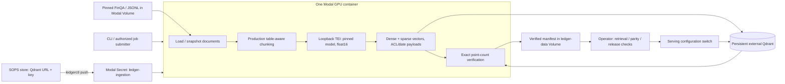
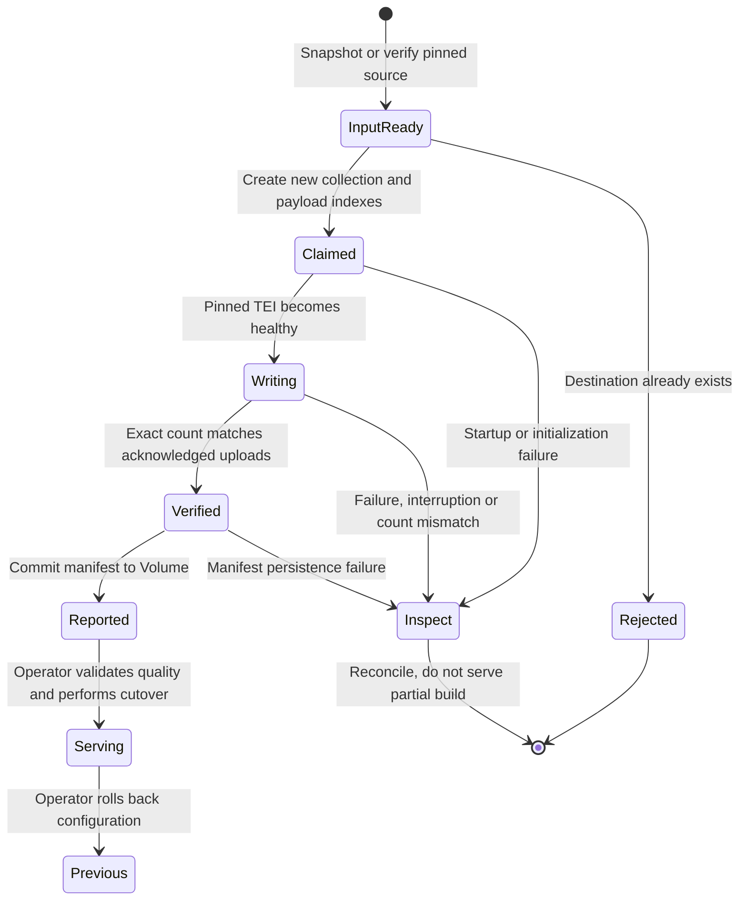

# Colocated Modal ingestion

> **Corpus pipeline (ADR 0007).** New builds should use the spec-driven pipeline:
> `python -m ledger_rag.corpus plan <corpus>` locally, then
> `modal run compute/ingestion.py::corpus --name <corpus> [--promote]` on GPU. It adds
> quality gates, lineage, a build record in Qdrant and alias promotion/rollback. The
> `ingest` job below is the legacy path, kept until the first live corpus build.

**Implemented, locally tested; cloud GPU execution is not yet validated.**
The caller submits a small job specification. Dataset loading, production chunking,
GPU embedding, sparse encoding and direct Qdrant writes happen in one Modal
container. Only the aggregate report returns to the caller.



Qdrant does **not** run in the disposable GPU container. The database must be
reachable from Modal through an authenticated HTTPS endpoint, ideally in the
same region. Your workstation's `127.0.0.1`, Docker service names and private
LAN addresses are not automatically reachable from Modal. Do not expose an
unauthenticated database or tunnel it publicly as a shortcut.

## Credentials and prerequisites

1. Authenticate Modal with the token in the encrypted store: `ledgerctl modal`
   injects `MODAL_TOKEN_ID` / `MODAL_TOKEN_SECRET` per command. No browser is
   required; see [headless authentication](AGENT_WORKFLOWS.md#headless-modal-authentication).
2. Provision Qdrant with TLS, persistence, backups and a least-privilege
   ingestion credential. The deployed server must support collection metadata
   (the reference uses Qdrant 1.20.0). Collection creation needs the corresponding
   permission; query credentials should not have write access.
3. Store the database URL and key in the encrypted store and deliver them:

   ```bash
   ledgerctl set LEDGER_QDRANT_URL
   ledgerctl set LEDGER_QDRANT_API_KEY
   ledgerctl push dev --target modal-database
   ```

   This replaces the `ledger-ingestion` Modal Secret with `LEDGER_QDRANT_URL` and
   `LEDGER_QDRANT_API_KEY` (plus the non-secret `LEDGER_SECRETS_REVISION`). Values
   travel in memory only; the URL must not embed credentials.

The ingestion job needs no public TEI endpoint or `ledger-tei` secret. Its model
server listens only on `127.0.0.1`, uses a random per-job key, and is terminated
on success, failure or cancellation. The model revision is a required immutable
40-character Hugging Face commit, not `main`. The current path supports
TEI-compatible Hub encoders; it does not automatically deploy trained Volume
artifacts or claim every embedding model works with TEI.

## Run a fresh FinQA build

After confirming the dataset rights, target database and resource budget:

```bash
uv run --locked --group compute modal run compute/ingestion.py \
  --collection finqa_gpu_v1 \
  --model-revision YOUR_40_CHARACTER_MODEL_COMMIT
```

The GPU job itself fetches and checksum-verifies the pinned FinQA release through
the shared [dataset registry](../services/engine/src/ledger_rag/evaluation/datasets/sources.py). It indexes report pages from all
three splits, not the gold answers/programs. Current corpus expectations are
2,789 documents and 8,611 chunks; verify the returned report against these.
This command never starts local model containers or calls a remote embedding
endpoint from the local CLI.

Defaults are one L4 (L40S capacity fallback), 4 CPU, 16 GiB RAM, 128-item embedding
and upload batches, no vector quantization, a one-hour job timeout, no automatic
function retries, and single-use containers
([function settings](../compute/ingestion.py#L62-L73)). These are bounded starting
configurations, **not measured cost/throughput optima or dollar spending caps**.
The GPU is allocated for loading and uploading too; colocating saves embedding
network hops but slow database writes can leave GPU time idle. Measure before
adding concurrency. `max_containers=1` is per function/app, not a global index lock.

## Chunk profiles

`--chunk-profile` selects how chunks are indexed (default `v1`). See
[ADR 0002](adr/0002-chunk-profiles-and-qwen3-rerankers.md) for the design.

- **`v1`:** the original, byte-identical chunking.
- **`v2`:** adds a deterministic filing header (ticker, fiscal year, form, page,
  section and table caption) and a row-wise table linearization, headed by the
  table's units or row-dimension cell, to the *indexed* text.
  Displayed and cited text keeps the Markdown table. Expect 8,647 FinQA chunks.
- **`v3`:** adds a cached per-document LLM summary line to the v2 header.

Each profile needs its own new collection. Never reuse a v1 collection name.

The profile is part of the collection identity. Ingestion writes `chunk_text`,
`chunk_profile` and, for v3, `chunk_summary_version` (`<prompt>/<model>`) into the
collection metadata. Serving reads `LEDGER_CHUNK_PROFILE` and
`LEDGER_CHUNK_SUMMARY_VERSION` and refuses to query a collection whose metadata
disagrees, naming both profiles in the error. A missing `chunk_profile` key means
`v1`, so existing v1 collections keep working unchanged.

```bash
uv run --locked --group compute modal run compute/ingestion.py \
  --collection finqa_gte_modernbert_v2ctx_1 --chunk-profile v2 \
  --model-revision e7f32e3c00f91d699e8c43b53106206bcc72bb22
```

A change to a profile's rendered text also needs a new collection, with the next `_N`
suffix (as with `tatqa_gte_modernbert_v1_1`). The current v2 FinQA collections are
listed below; ADR 0002 has their run lineage.

| Collection | Embedding | Run ID | Points |
|---|---|---|---:|
| `finqa_gte_modernbert_v2ctx_1` | gte-modernbert-base, 768-d | `3ad18a9d04494ee0b087b4916960634b` | 8,647 |
| `finqa_qwen3emb_v2ctx_1` | Qwen3-Embedding-0.6B, 1024-d | `75b8926c58d8462f985e4b2183ebcf9f` | 8,647 |

The last authenticated check (2026-10-31) found legacy metadata on both collections:
`chunk_text: title-header-v1` with no `chunk_profile` key. Do not serve these v2
collections under `v1` merely to bypass the identity check.

Before a metadata-only repair, retrieve the recorded ingestion reports and verify
their dataset checksum, code revision, embedding identity and chunk profile.
Compare live points against the deterministic v2 corpus, including chunk IDs,
`index_text`, units/captions and sparse vectors; a collection name or point count
alone is not lineage evidence. Preserve unrelated metadata, including write leases.
Only if the actual indexed corpus matches the current v2 rendering may an operator
set `chunk_text: contextual-v2` and `chunk_profile: v2` using Qdrant's
update-collection `metadata` field. Otherwise explicitly re-ingest a compatible
corpus; never relabel incompatible vectors. Re-read metadata, then verify v2
readiness succeeds and v1 readiness fails. Readiness itself never repairs metadata.

**2026-11-01 verification blocker:** the local Vault was initialized but sealed
(health HTTP 503); neither documented credential path could read the Qdrant key.
No authenticated live corpus/metadata verification or correction was performed,
and no re-ingestion or paid compute was started. Treat the repair as pending,
not as a verified metadata migration.

`finqa_gte_modernbert_v2ctx` and `finqa_qwen3emb_v2ctx` (8,644 points each) indexed
v2 text from before the review fixes. That text had no top-left table cells and missed
177 captions. Both were deleted from Qdrant Cloud on 2026-10-31.

v3 reads summaries only from the `ledger-data` Volume cache and fails if any
document lacks one. Fill the cache first. The command below runs on a CPU
container, uses the `ledger-llm` secret, makes at most 8 concurrent requests and is
idempotent, so rerun it to fill any gaps:

```bash
uv run --locked --group compute modal run compute/summaries.py   # --limit 20 to probe
```

For `Qwen/Qwen3-Embedding-0.6B` pass `--model-id`, the pinned `--model-revision`
and `--dimensions 1024`. Queries then need the Qwen3 instruction prefix (see the
ADR); documents are embedded without a prefix.

## Reuse with application documents

Supply UTF-8 JSONL containing one validated
[Document](../services/engine/src/ledger_rag/core/models.py) per line: `id`, `tenant_id`, `title`,
`text`, `source`, ISO `published_at`, and `allowed_groups`.
The job submitter is an authorized operator, **not an untrusted end-user API**.
Choose the authorized tenant explicitly; every document must match it.

Upload an approved corpus to the Modal data Volume, then submit only its path:

```bash
uv run --locked --group compute modal volume create ledger-data
uv run --locked --group compute modal volume put ledger-data documents.jsonl /incoming/documents.jsonl
uv run --locked --group compute modal run compute/ingestion.py \
  --source jsonl --input-path /data/incoming/documents.jsonl \
  --tenant-id acme --collection acme_gpu_v1 \
  --model-revision YOUR_40_CHARACTER_MODEL_COMMIT
```

Create the Volume only if absent. Input paths must resolve inside `/data`; a
symlink escaping the mount is rejected. The job copies the input to an ephemeral
snapshot before reading it. Keep the uploaded input immutable during that copy;
there is no transactional snapshot of a concurrently edited Volume file.
Blank/malformed lines, duplicate document identities, wrong tenants and empty
corpora fail explicitly without including document bodies in validation errors.

## Evaluation dataset corpora

ConvFinQA, TAT-QA and FinanceBench are fetched, checksum-verified and normalized
offline into `data/<dataset>/normalized/documents.jsonl`, which uses the same
Document JSONL contract. See [DATASETS.md](DATASETS.md) for provenance,
licenses, measured statistics and recorded runs. Upload each corpus to a
content-addressed path, named by its SHA-256, so the report's `input_sha256` can
be checked against the local file:

```bash
SHA=$(sha256sum data/tatqa/normalized/documents.jsonl | cut -d' ' -f1)
uv run --locked --group compute modal volume put ledger-data \
  data/tatqa/normalized/documents.jsonl /datasets/tatqa/$SHA/documents.jsonl
uv run --locked --group compute modal run compute/ingestion.py \
  --source jsonl --input-path /data/datasets/tatqa/$SHA/documents.jsonl \
  --tenant-id tatqa --collection tatqa_gte_modernbert_v1_1 \
  --model-revision e7f32e3c00f91d699e8c43b53106206bcc72bb22
```

- ConvFinQA pages are byte-identical FinQA pages, so they reuse
  `finqa_gte_modernbert_v1` and are never re-ingested.
- FinanceBench is **evaluation-only** (CC-BY-NC-4.0).
- JSONL reports record `input_path` and `input_sha256`, which is the digest of
  the uploaded file. FinQA reports leave both `null`.
- Modal mounts `/data` through a symlink. The input guard therefore compares
  fully resolved paths.

## Integrity and failure behavior



This describes the release workflow, **not a durable orchestrator implemented
by these state names**. `Reported` does not automatically become `Serving`.

- Each run atomically claims a **new collection**. Existing, partially written
  and previously completed collections are refused. No automatic overwrite,
  deletion, resume, alias switch or promotion occurs.
- Tenant-aware keyword, document ID, group ACL and publication-day payload
  indexes are created before embedding. This prepares filtered retrieval
  without relying on unindexed scans or changing an existing collection.
- Complete documents remain together for authoritative stale-chunk cleanup.
  Large documents can exceed the chunk grouping target; model requests and
  Qdrant uploads remain separately bounded. The new-only staging path skips
  redundant per-document deletes, avoiding thousands of database round trips.
  Ordinary document replacement still requires every upload batch to acknowledge
  `wait=True` before any stale deletion.
- Production title/table rendering, UUID identities, sparse weights, tenant/group
  ACLs and publication-day payloads are reused. Existing finite-vector, shape,
  model and collection-identity checks still apply.
- Only an exact database count matching the successfully written chunk count
  produces a successful report. It contains corpus fingerprint, Git revision,
  model revision, embedding-space ID, dimensions, image version, counts and timing.
  The manifest is atomically written to `/data/ingestion/<run-id>.json` and
  committed to the Volume before the job returns. Counts prove upload coverage,
  not retrieval quality, ANN readiness or durability beyond the database's
  configured replication/backups. Timing currently covers ingest/verification,
  not image build, dataset fetch or model cold start.
- On failure, stop and inspect the named isolated collection. Uncertain writes
  are not retried blindly. Use a new destination for an authorized rerun;
  delete abandoned collections only after inspection. Worker restarts or platform
  interruptions can repeat execution even with application retries disabled;
  the new-only destination guard prevents treating a partial run as a fresh build.
- Report persistence can fail after database writes finish. A missing successful
  job result is not proof that the collection is empty; reconcile before release.

## Connect query serving to the new index

Previously collection identity included the embedding URL. A private loopback
address inside a batch container is not the query endpoint, so new builds use
schema 3 with an explicit, transport-independent identity:

```text
tei-1.8-float16:<model-id>@<immutable-model-commit>
```

Copy the report's exact `embedding_space_id` into `LEDGER_EMBEDDING_SPACE_ID`
and configure the same model and dimensions, the actual HTTPS query embedding
endpoint, and `LEDGER_QDRANT_COLLECTION`. The production Compose overlay accepts
the external `LEDGER_QDRANT_URL`; its bundled Qdrant dependency remains part of
that reference stack. Deploy the API independently for a cloud-database-only setup.

The Modal query endpoints in [inference](../compute/inference.py) default to
pinned commits (`gte-modernbert-base@e7f32e3c…`, `gte-reranker-modernbert-base@f7481e60…`),
always serve float16, and reject branch or tag revisions at import. Override with
`LEDGER_EMBED_MODEL`/`LEDGER_EMBED_REVISION` and
`LEDGER_RERANK_MODEL`/`LEDGER_RERANK_REVISION` (40-character commits), then print
the matching identity with
`uv run --group compute modal run compute/inference.py::space_id`; it uses the
same format as the ingestion report. Volume models (`/models/...`) take no
revision and need an explicitly reviewed label.
That endpoint separately needs `ledger-tei` for caller authentication.
Do not label CPU INT8, different weights, pooling or rendering as the same space
without an explicit compatibility evaluation. The ID is an operator contract,
not cryptographic proof of what an external server loaded.

Leaving the new setting empty preserves schema-2 endpoint-bound identity.
Existing collections are **not migrated**; old/new or mismatched identities fail
closed. FinQA benchmarks and collection-copy ablations accept
`--embedding-space-id` (or `LEDGER_EMBEDDING_SPACE_ID`) so they can use the new
collections without recomputing vectors.

Before switching production traffic, verify model/query parity, ACL/date behavior,
known retrieval fixtures and database health/indexing. Retain the prior collection
and serving configuration for rollback. There is no distributed online replacement
coordinator or automatic release gate in this implementation.

## Validation and sources

```bash
uv run --locked --group compute pytest -q services/engine/tests/unit/test_bulk_ingestion.py services/engine/tests/unit/test_tei_ingestion.py services/engine/tests/unit/test_qdrant_store.py
uv run --locked --group compute mypy --strict --ignore-missing-imports compute
```

Tests exercise the remote function body locally with fake GPU/Volume dependencies
and real in-memory Qdrant. They do not prove cloud networking, GPU model loading
or throughput. Primary references:
[Modal Functions](https://modal.com/docs/reference/modal.App#function),
[Modal images](https://modal.com/docs/reference/modal.Image#uv_pip_install) (installed from
hash-pinned `compute/requirements/*.txt` exports of `uv.lock`; `uv_sync` does not support
uv workspaces),
[TEI 1.8 flags](https://github.com/huggingface/text-embeddings-inference/blob/v1.8.0/router/src/main.rs).
