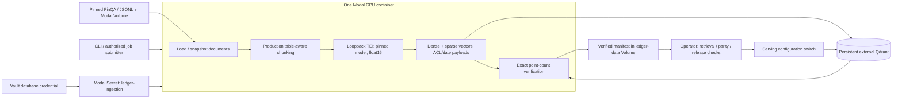
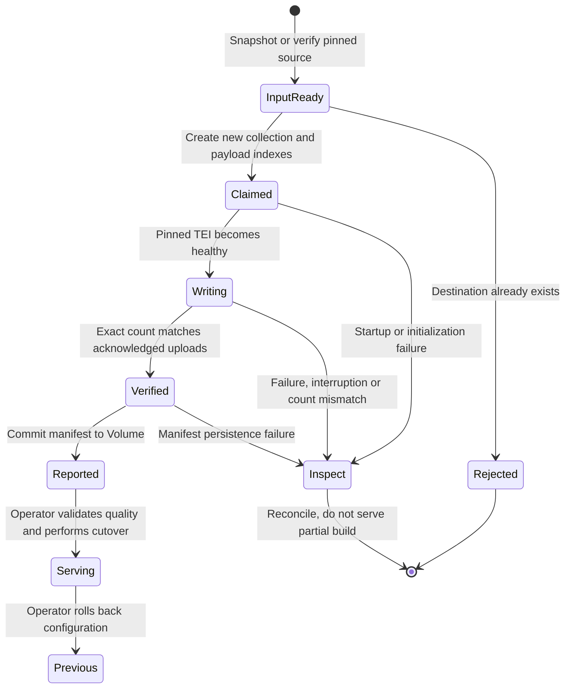

# Colocated Modal ingestion

**Implemented, locally tested; cloud GPU execution is not yet validated.**
The caller submits a small job specification. Dataset loading, production chunking,
GPU embedding, sparse encoding and direct Qdrant writes happen in one Modal
container. Only the aggregate report returns to the caller.



Qdrant does **not** run in the disposable GPU container. The database must be
reachable from Modal through an authenticated HTTPS endpoint, ideally in the
same region. Your workstation's `127.0.0.1`, Docker service names and private
LAN addresses are not automatically reachable from Modal. Do not expose an
unauthenticated database or tunnel it publicly as a shortcut.

## Credentials and prerequisites

1. Authenticate Modal through a local profile or secret-manager injection of
   `MODAL_TOKEN_ID` / `MODAL_TOKEN_SECRET`. No browser is required; see
   [headless authentication](AGENT_WORKFLOWS.md#headless-modal-authentication).
2. Provision Qdrant with TLS, persistence, backups and a least-privilege
   ingestion credential. The deployed server must support collection metadata
   (the reference uses Qdrant 1.20.0). Collection creation needs the corresponding
   permission; query credentials should not have write access.
3. Store the database key at `secret/ledger/qdrant#api_key` in Vault. Prefer
   [Modal workload identity](OPERATIONS.md#modal-workload-identity) so the job reads
   it directly; otherwise, with an authenticated Vault session, project it into the
   Modal environment:

   ```bash
   LEDGER_QDRANT_URL=https://YOUR-DATABASE \
     scripts/sync_modal_secrets.sh ingestion
   ```

   This creates `ledger-ingestion` with `LEDGER_QDRANT_URL` and
   `LEDGER_QDRANT_API_KEY`. The script uses a mode-0600 temporary JSON file,
   disables shell tracing and removes the file on exit. The URL must not embed
   credentials. The existing no-argument script still projects `ledger-tei`.

The ingestion job needs no public TEI endpoint or `ledger-tei` secret. Its model
server listens only on `127.0.0.1`, uses a random per-job key, and is terminated
on success, failure or cancellation. The model revision is a required immutable
40-character Hugging Face commit, not `main`. The current path supports
TEI-compatible Hub encoders; it does not automatically deploy trained Volume
artifacts or claim every embedding model works with TEI.

## Run a fresh FinQA build

After confirming the dataset rights, target database and resource budget:

```bash
uv run --locked --group compute modal run compute/ingestion.py \
  --collection finqa_gpu_v1 \
  --model-revision YOUR_40_CHARACTER_MODEL_COMMIT
```

The GPU job itself fetches and checksum-verifies the pinned FinQA release through
[the fetch script](../scripts/fetch_finqa.sh). It indexes report pages from all
three splits, not the gold answers/programs. Current corpus expectations are
2,789 documents and 8,611 chunks; verify the returned report against these.
This command never starts local model containers or calls a remote embedding
endpoint from the local CLI.

Defaults are one L4 (L40S capacity fallback), 4 CPU, 16 GiB RAM, 128-item embedding
and upload batches, no vector quantization, a one-hour job timeout, no automatic
function retries, and single-use containers. These are bounded starting
configurations, **not measured cost/throughput optima or dollar spending caps**.
The GPU is allocated for loading and uploading too; colocating saves embedding
network hops but slow database writes can leave GPU time idle. Measure before
adding concurrency. `max_containers=1` is per function/app, not a global index lock.

## Reuse with application documents

Supply UTF-8 JSONL containing one validated
[Document](../src/ledger_rag/core/models.py) per line: `id`, `tenant_id`, `title`,
`text`, `source`, ISO `published_at`, and `allowed_groups`.
The job submitter is an authorized operator, **not an untrusted end-user API**.
Choose the authorized tenant explicitly; every document must match it.

Upload an approved corpus to the Modal data Volume, then submit only its path:

```bash
uv run --locked --group compute modal volume create ledger-data
uv run --locked --group compute modal volume put ledger-data documents.jsonl /incoming/documents.jsonl
uv run --locked --group compute modal run compute/ingestion.py \
  --source jsonl --input-path /data/incoming/documents.jsonl \
  --tenant-id acme --collection acme_gpu_v1 \
  --model-revision YOUR_40_CHARACTER_MODEL_COMMIT
```

Create the Volume only if absent. Input paths must resolve inside `/data`; a
symlink escaping the mount is rejected. The job copies the input to an ephemeral
snapshot before reading it. Keep the uploaded input immutable during that copy;
there is no transactional snapshot of a concurrently edited Volume file.
Blank/malformed lines, duplicate document identities, wrong tenants and empty
corpora fail explicitly without including document bodies in validation errors.

## Integrity and failure behavior



This describes the release workflow, **not a durable orchestrator implemented
by these state names**. `Reported` does not automatically become `Serving`.

- Each run atomically claims a **new collection**. Existing, partially written
  and previously completed collections are refused. No automatic overwrite,
  deletion, resume, alias switch or promotion occurs.
- Tenant-aware keyword, document ID, group ACL and publication-day payload
  indexes are created before embedding. This prepares filtered retrieval
  without relying on unindexed scans or changing an existing collection.
- Complete documents remain together for authoritative stale-chunk cleanup.
  Large documents can exceed the chunk grouping target; model requests and
  Qdrant uploads remain separately bounded. The new-only staging path skips
  redundant per-document deletes, avoiding thousands of database round trips.
  Ordinary document replacement still requires every upload batch to acknowledge
  `wait=True` before any stale deletion.
- Production title/table rendering, UUID identities, sparse weights, tenant/group
  ACLs and publication-day payloads are reused. Existing finite-vector, shape,
  model and collection-identity checks still apply.
- Only an exact database count matching the successfully written chunk count
  produces a successful report. It contains corpus fingerprint, Git revision,
  model revision, embedding-space ID, dimensions, image version, counts and timing.
  The manifest is atomically written to `/data/ingestion/<run-id>.json` and
  committed to the Volume before the job returns. Counts prove upload coverage,
  not retrieval quality, ANN readiness or durability beyond the database's
  configured replication/backups. Timing currently covers ingest/verification,
  not image build, dataset fetch or model cold start.
- On failure, stop and inspect the named isolated collection. Uncertain writes
  are not retried blindly. Use a new destination for an authorized rerun;
  delete abandoned collections only after inspection. Worker restarts or platform
  interruptions can repeat execution even with application retries disabled;
  the new-only destination guard prevents treating a partial run as a fresh build.
- Report persistence can fail after database writes finish. A missing successful
  job result is not proof that the collection is empty; reconcile before release.

## Connect query serving to the new index

Previously collection identity included the embedding URL. A private loopback
address inside a batch container is not the query endpoint, so new builds use
schema 3 with an explicit, transport-independent identity:

```text
tei-1.8-float16:<model-id>@<immutable-model-commit>
```

Copy the report's exact `embedding_space_id` into `LEDGER_EMBEDDING_SPACE_ID`
and configure the same model and dimensions, the actual HTTPS query embedding
endpoint, and `LEDGER_QDRANT_COLLECTION`. The production Compose overlay accepts
the external `LEDGER_QDRANT_URL`; its bundled Qdrant dependency remains part of
that reference stack. Deploy the API independently for a cloud-database-only setup.

For the existing Modal query endpoint, set `LEDGER_EMBED_MODEL` and
`LEDGER_EMBED_REVISION` when deploying
[inference](../compute/inference.py); an explicit revision also pins float16.
That endpoint separately needs `ledger-tei` for caller authentication.
Do not label CPU INT8, different weights, pooling or rendering as the same space
without an explicit compatibility evaluation. The ID is an operator contract,
not cryptographic proof of what an external server loaded.

Leaving the new setting empty preserves schema-2 endpoint-bound identity.
Existing collections are **not migrated**; old/new or mismatched identities fail
closed. FinQA benchmarks and collection-copy ablations accept
`--embedding-space-id` (or `LEDGER_EMBEDDING_SPACE_ID`) so they can use the new
collections without recomputing vectors.

Before switching production traffic, verify model/query parity, ACL/date behavior,
known retrieval fixtures and database health/indexing. Retain the prior collection
and serving configuration for rollback. There is no distributed online replacement
coordinator or automatic release gate in this implementation.

## Validation and sources

```bash
uv run --locked --group compute pytest -q tests/unit/test_bulk_ingestion.py tests/unit/test_tei_ingestion.py tests/unit/test_qdrant_store.py tests/unit/test_modal_secret_sync.py
uv run --locked --group compute mypy --strict --ignore-missing-imports compute
```

Tests exercise the remote function body locally with fake GPU/Volume dependencies
and real in-memory Qdrant. They do not prove cloud networking, GPU model loading
or throughput. Primary references:
[Modal Functions](https://modal.com/docs/reference/modal.App#function),
[Modal images](https://modal.com/docs/reference/modal.Image#uv_sync),
[TEI 1.8 flags](https://github.com/huggingface/text-embeddings-inference/blob/v1.8.0/router/src/main.rs).
