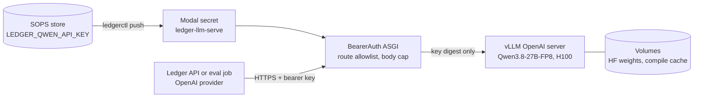
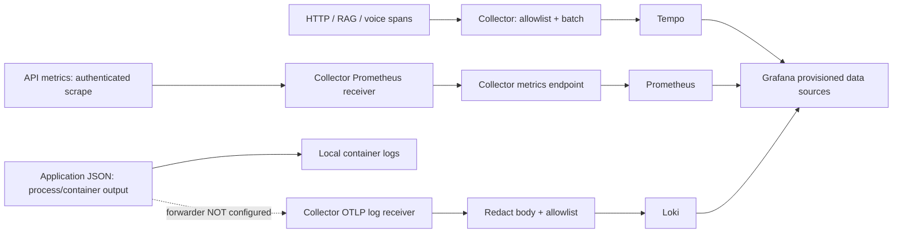

# Operations

## Scope and safe defaults

This is a runnable API and a **single-host, single-API-replica reference
deployment**, not a certified production service. Compose starts only a non-root,
read-only API on `127.0.0.1:8080`, using memory retrieval, synthetic
`data/examples.jsonl` and the extractive provider. No GPU, model download, cloud key
or infrastructure is needed. Memory documents disappear on restart; do not ingest
real financial data in demo.

```bash
export LEDGER_DEMO_TOKEN="$(openssl rand -hex 32)"   # or: ledgerctl run -- docker compose up
docker compose config --quiet
docker compose up --build -d engine
curl --fail http://127.0.0.1:8080/health/live
curl --fail http://127.0.0.1:8080/health/ready
docker compose logs --tail=50 engine
```

Startup rejects a missing or short token. The application never loads a dotenv
file and there is no `.env` to source. For authenticated requests use
`Authorization: Bearer <token>`. The demo token grants `reader` and `admin` for
the synthetic `demo` tenant only.

`POST /v1/query` returns a citation-validated answer.
`POST /v1/query/stream` sends SSE evidence followed by the validated final answer;
it is **not model-token streaming**. `POST /v1/documents` ingests documents as
admin. The admin-only `PATCH /v1/documents/{id}/acl` and `DELETE /v1/documents/{id}`
change or erase one tenant document without re-embedding
([routes](../services/engine/src/ledger_rag/api/app.py#L257-L292)).
`/metrics` also requires an admin bearer identity. Health endpoints are
unauthenticated and must not be exposed beyond a trusted ingress.

Optional Compose profiles: `--profile qdrant` adds a local, unauthenticated Qdrant
for development (bound to localhost); `--profile observability` adds the local
telemetry stack described below; `--profile chat` adds the web workspace.

## Configuration and secrets

Every credential lives in one SOPS + age encrypted store and reaches a runtime only
through `ledgerctl`: local commands get child-process variables, and Modal apps get
per-app Modal Secrets. Non-secret settings per environment are committed in
`config/env/`. See [secrets and configuration](SECRETS.md) for setup, rotation and
incident response, and [ADR 0005](adr/0005-sops-age-secrets.md) for the decision.
The API reads `LEDGER_*` environment variables only.

```bash
ledgerctl status                  # what is set, missing and synced
ledgerctl run -- uv run uvicorn ledger_rag.api.app:app --port 8080 --no-access-log
ledgerctl push dev                # Modal Secrets for the dev environment
ledgerctl modal -- app list               # Modal CLI, token injected per command
```

## Production status

The production runtime (Cloudflare for the public API, Modal for GPU services and
batch jobs) is being defined; the former single-host Compose production overlay,
self-hosted Vault and Vault Agent were removed with the move to SOPS + age. Until a
production target exists, these requirements stay release gates rather than shipped
configuration: OIDC with HTTPS issuer/JWKS, persistent authenticated Qdrant, an
explicit `openai` or `anthropic` provider, HTTPS for every model endpoint, TLS at the
ingress, shared quotas and egress allowlists. `LEDGER_ENVIRONMENT=production`
already refuses to start without OIDC, Qdrant, an explicit LLM and HTTPS endpoints.
Confirm the selected model, structured-output behavior, regional availability,
retention policy and licensing with the provider before granting access to actual
financial evidence.

## Optional self-hosted inference

There is no required inference container or GPU in the demo. A separately operated
Hugging Face TEI endpoint can expose OpenAI-compatible `/v1/embeddings`, including
supported Qwen3 embedding models. Configure `LEDGER_EMBEDDING_BASE_URL` with its
HTTPS `/v1` base, model name, correct `LEDGER_EMBEDDING_DIMENSIONS`, and the
embedding credential (`LEDGER_TEI_API_KEY` in the secret manifest). Production currently requires an embedding API key even
for self-hosting, so put TEI behind an authenticated gateway. Test batching and
dimensions against the actual model; changing model or dimensions requires a new
Qdrant collection and re-embedding, not reuse of an existing collection.

For optional BGE reranking, set `LEDGER_RERANKER_URL` to the TEI HTTPS base endpoint
(the adapter appends `/rerank`), with timeout
`LEDGER_RERANKER_TIMEOUT_SECONDS=3`. Chat reranks bounded candidates; voice
bypasses reranking. The manifest routes the same TEI key to
`LEDGER_RERANKER_API_KEY` for local runs.
`LEDGER_RERANKER_VOICE_URL` is read only by the Qwen3 `VllmRerankingRetriever`
(not wired into `make_retriever`). It receives the same bearer key, is validated like
other endpoints and must use HTTPS in production. An empty URL disables reranking
for that profile instead of failing.
Validate provider/model compatibility and capacity independently; this deployment
does not ship or benchmark a TEI service, OCR pipeline, ASR, or TTS.

Query planning is on by default and uses no network unless configured. Follow-up
rewriting calls the configured LLM provider (not with `LEDGER_PROVIDER=extractive`)
with a `LEDGER_PLANNER_REWRITE_TIMEOUT_SECONDS=1.5` deadline. The optional Laya
decision tier is enabled with `LEDGER_DECISION_BACKEND=laya`, an HTTPS
`LEDGER_DECISION_URL` (the `ledger-decisions` Modal endpoint) and a
`LEDGER_DECISION_API_KEY`, which the manifest routes from the same
`LEDGER_TEI_API_KEY` as the `ledger-tei` Modal secret. Client deadlines are capped at 400 ms (chat) and 150 ms
(voice), after which heuristics decide. See
[query planning](ARCHITECTURE.md#query-planning) for the measured latency and the
deploy command.

### Self-hosted open-weight LLM (Modal vLLM)

`compute/llm.py` serves `Qwen/Qwen3.8-27B-FP8` (Apache-2.0), pinned to Hub revision
`017b9c7af6b5689d5dd426a76e0bc077eb5ca20a`, with vLLM 0.32.0 on one H100. It
follows the vLLM recipe: `qwen3` reasoning parser, `qwen3_coder` tool calls, FP8 KV
cache, `--language-model-only`, a 32,768-token context and MTP speculative decoding
(`LEDGER_LLM_SPECULATIVE_TOKENS`, default 3, 0 disables). It exists because
free-tier hosted APIs rate-limited the evaluation (see [Evaluation](EVALUATION.md)).



```bash
ledgerctl push dev --target modal-llm-serve           # SOPS store -> Modal secret
uv run --group compute modal run compute/llm.py::download_weights
uv run --group compute modal deploy compute/llm.py
uv run --group compute modal run compute/llm_bench.py --phases cold,controls
```

`BearerAuth` (`compute/llm_middleware.py`) leaves only `GET /health` open. It
allowlists the OpenAI routes plus `/metrics` and `/ledger/startup` (the cold-start
breakdown), bounds request bodies, and logs no headers or keys. Point the API at it
with `LEDGER_PROVIDER=openai`, `LEDGER_LLM_BASE_URL=https://<workspace>--ledger-llm-serve-serve.modal.run/v1`
and `LEDGER_LLM_MODEL=Qwen/Qwen3.8-27B-FP8`. Server-specific controls go through
`LEDGER_LLM_EXTRA_BODY`, a JSON object of at most 4 KiB merged into each request.
It cannot override typed fields such as `model`, `messages`, `tools`, `temperature`
or `max_tokens`. For grounded answers, disable thinking with
`{"chat_template_kwargs":{"enable_thinking":false}}`. The provider strips leaked
`<think>` blocks and rejects a reasoning-only reply with an actionable error.

Measured in bench run `6e847a91` (H100 80GB HBM3, no compile cache
yet):

| Phase | Seconds |
|---|---:|
| Scheduling and image pull | 4.0 |
| Weights load | 20.8 |
| `torch.compile` | 35.7 |
| CUDA graph capture | 152.0 |
| Engine init (total) | 370.3 |
| Process start to ready | 455.1 |
| Client-observed cold start | 459.7 |

The first request after ready had a TTFT of 1.03 s. With
`enable_thinking: false`, a 64-token probe returned content and no reasoning.
With the default, and with template `reasoning_effort` of `low`, `medium` or
`xhigh`, the same probe returned only reasoning. A request-level
`reasoning_effort: "high"` is rejected with HTTP 400 (the template supports `low`,
`medium` and `xhigh`). The single-stream, concurrency, long-context and MTP
acceptance phases have not been measured yet.

Costs: `min_containers=0` with a 5-minute scaledown window and `max_containers=1`.
Idle cost is zero, but the first request after scale-down waits through the cold
start above. Keep the app warm only for the duration of an evaluation run.

## Telemetry and diagnostics

`LEDGER_OTLP_ENDPOINT` is an OTLP/HTTP base URL; the application appends
`/v1/traces`. The local Compose Collector base is
`http://otel-collector:4318` (`--profile observability`). That profile reads two
ignored local files: `deploy/observability/private/metrics-token` (an admin bearer token for the
authenticated `/metrics` scrape; locally the demo token) and
`deploy/observability/private/grafana-admin-password`. Keep them `0600`, never commit them, and
remember `deploy/observability/private/` is excluded from the image. The optional Langfuse Cloud trace base is
`https://cloud.langfuse.com/api/public/otel` (select the correct region). For
Langfuse, set `LEDGER_OTLP_HEADERS` to a JSON object with the required
`Authorization: Basic ...` and `x-langfuse-ingestion-version: 4` headers; declare it
in the secret manifest and rotate it like any other secret. See [Langfuse OTLP docs](https://langfuse.com/integrations/native/opentelemetry).
This exporter sends traces only. The service creates HTTP, RAG, reranking and
voice-stage spans, but not full GenAI prompt/completion or per-provider call
semantics; this is not yet a full
Langfuse LLM-observability integration. Do not send sensitive prompt/document
content. Restart the API after rotating headers; settings/exporters are startup-only.

Collector exports traces to Tempo over OTLP,
accepts OTLP logs and exports them to Loki's `/otlp` endpoint, and combines OTLP
metrics with authenticated `/metrics` scrapes. Prometheus scrapes Collector
`:8889`; Grafana provisions all three data sources.

Application structlog JSON goes to **process/container output** with request/trace
IDs and no request body. It is not automatically shipped to Loki: install a reviewed
host log forwarder (e.g. Alloy/Fluent Bit), parse JSON, redact at source, and send OTLP
logs to Collector. No Docker socket or unrestricted host-log mount is supplied.
Collector retains HTTP metadata plus fixed graph stage/tool/profile enums,
numeric/boolean retrieval/citation/outcome fields and `rag.plan.*` planner enums,
counts, confidences and timing
([allowlist](../deploy/observability/otel-collector.yaml#L21-L26)). Model strings, prompts, tool
arguments and outputs are not allowlisted. It drops other span attributes and
log bodies as defense in depth;
this is not proof of complete PII redaction. Review resource attributes, span
names, labels, exception strings, and ingress logs too. Never log JWTs, API keys,
queries, documents, or financial amounts. Separate security audit records from
debug telemetry, with least-privilege access, retention controls and an immutable
external audit sink; request JSON logs alone are not a compliance-grade audit trail.

Available metrics: `ledger_http_requests_total`,
`ledger_http_duration_seconds`, `ledger_retrieval_seconds`,
`ledger_generation_seconds`, `ledger_abstentions_total`, and (Qdrant backend)
`ledger_qdrant_rejected_points_total{reason}`. The last counts retrieved points
dropped as `invalid_payload` (schema corruption), `filter_violation` (tenant/ACL/
as-of mismatch despite the server filter) or `invalid_score`; search refills
`top_k` from the remaining fused candidates and logs `qdrant_points_rejected`
with counts only, never payloads or point IDs. Any non-zero rate signals index
corruption or a filter bug and should page. When the in-process voice gateway is
enabled, the same registry adds `ledger_voice_*` session, turn, STT, TTS
first-byte, first-audio and barge-in metrics
([voice metrics](../services/engine/src/ledger_rag/voice/metrics.py)).
Alert on HTTP 5xx/429, p95/p99 latency, scrape failures,
Qdrant disk exhaustion, rising abstentions, and provider timeouts. Prometheus
retains 15 days; Loki/Tempo retain seven days with local storage in this reference.
No dashboards, alert rules, managed SIEM, or measured SLO compliance are implied.

### Observability data flow



Solid paths reflect shipped configuration, not a verified cloud deployment.
The dashed log path is missing infrastructure, not automatic log delivery.
The Collector retains HTTP/error metadata plus the allowlisted RAG and planner
attributes; voice, reranker and verifier span attributes are dropped by the
default export pipeline.
Direct Langfuse export is an explicit alternative configuration, not a second
simultaneous sink shown here. Prompt capture remains disabled.

## TLS, zero trust, and cloud rollout

For batch indexing, use the [Modal ingestion runbook](INGESTION.md). The job
receives a dedicated database credential through the `ledger-ingestion` Modal
Secret delivered by `ledgerctl push`, performs embeddings and uploads in
one GPU container, and leaves Qdrant persistence outside that container. Serving
selects a verified cloud-built index with `LEDGER_QDRANT_URL`,
`LEDGER_QDRANT_COLLECTION` and `LEDGER_EMBEDDING_SPACE_ID`.

Expose only a TLS ingress/API gateway, enforce modern TLS, request/body limits,
OIDC policy, shared per-tenant rate quotas, and egress allowlists. For Kubernetes,
use cert-manager with a reviewed ACME or private-CA issuer; renew certificates
before expiry. On a cloud service, use its managed certificate and workload
identity capabilities instead of copying long-lived credentials onto nodes.
Neither a cluster, cert-manager installation, nor cloud IAM is shipped here.

Use a dedicated namespace/service account, default-deny ingress/egress network
policies, and narrowly permit ingress-to-API 8080, API-to-Qdrant 6333,
API-to-Collector 4318, DNS, and approved HTTPS identity/model
endpoints. Also permit Collector-to-API, Tempo/Loki and Prometheus-to-Collector.
Standard Kubernetes NetworkPolicy cannot securely allowlist changing external
FQDNs; use an egress proxy or FQDN-aware CNI. Disable service-account token
automount unless workload identity needs it; restrict shell/exec permissions and
run inference/storage/telemetry in separate trust zones.

OIDC accepts RS256/ES256 and requires issuer, audience, expiration, issued-at,
subject, and `tenant_id`; `roles` and `groups` are lists of strings.
Readers query; admins ingest, change document ACLs, delete documents and scrape
metrics. Authorization derives tenant and
groups from verified claims, not user input. Review IdP role/group mapping and
test cross-tenant isolation before onboarding customers. Enforce access and
revocation at ingestion and retrieval; retrieval filters do not replace data
governance or an authorization review.

## Health, capacity, and failure handling

Use `/health/live` for liveness and `/health/ready` for readiness.
Readiness must gate load-balancer traffic; it is not a remote LLM accuracy or
provider-availability guarantee. Use separate synthetic identity/model probes.
Readiness is **read-only and lock-free**: one collection-info read validates
reachability, vector/sparse schema, embedding identity, quantization and write
state. It never creates or alters a collection and does not wait behind writers.
A missing collection is reported unready. Provision explicitly: set
`LEDGER_QDRANT_BOOTSTRAP_ON_STARTUP=true` to create a missing collection with its payload
indexes at startup, ingest documents (the write path provisions the same way),
or build a staged collection with the [ingestion runbook](INGESTION.md). An
existing collection is validated and never migrated in place.
The image's healthcheck uses installed Python, not a nonexistent curl binary.
Minimal infrastructure images without guaranteed HTTP clients have no pretend
curl/wget healthchecks. Probe their HTTP health
endpoints from your orchestrator instead.

Suggested Kubernetes settings: startup probe every 5s with 24 failures allowed,
liveness every 15s (three failures), readiness every 5s (three failures), all with
3s timeouts; allow at least 30s termination grace and drain active SSE connections.
Use non-root UID/GID 10001, read-only root filesystem, dropped capabilities,
no privilege escalation, and a writable bounded `/run/ledger-runtime` tmpfs.
Apply namespace quotas/LimitRanges and pod disruption budgets in the actual
cluster; no Kubernetes manifests are claimed to be installed.

Compose limits API to 1 CPU/768 MiB, concurrency to the app default 32, and Qdrant
to 2 CPU/2 GiB; these are **starting budgets, not capacity measurements**. Run one
uvicorn worker and **one API replica** for this reference. Do not enable horizontal
autoscaling or multiple workers: document replacement is serialized only inside
one instance (reads there run concurrently; writes are exclusive).

Failed-replacement quarantine is **durable and fails closed**. Before mutating, a
writer stores a `ledger_write_lease` (`writer`, `expires_at`) in the Qdrant
collection metadata and removes it only after all upserts and stale deletes
succeed; long writes refresh it. Searches and readiness already read collection
metadata, so an expired lease (crash, cancellation, restart or failure
mid-replacement) makes **every** instance, including restarted ones, unready
and refuse searches and writes. An unexpired lease held by another process is an
in-flight write: reads continue and other writers refuse. This is best-effort
coordination, not a distributed lock. Size `LEDGER_QDRANT_WRITE_LEASE_SECONDS`
(default 120) above one upsert batch plus the stale deletes; an over-long write
fails closed until it finishes. Restarting an API is **not repair**. If a
replacement fails, stop ingestion, reconcile the full authoritative
document/ACL state with the index, validate it, then explicitly release the
lease with `uv run python scripts/release_qdrant_write_lease.py
--confirm-reconciled` (same `LEDGER_*` settings as the API) before restoring
traffic.

Upstream **retries** cover only idempotent computations: LLM, embedding and
reranker HTTP calls. 408/425/429/500/502/503/504/529 and transport errors
(connect, read timeout) are retried up to `LEDGER_UPSTREAM_MAX_RETRIES` (default
2) with full-jitter backoff, `uniform(0, min(max, base·2^attempt))`
(`LEDGER_UPSTREAM_RETRY_BASE_SECONDS` 0.2, `LEDGER_UPSTREAM_RETRY_MAX_DELAY_SECONDS`
5). A `Retry-After` header (seconds or HTTP date) sets the minimum delay; if it
exceeds the max delay, the call fails at once. A retry starts only if the delay plus
0.25s still fits before the request deadline (`LEDGER_QUERY_DEADLINE_SECONDS`).
The `voice` profile is capped at **one** retry. Other 4xx statuses fail fast.
Each retry logs `upstream_retry` (operation, attempt, status, delay; no content).
A retried LLM 5xx or timeout may be **billed twice**; set the cap to 0 if that
matters. Qdrant reads and writes are never retried; writes stay governed by the
lease above.

Horizontal scaling requires a distributed index coordinator, durable ACL
versioning, and a transactional ingestion outbox/reconciliation mechanism first.
Then implement **shared** gateway quotas and test multi-replica failure/race
behavior: the current limiter/concurrency control is process-local and multiplying
replicas multiplies its allowance. Persistent Qdrant or a gateway alone does not
resolve the index-consistency issue. Size Qdrant using real embedding dimensions,
index overhead, corpus size and replication.

**Unmeasured planning targets:** 99.9% monthly API availability, chat p95 final
answer under 8s, voice p95 under 3s for the validated final answer, and retrieval
p95 under 500ms. Provider/network tails, reranking, cold starts and prompt length
may violate these; measure end-to-end before committing an SLO. SSE evidence
arrival is not time-to-first-model-token or ASR/TTS latency. Set explicit upstream
timeouts, per-tenant spending budgets, retry ceilings and overload responses.

## Backup, restore, and cost controls

* Qdrant: create collection snapshots through an authenticated admin workflow,
  copy them to encrypted/versioned object storage, retain source documents and
  embedding-model/version metadata, then restore into an isolated compatible
  server and test ACL filters and known retrieval fixtures. Do not rely on copying
  a live volume. Upserts/replacements are not a cross-system transaction.
* Secrets: push the private SOPS store to its remote after each change and keep
  the offline age backup; restore by cloning the store and importing the identity
  (see [secrets](SECRETS.md#rotation-and-incident-response)).
* Grafana/Prometheus/Loki/Tempo: back up configuration and required persistent
  data with application-aware snapshots; use managed/object storage for HA.
  Local bootstrap files under `deploy/observability/private/` are not a backup target.

Proposed, **unverified** recovery objectives are RPO 24h/RTO 4h. Test restoring
from off-host backups and record actual results before promising them. Avoid
`docker compose down -v`: it destroys persistent data. For rollout, build a fresh
image, deploy by immutable digest, pause ingestion, drain/stop the old single
instance, then check readiness, index reconciliation and authenticated fixtures
before resuming traffic. Do not overlap writable replicas in this reference.
Keep the previous image/config for rollback; collection
or embedding migrations may require restoring compatible snapshots too.

Track LLM input/output tokens, embedding volume, reranker inference/GPU hours,
Qdrant RAM/disk/replication, telemetry cardinality/retention, cloud egress, and
backup costs. The demo has no paid inference costs; production cost per query and
accuracy are not measured. Enforce gateway tenant budgets and provider caps;
re-embedding a corpus can cost more than serving it. Make a tenant-safe cache and
shared limiter explicit follow-up infrastructure, not assumed features.

## CI and verified baseline

CI runs locked `uv sync`, Ruff, strict mypy, pytest on Python 3.11–3.13, package
build, a threshold-gated synthetic evaluation (`ledger_rag.evaluation.harness --smoke`),
image build and Compose schema validation. Synthetic smoke gates are not an
independent real-world quality benchmark. The production Docker image
uses frozen, no-dev, non-editable installation in a separate builder. Secret
scanning uses the pinned Gitleaks CLI for checkout and full history; it does not
depend on a paid organization Action license. No image publishing/cloud
deployment occurs automatically.

Container tags and manifest digests were checked against their registries on
2026-10-31: uv 0.13.6, Python 3.11.14, Qdrant 1.20.0, Collector 0.164.0, Prometheus 3.15.1, Grafana 13.3.0, Loki 3.7.9,
Tempo **2.10.10**, Gitleaks 8.30.1. Tempo 2 is intentional for the lightweight
monolithic config; Tempo 3 requires a different architecture/config and is not a
drop-in replacement. Pinned availability is not a vulnerability attestation:
scan images, patch/retest regularly, verify model/server metadata compatibility,
and update digests through reviewed dependency changes.

Official references (web docs, not Context7 verification):
[SOPS age identities](https://getsops.io/docs/usage/identities/age/),
[Collector configuration](https://opentelemetry.io/docs/collector/configuration/),
[Tempo configuration](https://grafana.com/docs/tempo/latest/configuration/),
[TEI quick tour](https://huggingface.co/docs/text-embeddings-inference/quick_tour),
[Compose merge rules](https://docs.docker.com/reference/compose-file/merge/).
