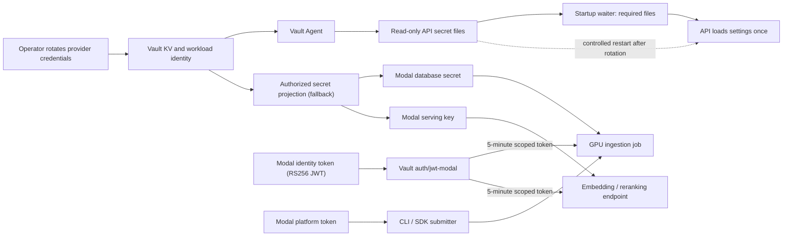
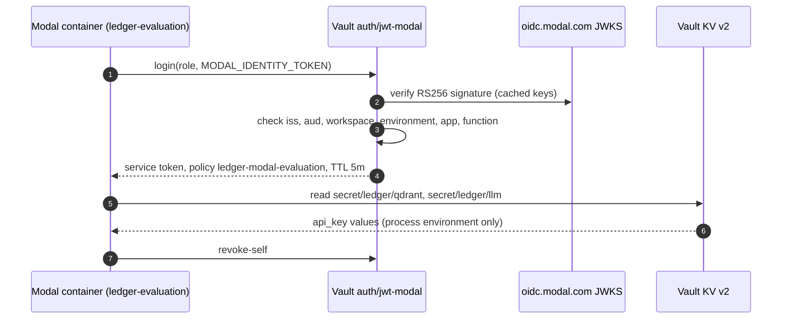
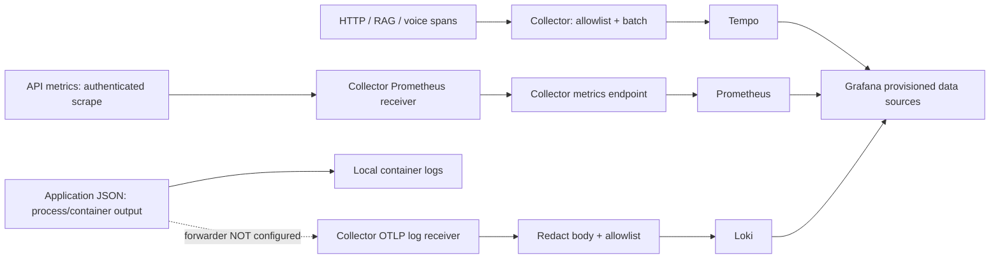

# Operations

## Scope and safe defaults

This is a runnable API and a **single-host, single-API-replica reference
deployment**, not a certified production service. Compose starts only a non-root, read-only API on
`127.0.0.1:8080`, using memory retrieval, synthetic `data/examples.jsonl`, and the
extractive provider. No GPU, model download, cloud key, or infrastructure is needed.
Memory documents disappear on restart; do not ingest real financial data in demo.

```bash
cp .env.example .env
# Generate a fresh token locally and put it in the ignored .env file.
python -c 'import secrets; print(secrets.token_urlsafe(32))'
docker compose config --quiet
docker compose up --build -d api
curl --fail http://127.0.0.1:8080/health/live
curl --fail http://127.0.0.1:8080/health/ready
docker compose logs --tail=50 api
```

The token is deliberately blank in `.env.example`; startup rejects missing/short
tokens. Compose reads `.env` for interpolation; the application does **not** load a
dotenv file. Never source an environment or Vault-rendered file in a shell.
For authenticated requests use `Authorization: Bearer <locally generated token>`.
The demo token grants `reader` and `admin` for the synthetic `demo` tenant only.

`POST /v1/query` returns a citation-validated answer.
`POST /v1/query/stream` sends SSE evidence followed by the validated final answer;
it is **not model-token streaming**. `POST /v1/documents` ingests documents as
admin; `/metrics` also requires an admin bearer identity. Health endpoints are
unauthenticated and must not be exposed beyond a trusted ingress.

## Production prerequisites

Use Docker Compose 2.24.4+ (the overlay uses `!override`) on Linux. Production is an
explicit overlay, **never** a dev-mode Vault or an automatic default:

```bash
docker compose -f compose.yaml -f deploy/compose.production.yaml \
  --profile production config --quiet
# Only after the provisioning steps below:
docker compose -f compose.yaml -f deploy/compose.production.yaml \
  --profile production up --build -d
```

Supply non-secret OIDC, provider, model, and HTTPS endpoint variables from
`.env.example` or deployment configuration. The overlay requires OIDC, persistent
Qdrant, and an explicit `openai` or `anthropic` provider. HTTPS is mandatory for
issuer, JWKS, LLM, embeddings, and an optional reranker. Confirm the selected model,
structured-output behavior, regional availability, retention policy, and licensing
with the provider before granting access to actual financial evidence.

Provision the following files **before** starting services:

| Ignored local path | Purpose |
| --- | --- |
| `deploy/private/vault-tls/ca.crt` | Trusted CA, readable by Vault server and Agent |
| `deploy/private/vault-tls/server.crt`, `server.key` | Server TLS certificate/key; SAN must include `vault` |
| `deploy/private/approle/role-id`, `secret-id` | Narrow AppRole credentials; readable only by UID 10001 and operators |
| `deploy/private/qdrant.yaml` | Qdrant server configuration containing `service.api_key` |
| `deploy/private/grafana-admin-password` | Unique bootstrap administrator password; readable by Grafana UID 472 |

`deploy/private/` is ignored by `deploy/.gitignore` and excluded from the image.
Never commit these files or include them in support bundles. Host bind mounts must
have ownership/permissions compatible with the specified container UIDs; do not
solve permission errors with world-readable secrets. Vault runs as UID 100/GID
1000: make its TLS directory traversable by that group (`0750`) and its private
key group-readable (`0640`), while retaining operator ownership. Agent's AppRole
directory/files need UID 10001 access (`0700`/`0600`).
The Qdrant server key must
match the API's Vault key. A minimal private Qdrant configuration has:

```yaml
service:
  api_key: "<provision through your secret delivery process>"
```

The Qdrant connection in this single-host reference is authenticated but uses
plaintext on the Docker bridge. Terminate internal TLS or use an mTLS mesh and
update `LEDGER_QDRANT_URL` before deploying across hosts. Loki, Tempo, Prometheus,
and Collector endpoints have no application authentication in these configs:
they are private infrastructure, **not public services**. Only selected UI/admin
ports are published, always on `127.0.0.1`; do not remove that binding.

## Vault bootstrap, delivery, and rotation



This diagram separates credential consumers; the platform token is not a TEI
bearer key or a Qdrant key. File updates alone do not reload a running API.

`deploy/vault/server.hcl` uses TLS and persistent Raft storage, not `-dev`.
The supplied Vault is one node and therefore not HA. Start **only** Vault while
provisioning:

```bash
docker compose --profile production up -d vault
docker compose --profile production exec vault vault operator init
docker compose --profile production exec vault vault operator unseal
```

Handle initialization output as highly sensitive. Split recovery/unseal material
among authorized custodians, and replace manual unseal with a reviewed cloud-KMS
auto-unseal configuration for an actual deployment. Never store root tokens or
unseal keys in Compose or the repository.

An authorized operator must enable a KV v2 mount at `secret/`, AppRole at
`auth/approle`, install `deploy/vault/policy.hcl`, and create a dedicated role
attached to that policy only. Set short token TTLs, bounded SecretID lifetimes,
appropriate use limits, and role/secret CIDR constraints for your infrastructure.
The read-only bootstrap SecretID is retained (`remove_secret_id_file_after_reading
= false`) because Agent cannot delete a read-only bind mount; choose a use limit
allowing expected re-authentication and rotate it externally. Prefer wrapped
SecretID delivery or platform workload identity for a managed deployment.

Populate these **KV v2 logical paths** through an approved secret-management
workflow, not literal credentials in shell history:

* `secret/ledger/llm`, `secret/ledger/embedding`, `secret/ledger/qdrant`: one
  `api_key` field each. Separate paths exist because Vault ACLs are path-scoped:
  a GPU job that needs the database key must not be able to read the LLM key.
* `secret/ledger/telemetry`: `metrics_token`, a short-lived OIDC access token with
  the API audience, required tenant claim, and `admin` role, plus
  `otlp_headers_json` (the JSON object `{}` for the local Collector, or protected
  OTLP headers when directly using an authenticated OTLP backend).

The templates intentionally address the KV v2 HTTP paths
`secret/data/ledger/{llm,embedding,qdrant,telemetry}`. Vault Agent AppRole
auto-auth fetches these records and renders separate files, mode `0600`, without a
token sink or dotenv output. API secrets use tmpfs-backed `ledger-secrets`; the
Collector's bearer credential uses a separate `telemetry-secrets` tmpfs volume.
The API and Collector mount their respective volumes read-only as UID 10001.
Prometheus receives scraped metrics from the Collector, **not** the API bearer
token. In the base infrastructure profile alone, Collector instead expects an
operator-provided `deploy/private/metrics-token`; the production overlay replaces
that bind mount with Vault delivery.

The API waits up to 120 seconds for all required key files. Collector may initially
restart until its credential file is rendered. A sealed/uninitialized Vault fails
its `vault status` healthcheck and blocks Agent startup by design.

`LEDGER_SECRETS_DIR=/run/ledger-secrets` is interpreted by `get_settings()`.
Pydantic reads exact filenames `LEDGER_LLM_API_KEY`,
`LEDGER_EMBEDDING_API_KEY`, `LEDGER_QDRANT_API_KEY`, and
`LEDGER_OTLP_HEADERS`. The first three files contain raw key values; the last
contains a JSON object of OTLP headers (use `{}` when none are required). Environment
variables take precedence, so **do not set API-key
environment variables** in production. Secret files are neither executable nor
shell assignments. Settings and clients are initialized once: Agent updates files
but application keys do **not** hot-reload. Pause ingestion and perform a controlled
single-instance restart after rotation and index consistency checks, preserving a
provider-side overlap period for old/new keys, not overlapping API writers.

The metrics token must be refreshed in Vault **before** expiration by an external
OIDC client-credentials broker/job; Vault KV is storage, not an OIDC token issuer.
Agent re-renders static KV secrets each minute. Monitor Collector scrape failures
and verify bearer-file rereading after rotation; restart Collector if your chosen
version/integration requires it. Do not use a long-lived demo token in production.
Because the present API requires `admin` for metrics, this monitoring principal is
also capable of ingestion; use a dedicated identity and tightly restrict network
access until a distinct metrics-only role is implemented.

### Modal workload identity

Modal injects `MODAL_IDENTITY_TOKEN`, an RS256 JWT issued by
`https://oidc.modal.com`, into every container. Vault's JWT auth method verifies it
against Modal's published JWKS, so GPU jobs can fetch their own credentials and no
provider key has to be copied into a Modal Secret. Only the Modal platform token
remains outside Vault: it submits jobs and is not a data-plane credential.



Configure once with an administrative Vault session:

```bash
MODAL_WORKSPACE_ID=ac-YOUR-WORKSPACE MODAL_ENVIRONMENT=main \
  scripts/vault_configure_modal_jwt.sh
```

The script is idempotent. It enables `auth/jwt-modal`, installs the policies in
[`deploy/vault/modal/`](../deploy/vault/modal/), and binds each role to the token's
`workspace_id`, `environment_name`, `app_name` and (for ingestion) `function_name`
claims:

| Role | Modal apps | Readable KV paths |
|---|---|---|
| `ledger-ingestion` | `ledger-ingestion` (function `ingest`) | `qdrant`, `llm` (contextual summaries) |
| `ledger-evaluation` | `ledger-evaluation` | `qdrant`, `llm` |
| `ledger-serving` | `ledger-inference`, `ledger-reranker`, `ledger-verifier`, `ledger-decisions` | `embedding` |

Vault tokens are service tokens with a 5-minute TTL (10-minute hard cap), no
`default` policy, and only `lookup-self`/`revoke-self` beyond the KV reads. Jobs
read secrets once at start-up through
[`workload_identity.py`](../src/ledger_rag/security/workload_identity.py) and revoke
the token immediately. A container sets `LEDGER_VAULT_ADDR`, `LEDGER_VAULT_ROLE`
and, for a private CA, `LEDGER_VAULT_CA_PEM`; none of these is secret. Without
`LEDGER_VAULT_ADDR` the helper is a no-op and the job uses environment variables
projected by `scripts/sync_modal_secrets.sh` (policy `ledger-modal-sync`).

Modal identity tokens are valid for 48 hours, so the claim bindings, not the token
lifetime, carry the security boundary: never bind a role to the workspace alone.
Vault must be reachable from Modal over public TLS (for example a hosted Vault or
OpenBao cluster with cloud-KMS auto-unseal); a workstation Vault is not.

This flow was verified against the reference Vault 2.2.1 with a real
Modal-issued token:
- A role bound to the probe app read exactly its two permitted paths.
- The same token was rejected by `ledger-ingestion` (claim `app_name` mismatch).
- The evaluation policy received HTTP 403 for `secret/ledger/embedding`.
- The token-accessor count was unchanged after the job, confirming revocation.

## Optional self-hosted inference

There is no required inference container or GPU in the demo. A separately operated
Hugging Face TEI endpoint can expose OpenAI-compatible `/v1/embeddings`, including
supported Qwen3 embedding models. Configure `LEDGER_EMBEDDING_BASE_URL` with its
HTTPS `/v1` base, model name, correct `LEDGER_EMBEDDING_DIMENSIONS`, and Vault
embedding credential. Production currently requires an embedding API key even
for self-hosting, so put TEI behind an authenticated gateway. Test batching and
dimensions against the actual model; changing model or dimensions requires a new
Qdrant collection and re-embedding, not reuse of an existing collection.

For optional BGE reranking, set `LEDGER_RERANKER_URL` to the TEI HTTPS base endpoint
(the adapter appends `/rerank`), with timeout
`LEDGER_RERANKER_TIMEOUT_SECONDS=3`. Chat reranks bounded candidates; voice
bypasses reranking. If protected, add an Agent template analogous to the API key
templates that renders `LEDGER_RERANKER_API_KEY` into `/run/ledger-secrets` from a
dedicated KV field. The supplied template does not require this optional secret.
`LEDGER_RERANKER_VOICE_URL` is read only by the Qwen3 `VllmRerankingRetriever`
(not wired into `make_retriever`). It receives the same bearer key, is validated like
other endpoints and must use HTTPS in production. An empty URL disables reranking
for that profile instead of failing.
Validate provider/model compatibility and capacity independently; this deployment
does not ship or benchmark a TEI service, OCR pipeline, ASR, or TTS.

Query planning is on by default and uses no network unless configured. Follow-up
rewriting calls the configured LLM provider (not with `LEDGER_PROVIDER=extractive`)
with a `LEDGER_PLANNER_REWRITE_TIMEOUT_SECONDS=1.5` deadline. The optional Laya
decision tier is enabled with `LEDGER_DECISION_BACKEND=laya`, an HTTPS
`LEDGER_DECISION_URL` (the `ledger-decisions` Modal endpoint) and a
`LEDGER_DECISION_API_KEY` file rendered from the same Vault field as the
`ledger-tei` Modal secret. Client deadlines are capped at 400 ms (chat) and 150 ms
(voice), after which heuristics decide. See
[query planning](ARCHITECTURE.md#query-planning) for the measured latency and the
deploy command.

## Telemetry and diagnostics

`LEDGER_OTLP_ENDPOINT` is an OTLP/HTTP base URL; the application appends
`/v1/traces`. The production Compose Collector base is
`http://otel-collector:4318`. The optional Langfuse Cloud trace base is
`https://cloud.langfuse.com/api/public/otel` (select the correct region). For
Langfuse, populate `otlp_headers_json` in Vault with the required `Authorization:
Basic ...` and `x-langfuse-ingestion-version: 4` headers; rotate it like any other
secret. See [Langfuse OTLP docs](https://langfuse.com/integrations/native/opentelemetry).
This exporter sends traces only. The service creates HTTP, RAG, reranking and
voice-stage spans, but not full GenAI prompt/completion or per-provider call
semantics; this is not yet a full
Langfuse LLM-observability integration. Do not send sensitive prompt/document
content. Restart the API after rotating headers; settings/exporters are startup-only.

Collector exports traces to Tempo over OTLP,
accepts OTLP logs and exports them to Loki's `/otlp` endpoint, and combines OTLP
metrics with authenticated `/metrics` scrapes. Prometheus scrapes Collector
`:8889`; Grafana provisions all three data sources.

Application structlog JSON goes to **process/container output** with request/trace
IDs and no request body. It is not automatically shipped to Loki: install a reviewed
host log forwarder (e.g. Alloy/Fluent Bit), parse JSON, redact at source, and send OTLP
logs to Collector. No Docker socket or unrestricted host-log mount is supplied.
Collector retains HTTP metadata plus fixed graph stage/tool/profile enums and
numeric/boolean retrieval/citation/outcome fields. Model strings, prompts, tool
arguments and outputs are not allowlisted. It drops other span attributes and
log bodies as defense in depth;
this is not proof of complete PII redaction. Review resource attributes, span
names, labels, exception strings, and ingress logs too. Never log JWTs, API keys,
queries, documents, or financial amounts. Separate security audit records from
debug telemetry, with least-privilege access, retention controls and an immutable
external audit sink. Vault audit devices must be enabled by the operator; request
JSON logs alone are not a compliance-grade audit trail.

Available metrics: `ledger_http_requests_total`,
`ledger_http_duration_seconds`, `ledger_retrieval_seconds`,
`ledger_generation_seconds`, `ledger_abstentions_total`, and (Qdrant backend)
`ledger_qdrant_rejected_points_total{reason}`. The last counts retrieved points
dropped as `invalid_payload` (schema corruption), `filter_violation` (tenant/ACL/
as-of mismatch despite the server filter) or `invalid_score`; search refills
`top_k` from the remaining fused candidates and logs `qdrant_points_rejected`
with counts only, never payloads or point IDs. Any non-zero rate signals index
corruption or a filter bug and should page.
Alert on HTTP 5xx/429, p95/p99 latency, scrape failures, Vault sealed state,
Qdrant disk exhaustion, rising abstentions, and provider timeouts. Prometheus
retains 15 days; Loki/Tempo retain seven days with local storage in this reference.
No dashboards, alert rules, managed SIEM, or measured SLO compliance are implied.

### Observability data flow



Solid paths reflect shipped configuration, not a verified cloud deployment.
The dashed log path is missing infrastructure, not automatic log delivery.
The Collector currently retains only a narrow HTTP/error attribute allowlist;
custom RAG/voice attributes are not all retained by the default export pipeline.
Direct Langfuse export is an explicit alternative configuration, not a second
simultaneous sink shown here. Prompt capture remains disabled.

## TLS, zero trust, and cloud rollout

For batch indexing, use the [Modal ingestion runbook](INGESTION.md). The job
receives a dedicated database credential through the `ledger-ingestion` Modal
Secret projected from Vault, performs embeddings and uploads in one GPU
container, and leaves Qdrant persistence outside that container. The production
overlay accepts `LEDGER_QDRANT_URL`, `LEDGER_QDRANT_COLLECTION` and
`LEDGER_EMBEDDING_SPACE_ID` for a verified cloud-built index; defaults preserve
the bundled database and legacy collection identity.

Expose only a TLS ingress/API gateway, enforce modern TLS, request/body limits,
OIDC policy, shared per-tenant rate quotas, and egress allowlists. For Kubernetes,
use cert-manager with a reviewed ACME or private-CA issuer; renew certificates
before expiry. On a cloud service, use its managed certificate and workload
identity capabilities instead of copying bootstrap AppRole files onto nodes.
Neither a cluster, cert-manager installation, nor cloud IAM is shipped here.

Use a dedicated namespace/service account, default-deny ingress/egress network
policies, and narrowly permit ingress-to-API 8080, API-to-Qdrant 6333,
API-to-Collector 4318, Agent-to-Vault 8200, DNS, and approved HTTPS identity/model
endpoints. Also permit Collector-to-API, Tempo/Loki and Prometheus-to-Collector.
Standard Kubernetes NetworkPolicy cannot securely allowlist changing external
FQDNs; use an egress proxy or FQDN-aware CNI. Disable service-account token
automount unless workload identity needs it; restrict shell/exec permissions and
run inference/storage/telemetry in separate trust zones.

OIDC accepts RS256/ES256 and requires issuer, audience, expiration, issued-at,
subject, and `tenant_id`; `roles` and `groups` are lists of strings.
Readers query; admins ingest and scrape metrics. Authorization derives tenant and
groups from verified claims, not user input. Review IdP role/group mapping and
test cross-tenant isolation before onboarding customers. Enforce access and
revocation at ingestion and retrieval; retrieval filters do not replace data
governance or an authorization review.

## Health, capacity, and failure handling

Use `/health/live` for liveness and `/health/ready` for readiness.
Readiness must gate load-balancer traffic; it is not a remote LLM accuracy or
provider-availability guarantee. Use separate synthetic identity/model probes.
Readiness is **read-only and lock-free**: one collection-info read validates
reachability, vector/sparse schema, embedding identity, quantization and write
state. It never creates or alters a collection and does not wait behind writers.
A missing collection is reported unready. Provision explicitly: set
`LEDGER_QDRANT_BOOTSTRAP_ON_STARTUP=true` (the bundled production overlay does,
for its fresh local Qdrant) to create a missing collection with its payload
indexes at startup, ingest documents (the write path provisions the same way),
or build a staged collection with the [ingestion runbook](INGESTION.md). An
existing collection is validated and never migrated in place.
The image's healthcheck uses installed Python, not a nonexistent curl binary.
Vault uses its installed CLI; minimal infrastructure images without guaranteed
HTTP clients have no pretend curl/wget healthchecks. Probe their HTTP health
endpoints from your orchestrator instead.

Suggested Kubernetes settings: startup probe every 5s with 24 failures allowed,
liveness every 15s (three failures), readiness every 5s (three failures), all with
3s timeouts; allow at least 30s termination grace and drain active SSE connections.
Use non-root UID/GID 10001, read-only root filesystem, dropped capabilities,
no privilege escalation, and a writable bounded `/run/ledger-runtime` tmpfs.
Apply namespace quotas/LimitRanges and pod disruption budgets in the actual
cluster; no Kubernetes manifests are claimed to be installed.

Compose limits API to 1 CPU/768 MiB, concurrency to the app default 32, and Qdrant
to 2 CPU/2 GiB; these are **starting budgets, not capacity measurements**. Run one
uvicorn worker and **one API replica** for this reference. Do not enable horizontal
autoscaling or multiple workers: document replacement is serialized only inside
one instance (reads there run concurrently; writes are exclusive).

Failed-replacement quarantine is **durable and fails closed**. Before mutating, a
writer stores a `ledger_write_lease` (`writer`, `expires_at`) in the Qdrant
collection metadata and removes it only after all upserts and stale deletes
succeed; long writes refresh it. Searches and readiness already read collection
metadata, so an expired lease (crash, cancellation, restart or failure
mid-replacement) makes **every** instance, including restarted ones, unready
and refuse searches and writes. An unexpired lease held by another process is an
in-flight write: reads continue and other writers refuse. This is best-effort
coordination, not a distributed lock. Size `LEDGER_QDRANT_WRITE_LEASE_SECONDS`
(default 120) above one upsert batch plus the stale deletes; an over-long write
fails closed until it finishes. Restarting an API is **not repair**. If a
replacement fails, stop ingestion, reconcile the full authoritative
document/ACL state with the index, validate it, then explicitly release the
lease with `uv run python scripts/release_qdrant_write_lease.py
--confirm-reconciled` (same `LEDGER_*` settings as the API) before restoring
traffic.

Upstream **retries** cover only idempotent computations: LLM, embedding and
reranker HTTP calls. 408/425/429/500/502/503/504/529 and transport errors
(connect, read timeout) are retried up to `LEDGER_UPSTREAM_MAX_RETRIES` (default
2) with full-jitter backoff, `uniform(0, min(max, base·2^attempt))`
(`LEDGER_UPSTREAM_RETRY_BASE_SECONDS` 0.2, `LEDGER_UPSTREAM_RETRY_MAX_DELAY_SECONDS`
5). A `Retry-After` header (seconds or HTTP date) sets the minimum delay; if it
exceeds the max delay, the call fails at once. A retry starts only if the delay plus
0.25s still fits before the request deadline (`LEDGER_QUERY_DEADLINE_SECONDS`).
The `voice` profile is capped at **one** retry. Other 4xx statuses fail fast.
Each retry logs `upstream_retry` (operation, attempt, status, delay; no content).
A retried LLM 5xx or timeout may be **billed twice**; set the cap to 0 if that
matters. Qdrant reads and writes are never retried; writes stay governed by the
lease above.

Horizontal scaling requires a distributed index coordinator, durable ACL
versioning, and a transactional ingestion outbox/reconciliation mechanism first.
Then implement **shared** gateway quotas and test multi-replica failure/race
behavior: the current limiter/concurrency control is process-local and multiplying
replicas multiplies its allowance. Persistent Qdrant or a gateway alone does not
resolve the index-consistency issue. Size Qdrant using real embedding dimensions,
index overhead, corpus size and replication.

**Unmeasured planning targets:** 99.9% monthly API availability, chat p95 final
answer under 8s, voice p95 under 3s for the validated final answer, and retrieval
p95 under 500ms. Provider/network tails, reranking, cold starts and prompt length
may violate these; measure end-to-end before committing an SLO. SSE evidence
arrival is not time-to-first-model-token or ASR/TTS latency. Set explicit upstream
timeouts, per-tenant spending budgets, retry ceilings and overload responses.

## Backup, restore, and cost controls

* Qdrant: create collection snapshots through an authenticated admin workflow,
  copy them to encrypted/versioned object storage, retain source documents and
  embedding-model/version metadata, then restore into an isolated compatible
  server and test ACL filters and known retrieval fixtures. Do not rely on copying
  a live volume. Upserts/replacements are not a cross-system transaction.
* Vault: take authenticated `vault operator raft snapshot save` backups, encrypt
  externally, retain recovery access separately, and test restore/unseal in an
  isolated environment. Use at least three Raft nodes or managed Vault for HA.
* Grafana/Prometheus/Loki/Tempo: back up configuration and required persistent
  data with application-aware snapshots; use managed/object storage for HA.
  Bootstrap secrets and transient rendered tmpfs files are not a backup target.

Proposed, **unverified** recovery objectives are RPO 24h/RTO 4h. Test restoring
from off-host backups and record actual results before promising them. Avoid
`docker compose down -v`: it destroys persistent data. For rollout, build a fresh
image, deploy by immutable digest, pause ingestion, drain/stop the old single
instance, then check readiness, index reconciliation and authenticated fixtures
before resuming traffic. Do not overlap writable replicas in this reference.
Keep the previous image/config for rollback; collection
or embedding migrations may require restoring compatible snapshots too.

Track LLM input/output tokens, embedding volume, reranker inference/GPU hours,
Qdrant RAM/disk/replication, telemetry cardinality/retention, cloud egress, and
backup costs. The demo has no paid inference costs; production cost per query and
accuracy are not measured. Enforce gateway tenant budgets and provider caps;
re-embedding a corpus can cost more than serving it. Make a tenant-safe cache and
shared limiter explicit follow-up infrastructure, not assumed features.

## CI and verified baseline

CI runs locked `uv sync`, Ruff, strict mypy, pytest on Python 3.11–3.13, package
build, a threshold-gated synthetic evaluation (`ledger_rag.evaluation.harness --smoke`),
image build and Compose schema validation. Synthetic smoke gates are not an
independent real-world quality benchmark. The production Docker image
uses frozen, no-dev, non-editable installation in a separate builder. Secret
scanning uses the pinned Gitleaks CLI for checkout and full history; it does not
depend on a paid organization Action license. No image publishing/cloud
deployment occurs automatically.

Container tags and manifest digests were checked against their registries on
2026-10-31: uv 0.13.6, Python 3.11.14, Qdrant 1.20.0, Vault 2.2.1,
Collector 0.164.0, Prometheus 3.15.1, Grafana 13.3.0, Loki 3.7.9,
Tempo **2.10.10**, Gitleaks 8.30.1. Tempo 2 is intentional for the lightweight
monolithic config; Tempo 3 requires a different architecture/config and is not a
drop-in replacement. Pinned availability is not a vulnerability attestation:
scan images, patch/retest regularly, verify model/server metadata compatibility,
and update digests through reviewed dependency changes.

Official references (web docs, not Context7 verification):
[Vault AppRole auto-auth](https://developer.hashicorp.com/vault/docs/agent-and-proxy/autoauth/methods/approle),
[Vault Agent templates](https://developer.hashicorp.com/vault/docs/agent-and-proxy/agent/template),
[Collector configuration](https://opentelemetry.io/docs/collector/configuration/),
[Tempo configuration](https://grafana.com/docs/tempo/latest/configuration/),
[TEI quick tour](https://huggingface.co/docs/text-embeddings-inference/quick_tour),
[Compose merge rules](https://docs.docker.com/reference/compose-file/merge/).
