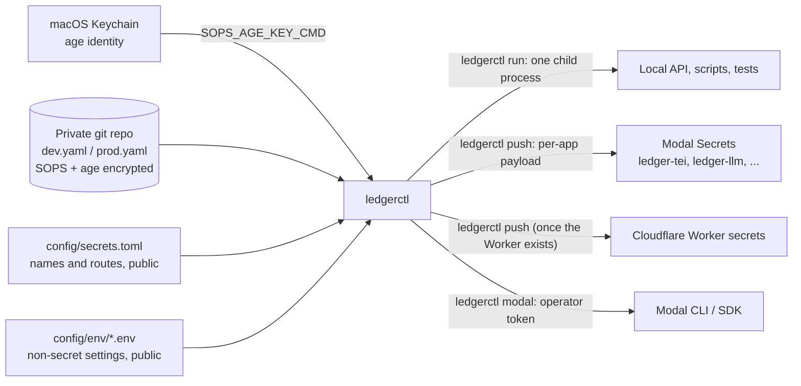

# Secrets and configuration

Ledger keeps **one encrypted source of truth** for every credential and gives each
runtime only the keys it needs. One command, `ledgerctl`, stores values, **injects**
them into a local process and **pushes** them to runtime secret stores. Nothing
secret is committed to this public repository, baked into images or printed.



| Piece | Where | Holds |
|---|---|---|
| Age identity | macOS login Keychain item `ledger-sops-age` | The only key that decrypts the store |
| Encrypted store | Private repo, default `~/.config/ledger/secrets` (`LEDGER_SECRETS_HOME`) | `dev.yaml`, `prod.yaml`: key names readable, values encrypted |
| [Secret manifest](../config/secrets.toml) | This repo | Every secret's name, environments, generator and delivery targets |
| [Profiles](../config/env/) | This repo | Non-secret `LEDGER_*` settings per environment |
| `ledgerctl` | `uv run ledgerctl`, or on PATH after `ledgerctl install` | The only supported way to read, change, inject and push values |

The decision, the alternatives considered (Vault, Doppler, Infisical, GCP and AWS
secret managers, registries) and what this design does not provide are recorded in
[ADR 0005](adr/0005-sops-age-secrets.md).

## Commands

| Command | What it does |
|---|---|
| `ledgerctl init` | First-time setup, safe to re-run: identity in the Keychain, encrypted store, internal keys; lists what is still missing |
| `ledgerctl status` | Per environment: `set`, `MISSING`, `optional`, `const`; and whether each runtime has the current revision |
| `ledgerctl set NAME` | Hidden prompt (or `--stdin`); writes every environment the manifest declares unless `--env` narrows it; commits to the store |
| `ledgerctl unset NAME` | Removes a value |
| `ledgerctl rotate [NAME ...]` | Regenerates internal credentials (all generated ones by default) |
| `ledgerctl run [--env dev] -- CMD` | **Inject**: runs one command with that environment's settings and secrets |
| `ledgerctl push ENV [--target NAME] [--dry-run]` | **Push**: replaces each runtime secret store (Modal Secrets) with its routed payload; repeat `--target` (e.g. `modal-tei`) to push only those manifest targets ([push](../tools/ledgerctl/src/ledgerctl/cli.py#L236-L268)) |
| `ledgerctl modal -- ARGS` | Modal CLI with the project token and environment, for that command only |
| `ledgerctl key public \| backup PATH` | Shows the public key, or writes the identity once to offline storage |
| `ledgerctl install` | Puts `ledgerctl` on PATH (`~/.local/bin`) bound to this checkout and its lockfile |

## First-time setup on a workstation

```bash
brew install sops age
uv run ledgerctl install                          # afterwards just `ledgerctl`
ledgerctl init
ledgerctl key backup /Volumes/<USB>/ledger-age.txt  # once, offline
```

Add provider and platform credentials (each is a hidden prompt):

```bash
ledgerctl set MODAL_TOKEN_ID          # Modal dashboard: Settings -> API Tokens
ledgerctl set MODAL_TOKEN_SECRET
ledgerctl set LEDGER_GEMINI_API_KEY
ledgerctl set LEDGER_QDRANT_URL
ledgerctl set LEDGER_QDRANT_API_KEY
ledgerctl set LEDGER_FRED_API_KEY
ledgerctl set LEDGER_ELEVENLABS_API_KEY
ledgerctl status
```

Obtain values from provider consoles or a password manager; never paste them into
chat, tickets or shell arguments. Push the store to its private remote after
changes: `git -C ~/.config/ledger/secrets push`.

## Daily use

```bash
ledgerctl run -- uv run uvicorn ledger_rag.api.app:app --port 8080 --no-access-log
ledgerctl modal -- app list
ledgerctl push dev --dry-run          # names only, nothing sent
ledgerctl push dev
```

`ledgerctl run` sets variables for the child process only, replacing itself with
that process (`exec`), so signals and exit codes pass straight through. It merges,
in order: your shell environment, the profile, then the secrets routed to the
`local` target. Missing required values produce a warning, never a silent
default. Platform tokens (`operator` target) are added only with `--operator` or
by `ledgerctl modal`, and the manifest refuses any route that would deliver them
to a runtime.

### Why the Keychain is used through `security`

The identity is written with `security -i` reading commands from stdin (never
argv or disk) and read by SOPS through `SOPS_AGE_KEY_CMD`. Python's `keyring`
library was considered: it would bind the Keychain item's access list to the
Python interpreter, so every interpreter upgrade or separate tool environment
raises a GUI permission dialog that blocks non-interactive runs. The `security`
tool ships with macOS and needs no extra dependency.

## Delivery and runtime contract

- Each Modal app attaches only the Modal Secrets it needs (`ledger-tei`,
  `ledger-ingestion`, `ledger-llm`, `ledger-llm-serve`, `ledger-voice`). A push **replaces** each
  Secret's contents, so a key removed from the manifest is removed remotely too.
  Replacement deletes then recreates the Secret: avoid starting containers during
  a push.
- Every delivered payload carries the non-secret `LEDGER_SECRETS_REVISION`, a
  12-character hash of the encrypted file. `ledgerctl status` compares it with
  what each target last received and marks stale targets.
- Running containers keep the values they started with. After a rotation, push
  and then redeploy or restart the affected apps.
- The API reads settings from `LEDGER_*` environment variables only. The former
  `LEDGER_SECRETS_DIR` secret-file mechanism now fails at startup on purpose.
- Cloudflare delivery (`wrangler secret bulk` via stdin, stale keys deleted) is
  implemented but has no target until the Cloudflare Worker exists.

## Adding a secret

1. Declare it in [`config/secrets.toml`](../config/secrets.toml): description,
   environments, `deliver` routes (renaming per runtime where code expects another
   variable name), and `required`/`generate` as appropriate.
2. Read it in code from the environment variable named by its route.
3. `ledgerctl set NAME` (or `ledgerctl rotate NAME` for a generated key), then
   `ledgerctl push <env>`.

Non-secret settings belong in `config/env/<env>.env`; the loader rejects names that
look secret (`*_API_KEY`, `*_TOKEN`, `*_SECRET`, `*_PASSWORD`).

## CI and other machines

On a machine without the Keychain, provide the identity through
`SOPS_AGE_KEY_FILE`, `SOPS_AGE_KEY` or `SOPS_AGE_KEY_CMD`; these take precedence over
the Keychain. Give CI its own age identity as an additional recipient (edit
`.sops.yaml` in the store and run `sops updatekeys` on each file) so it can be
revoked independently. A runner that only deploys should receive only the Modal or
Cloudflare token it uses, not the whole store.

## Rotation and incident response

- **Provider key exposed:** revoke it at the provider first, then
  `ledgerctl set NAME`, `ledgerctl push <env>` and redeploy.
- **Internal key exposed:** `ledgerctl rotate NAME`, push, redeploy.
- **Age identity exposed:** treat every value in every revision of the store as
  public. Rotate all provider credentials, generate a new identity, add it to
  `.sops.yaml`, run `sops updatekeys` on each file, remove the old recipient and
  re-encrypt (`sops rotate -i`).
- **Age identity lost:** the encrypted history is unreadable. Restore the identity
  from the offline backup (`security add-generic-password -a "$USER" -s
  ledger-sops-age -w` prompts for it), or re-enter every credential.

## Security properties and limits

- Values exist in plaintext only in the memory of `ledgerctl` and its child
  processes and in the runtime stores (Modal, Cloudflare), which encrypt them at
  rest. They never appear in argv, temporary files, logs or this repository.
- `sops set --value-stdin` re-encrypts a single value under the file's data key,
  so git diffs in the store show which key changed without revealing values.
- Git history is the change audit trail (who changed which key, when). There is no
  read audit: reads happen locally. Modal and Cloudflare record deployments.
- Runtimes hold delivered copies; access is not keyless. Keyless workload identity
  would require a cloud IAM (AWS/GCP/Azure) or a paid secrets-manager tier, which
  [ADR 0005](adr/0005-sops-age-secrets.md) judged not worth the extra platform.
- The Keychain item is readable by processes running as your macOS user through
  the `security` tool, like an SSH key on disk. Protect the user session; keep the
  offline backup offline.
