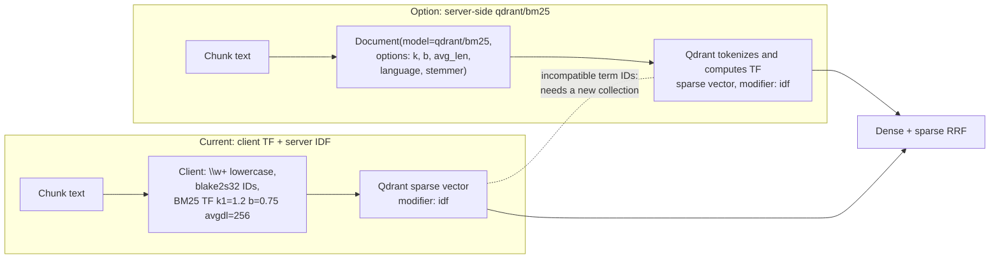

# ADR 0001: Keep hashed client-side BM25 TF with Qdrant's native IDF modifier

- Status: accepted (research only; no collection was changed)
- Date: 2026-10-31
- Context: ruthless review item 25. The servers are Qdrant 1.20.0 (Cloud and compose),
  with qdrant-client 1.20.0.

## Question

Can Qdrant 1.15+ compute BM25 and IDF server-side? If so, can the current hashed
sparse scheme use it?

## Findings

1. **The IDF modifier is already native and already used.** Sparse vectors
   configured with `SparseVectorParams(modifier=Modifier.IDF)` ("idf") make Qdrant
   apply corpus inverse document frequency at query time. Qdrant keeps that IDF
   current as points change. `QdrantRetriever` creates the `sparse` vector with
   this modifier and `ready()` rejects collections without it, so no work remains here.
2. **IDF works with hashed indices.** Qdrant treats each sparse dimension as an
   opaque term ID and counts the documents that contain it. Our IDs are
   `blake2s(term)[:4]` (32-bit). Collisions are rare, merge two terms' document
   frequency, and are covered by the `sparse_model` identity string in collection
   metadata.
3. **Server-side BM25 term-frequency inference exists from 1.15.2** (qdrant#6891,
   "Implement BM25 inference in Qdrant locally"). You upsert and query a
   `Document(text=..., model="qdrant/bm25", options=Bm25Config(...))` and Qdrant
   tokenizes the text and computes saturated TF, with `k`, `b`, `avg_len`,
   tokenizer, language, stopwords, stemmer and token-length options. It still
   relies on `modifier: idf` for IDF. Note that `avg_len` is a configured constant
   (default 256), like our `avgdl=256`, not a value measured from the corpus.
4. **The two schemes are not index-compatible.** Server-side BM25 uses its own
   tokenizer, stemming and stopwords and its own term-ID hashing. Our scheme uses
   `\w+`, lowercase, no stemming and blake2s32 IDs. Their sparse vectors live in
   different term spaces: mixing them in one collection silently corrupts
   ranking. Switching therefore needs re-ingestion into a **new** collection and a
   new `sparse_model` identity. Existing collections are rejected, not migrated.
5. The 1.20 API also exposes full-text-index BM25 scoring (`Bm25Scoring`) for
   text queries. It is a separate retrieval path, not a sparse vector, and cannot
   take part in today's dense+sparse RRF prefetch without a query redesign.

## Decision

Keep the current scheme. It already gets native IDF. Moving TF computation to the
server gives only stemming/stopwords and less client code. In exchange it costs
a full re-ingestion and couples ranking to server-side tokenizer versions. It also
needs an evaluation gate before any promotion. The live collection
`finqa_gte_modernbert_v1` is untouched.

## Consequences and follow-up

- If an experiment is wanted, ingest a **staged** collection with
  `Document(model="qdrant/bm25")` sparse vectors (`language="english"`, `avg_len`
  set to the measured mean chunk token length). Identify it with a new
  `sparse_model`, e.g. `qdrant-bm25-<server-version>-<options-hash>`. Compare
  it against the current collection with the FinQA retrieval ablation
  ([evaluation](../EVALUATION.md)) and promote only on a measured improvement.
- A cheaper improvement in the current scheme: replace the fixed `avgdl=256` with a
  measured corpus value recorded in the `sparse_model` identity. This also needs a
  new collection, because stored TF weights would change.
