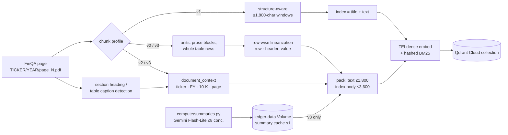
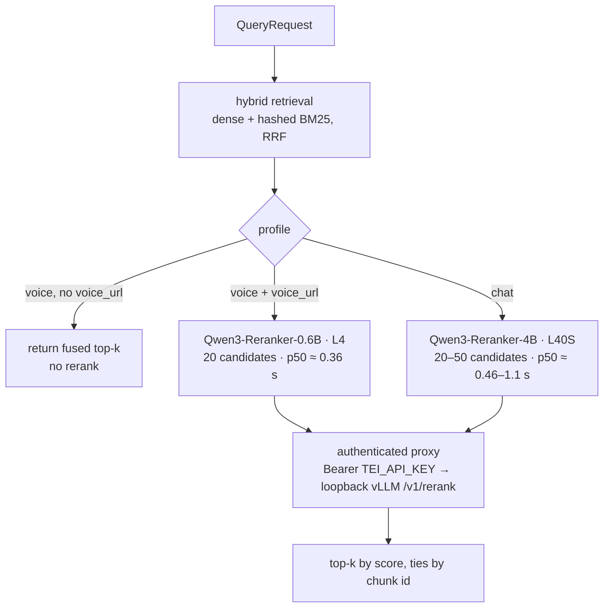

# ADR 0002: Versioned chunk profiles and Qwen3 rerankers

- Status: accepted for A/B evaluation. No profile or reranker is promoted yet.
- Date: 2026-10-31 (revised the same day after code review; see
  [Revision after code review](#revision-after-code-review))
- Context: retrieval workstream. Scope: [chunking](../../src/ledger_rag/ingestion/chunking.py),
  [document context](../../src/ledger_rag/ingestion/context.py),
  [Modal ingestion](../../compute/ingestion.py), [summaries](../../compute/summaries.py),
  [vLLM reranker app](../../compute/reranker.py) and its
  [client](../../src/ledger_rag/retrieval/vllm_reranker.py).

## Context

In financial RAG, retrieval is the dominant failure mode. FinanceBench falls from 85%
with oracle evidence to 19% with a shared vector store. The FinQA corpus is 2,789
10-K pages, each with prose, a pipe-Markdown table and more prose. Two weaknesses
in the v1 index motivate this change:

1. **Missing filing context.** A v1 chunk is embedded as `"{title}\n{text}"`. The
   title (`"ADI annual report 2009, page 49"`) names a ticker and year but not the form,
   section or table caption. Many chunks are tables whose numbers mean nothing
   without that context.
2. **Pipe-only tables (review item 5).** Dense and sparse models see
   `| 2009 | 2008 |` rows. A value is separated from its column header by every
   other cell in the row, and from the header row by every other row.

Snowflake's finance study found that cheap document-level headers beat per-chunk
LLM context, and that chunks of about 1,800 characters worked best. This decision
therefore builds deterministic headers first and makes the LLM summary optional.

## Decision

### Versioned chunk profiles

`chunk_document(..., profile=...)` and `modal run compute/ingestion.py --chunk-profile`
select one of three profiles:

| Profile | Displayed/cited `text` | Indexed text (dense, sparse and rerank) | Chunk IDs |
|---|---|---|---|
| `v1` (default) | ≤1,800-char structure-aware windows | `"{title}\n{text}"`, byte-identical to before | unchanged |
| `v2` | Same budget, units are prose blocks or whole table rows | header + prose + **row-wise table linearization** (≤3,600 chars) | new namespace (profile + index digest) |
| `v3` | as v2 | v2 + one `Summary:` line from a cached per-document LLM summary | new namespace |

Display text and indexed text are kept separate in a new optional field,
`Chunk.index_text`. `contextual_text(chunk)` returns `index_text` when it is set and
the v1 string otherwise. The Qdrant writer, the sparse encoder and both reranker
clients all call `contextual_text`, so v2/v3 change only the indexed
representation. Citations still show the original Markdown table. The field
round-trips through the Qdrant payload, so a v1 collection stays valid and is
readable without changes.

**v1 is frozen.** It was verified byte-identical against the previous chunker over
the full FinQA corpus (8,611 chunks). A golden digest test (`test_chunk_profiles.py`)
keeps it that way.

### Deterministic document header (v2/v3)

```text
Filing: AMT Form 10-K, fiscal year 2012, page 118
Section: Notes to Consolidated Financial Statements
Table: <nearest caption before the table, ≤240 chars>
Summary: <≤600 chars, v3 only>

<body>
```

- **Company:** the ticker only. FinQA carries no ticker→name mapping. A heuristic
  extracted from page text covered 39 of 137 tickers and was wrong for some
  (for example, HWM was resolved to its predecessor names), so company names are
  never invented.
- **Fiscal year and form:** from the FinQA path `TICKER/YEAR/page_N.pdf`. `Form 10-K`
  is asserted only for IDs that match that pattern. Other documents get
  `Document: <title>`.
- **Section:** the last canonical 10-K heading found in the text up to and including
  the chunk (Items 1–9A, Notes, MD&A, Market Risk, Selected Financial Data, auditor's
  report). A generic match nested inside a more specific Item match is ignored.
  The document is scanned once (`SectionHeadings`); each chunk rescans only a bounded
  window plus its own text, so cost is linear in document size.
- **Table caption:** the last sentence with a letter or digit in the prose before the
  table, when it reads like a caption or unit line. Punctuation-only sentences, such
  as FinQA's stray trailing `" ."`, are skipped.
- Over FinQA, 3,006 chunks get a section and 1,937 chunks (on 1,923 pages) get a table
  caption. A line is omitted rather than guessed when nothing is found.

### Table linearization (v2/v3)

Each table cell becomes one line:

```text
<row label> | <column header>: <value>
```

Example: `cash and cash equivalents | 2009: $ 1,234`.

Each table unit (and each continuation) starts with a header block:

- `Units: <top-left cell>` when that cell names units (`$ in millions`,
  `( in millions )`), otherwise `Rows: <top-left cell>` (a row dimension such as
  `december 31`). The line is dropped when the chunk's rendered `Table:` caption
  already contains the cell, and omitted when the cell is empty.
- `Column: <header>` for a column header that row lines would not carry in full:
  it is clipped, or no row has a value under it.

Then:

- Labels are clipped to 160 characters in value lines; a clipped row label is
  emitted once in full.
- A value is never split from its header, and a row is never split across chunks.
- Headerless (single-row) FinQA tables are linearized as data.
- Packing is greedy within bounds: display `text` ≤1,800 characters and indexed body
  ≤3,600 characters.
- If one row's linearization exceeds the index budget, it is emitted as several
  index chunks that share the same display text.
- If the header is longer than half the budget, or a single row exceeds 1,800
  display characters, the section falls back to v1-style windows.
- Output and IDs are deterministic.
- FinQA v2 statistics: 8,647 chunks (v1: 8,611). Indexed text has a mean of
  ~1,531 characters, p99 3,107 and max 3,920 (header included). Every non-empty
  FinQA table cell appears in its page's combined index text.

**Known side effect:** the sparse encoder normalizes length against a fixed
`avgdl=256` tokens, so longer v2 index text lowers per-term BM25 weights relative
to v1. This affects both arms of a v1/v2 comparison in the same way, but absolute
sparse scores across profiles are not comparable.

### Optional v3 summaries

[`compute/summaries.py`](../../compute/summaries.py) runs on a CPU Modal container:

- **Model:** `gemini-3.5-flash-lite`, through the OpenAI-compatible `ledger-llm`
  secret.
- **Concurrency:** at most 8 requests at a time. HTTP 408/409/425/429/5xx and
  transport errors are retried with jittered exponential backoff.
- **Cache:** written atomically to the `ledger-data` Volume at
  `/data/summaries/s1/<model>/<hash[:2]>/<sha256(title, text)>.json`.

`--chunk-profile v3` reads only the cache and fails if any document lacks a
summary, so ingestion never calls the LLM. Failure reports contain reason
categories, never document text.

### Indexing pipeline per profile



### Embedding candidates

| Model | Revision | Dims | Pooling / query prompt | License | Status |
|---|---|---|---|---|---|
| `Alibaba-NLP/gte-modernbert-base` | `e7f32e3c00f91d699e8c43b53106206bcc72bb22` | 768 | CLS, no prefix | Apache-2.0 | baseline |
| `Qwen/Qwen3-Embedding-0.6B` | `97b0c614be4d77ee51c0cef4e5f07c00f9eb65b3` | 1024 | last token (TEI reads `1_Pooling`), normalized; query prefix below, documents unprefixed | Apache-2.0 | candidate |

The Qwen3 query prefix (`LEDGER_EMBEDDING_QUERY_PREFIX` / eval `--query-prefix`) is
the model card's default instruction:

```text
Instruct: Given a web search query, retrieve relevant passages that answer the query\nQuery:
```

TEI 1.8 supports Qwen3 natively (its release notes list "Qwen3 support" and
FlashQwen3 on CUDA). The ingestion ran on `text-embeddings-inference:89-1.8`.

Excluded for license reasons (non-commercial): jina-reranker-v3, NV-Embed-v2 and
Jina-v4.

### Reranker candidates and serving

| Model | Revision | GPU | Serving |
|---|---|---|---|
| `Alibaba-NLP/gte-reranker-modernbert-base` | as deployed | TEI | existing `RerankingRetriever` |
| `Qwen/Qwen3-Reranker-0.6B` | `e61197ed45024b0ed8a2d74b80b4d909f1255473` | L4 | vLLM 0.32.0 |
| `Qwen/Qwen3-Reranker-4B` | `22e683669bc0f0bd69640a1354a6d0aebcfeede5` | L40S | vLLM 0.32.0 |

All three are Apache-2.0. [`compute/reranker.py`](../../compute/reranker.py) follows the
documented vLLM recipe:

- **Model conversion:** `--runner pooling` with
  `--hf-overrides '{"architectures":["Qwen3ForSequenceClassification"],"classifier_from_token":["no","yes"],"is_original_qwen3_reranker":true}'`.
- **Prompt template:** `--chat-template compute/qwen3_reranker.jinja`, copied verbatim
  from vLLM v0.32.0 `examples/pooling/score/template`. It renders the model card's
  system / `<Instruct>` / `<Query>` / `<Document>` format.
- **Instruction:** finance-specific by default ("Given a question about a company's SEC
  filing, retrieve the filing passage or table that contains the facts needed to
  answer it"). Callers can override it.

**Security.** vLLM's non-`/v1` rerank routes ignore `--api-key`, so vLLM binds to
`127.0.0.1` only. A FastAPI proxy in the same container:

- enforces `Authorization: Bearer $TEI_API_KEY` from the `ledger-tei` secret, compared
  in constant time;
- bounds requests (≤100 texts, query ≤4,000 characters, text ≤32,000 characters);
- exposes a **TEI-compatible** `POST /rerank` that returns `[{"index","score"}]`.

Because the wire format matches TEI, the existing `RerankingRetriever` and the eval
harness `--reranker-url` work against it unchanged. `VllmRerankingRetriever` adds
the instruction and voice/chat routing. Containers use `min_containers=0` and
`scaledown_window=300`.

### Measured reranker latency

Measurement setup:

- **Date:** 2026-10-31, Modal `us-east`, vLLM 0.32.0, bf16, `max_model_len=8192`.
- **Workload:** 400 FinQA v1 chunks of 1,650–1,800 display characters (mean
  contextual text 1,764 characters) and FinQA test questions.
- **Method:** 30 measured requests per cell after 3 warm-up requests, sequential, from
  a CPU Modal function in the same region.
- **Client** = HTTPS round trip through the Modal web endpoint. **Upstream** = time
  inside the proxy waiting for vLLM.

| Model (GPU) | Candidates | Client p50 | Client p95 | Upstream p50 | Upstream p95 |
|---|---:|---:|---:|---:|---:|
| Qwen3-Reranker-0.6B (L4) | 20 | 362 ms | 386 ms | 279 ms | 306 ms |
| Qwen3-Reranker-0.6B (L4) | 50 | 793 ms | 844 ms | 705 ms | 741 ms |
| Qwen3-Reranker-4B (L40S) | 20 | 459 ms | 504 ms | 403 ms | 452 ms |
| Qwen3-Reranker-4B (L40S) | 50 | 1,109 ms | 1,153 ms | 1,022 ms | 1,069 ms |

- **Cold start**, measured as the first request including vLLM startup: 0.6B took
  260 s with an empty cache (weights download plus `torch.compile`) and 115 s with a
  warm `ledger-hf-cache` volume; 4B took 125 s.
- Modal answers requests still pending after about 150 s with `303` redirects. The
  bench client follows them, but the existing `RerankingRetriever` does not
  (`follow_redirects=False`). Warm an endpoint before using it from that client.
- Unauthenticated requests returned `401`.
- **Smoke test only, not a quality result:** on 40 FinQA test questions, the first
  chunk of the gold page was placed against 19 chunks from other pages. 0.6B ranked
  it first 77.5% of the time (MRR 0.844); chance is 5%. This confirms the
  classifier conversion and template are wired correctly.

### Query-time routing

Voice already bypasses the TEI reranker. Its budget is spent on the first token,
and a 20-candidate rerank costs about 0.36 s even with the 0.6B model on a warm
L4. The proposed default is therefore:

- **Voice:** no reranker, or 0.6B on 20 candidates if the A/B shows a large
  quality gain.
- **Chat:** 4B on 20–50 candidates.

`VllmRerankingRetriever(inner, settings, voice_url=...)` implements this routing:

- `settings.reranker_url` serves chat. The optional voice endpoint comes from
  `voice_url` or `LEDGER_RERANKER_VOICE_URL` (`settings.reranker_voice_url`).
- An empty URL disables reranking for that profile: the inner retriever's results
  are returned unchanged. This matches the TEI wrapper, which `make_retriever` does
  not install when `reranker_url` is empty.
- Both endpoints receive the same bearer key. Both are validated like other service
  endpoints, and both must use HTTPS in production (checked by `Settings` at startup
  and by the client for an explicit `voice_url`).



## Collections built

All use FinQA dataset commit `0f16e2867befa6840783e58be38c9efb9229d742`, corpus
SHA-256 `9b455b1b…ae9d`, 2,789 documents, TEI image
`ghcr.io/huggingface/text-embeddings-inference:89-1.8`, float16 and no quantization.
Reports are on the `ledger-data` Volume at `/data/ingestion/<run_id>.json`.

| Collection | Profile | Embedding | Run ID | Chunks | Ingest s |
|---|---|---|---|---:|---:|
| `finqa_gte_modernbert_v1` (existing, untouched) | v1 | gte-modernbert-base 768-d | `adb0f1a36082405b8497e2c39d15bfe3` | 8,611 | 162 |
| `finqa_gte_modernbert_v2ctx` | v2 | gte-modernbert-base 768-d | `701b26b2f7b842f18877e3f2cc2a0aec` | 8,644 | 762 |
| `finqa_qwen3emb_v2ctx` | v2 | Qwen3-Embedding-0.6B 1024-d | `a38277a6839d47f292dd28c751362d58` | 8,644 | 281 |

The `embedding_space_id` values are
`tei-1.8-float16:Alibaba-NLP/gte-modernbert-base@e7f32e3c00f91d699e8c43b53106206bcc72bb22`
and `tei-1.8-float16:Qwen/Qwen3-Embedding-0.6B@97b0c614be4d77ee51c0cef4e5f07c00f9eb65b3`.

The gte v2 run had the same 69 batches as v1 but took 4.7× longer. Per-request
TEI inference stayed around 80 ms, and the later Qwen3 run of the same chunks took
281 s, so the slowdown is attributed to Qdrant Cloud write latency during that
window. It has not been investigated further.

## A/B plan (eval workstream)

This ADR makes **no quality claim**. The FinQA harness
(`ledger_rag.evaluation.benchmarks.finqa`) should run the following arms on Modal,
using the same questions, seed and page-level relevance:

| Arm | Collection | Embedding / query prefix | Reranker |
|---|---|---|---|
| A0 (baseline) | `finqa_gte_modernbert_v1` | gte, none | none / TEI gte-reranker |
| A1 | `finqa_gte_modernbert_v2ctx` | gte, none | none / TEI gte-reranker |
| A2 | `finqa_qwen3emb_v2ctx` | Qwen3-0.6B, Qwen3 prefix above | none / TEI gte-reranker |
| R1 | best of A0–A2 | — | Qwen3-Reranker-0.6B, 20 candidates |
| R2 | best of A0–A2 | — | Qwen3-Reranker-4B, 20 and 50 candidates |

- **Configurations:** run `sparse`, `dense`, `hybrid` and `hybrid:rerank` for A0–A2,
  under both `company` and `global` scopes. Global scope is the FinanceBench-style
  shared-store setting that matters most.
- **Metrics:** `page_hit@{1,3,5,10}`, `page_mrr@10` and `evidence_recall@{3,5}`,
  plus reranker p50/p95 from the harness.
- **Promotion rule:** promote a profile only if hybrid `page_hit@5` improves in
  global scope with non-overlapping bootstrap CIs (the harness's `summarize`),
  without regression in company scope. For voice, promote a reranker only if its
  gain justifies the measured latency above.
- **Comparability:** chunk IDs differ between profiles, but relevance is page-level
  (`document_id`), so metrics are comparable. `evidence_recall` matches gold units
  against display `text`. All 1,903 test gold units are contained verbatim in some
  chunk under both v1 and v2, so that metric is also comparable.
- **v3 arm (optional):** `finqa_gte_modernbert_v3ctx` is built only if v2 shows a
  gain. The summary cache is already populated; see [ingestion](../INGESTION.md).

Harness wiring:

- **Qwen3 query embedding:** deploy [inference](../../compute/inference.py) with
  `LEDGER_EMBED_MODEL=Qwen/Qwen3-Embedding-0.6B` and the pinned revision. Pass
  `--embedding-model`, `--embedding-dimensions 1024`, `--embedding-space-id`
  and `--query-prefix`.
- **Qwen3 rerankers:** `modal deploy compute/reranker.py`, then pass the class web URL
  as `--reranker-url`, with `LEDGER_RERANKER_API_KEY` set to the `ledger-tei` key.
  The default finance instruction is applied server-side.

## Revision after code review

A review of the first version found four defects. All are fixed, and v2 output is
deterministic again under the new rules. Numbers are measured on the full FinQA
corpus (2,789 pages) unless noted.

| Finding | Before | After |
|---|---|---|
| Section heading detection was O(chunks × document length) | 676 KB synthetic document: 30.0 s (v1: 0.009 s) | 0.34 s; FinQA v2 output byte-identical to before the change |
| Linearization dropped the top-left header cell | 956 non-empty cells missing from index text in 951 tables (946 top-left) | 0 missing |
| A trailing `" ."` sentence hid table captions | 1,746 pages (1,759 chunks) with a caption | 1,923 pages (1,936 chunks; 1,937 with the table fix) |
| Voice reranker URL not scheme-checked, empty chat URL posted to `/rerank` | misconfiguration failed per request | HTTPS required in production at startup; empty URL bypasses reranking |

A 1,000-filing JSONL ingest under v2 would have exceeded the one-hour Modal timeout
from heading detection alone. The two v2 collections built before the fix indexed
the defective text and were rebuilt (see [Collections built](#collections-built)).

## Consequences and follow-up

- **New behavior is opt-in.** v1 remains the default and no existing collection
  changes. Selecting v2/v3 requires a new collection.
- **Larger index payload.** v2 payloads carry both display and index text, so they
  are about 2× larger.
- **Not yet production-ready.** The reranker app is a separate scale-to-zero service
  with a 2–4 minute cold start. Production voice use would need warm capacity (a
  cost decision) and redirect handling in the client.
