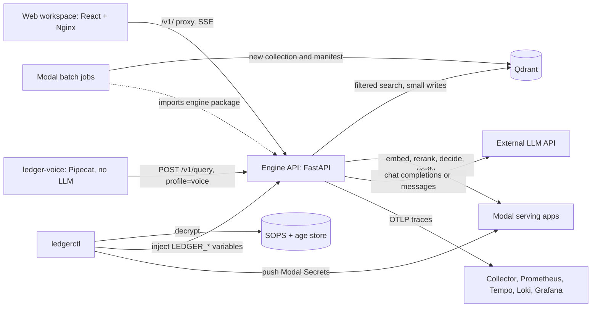

# Which units make up Ledger RAG, and how do they connect?

## Question and scope

This page lists the deployable and installable units and their runtime connections.
It excludes classes and modules. The [engine README](../../services/engine/README.md) lists engine packages.

## Summary

The engine is one FastAPI modular monolith that every channel calls over HTTP.
The web workspace and the voice service are clients of its public contract.
Modal hosts GPU endpoints and batch jobs, and `ledgerctl` delivers secrets to every runtime.

## Container diagram

Text equivalent: the web workspace and `ledger-voice` call the engine over HTTP.
The engine searches Qdrant, calls Modal serving apps and an external LLM, and exports traces.
Modal batch jobs reuse engine code and write new Qdrant collections.
`ledgerctl` decrypts the secret store, injects local variables and pushes Modal Secrets.

## Units

| Unit | Responsibility | Technology | Owner | Interface | Source |
|---|---|---|---|---|---|
| Engine API (`ledger-rag`) | Authorize, retrieve, generate, validate and abstain for every channel | Python 3.11+, FastAPI, LangGraph, qdrant-client | unknown | `/v1/query`, `/v1/query/stream`, `/v1/documents`, `/health/*`, `/metrics`, `/mcp`; [CHAT_API.md](../CHAT_API.md) | [app.py](../../services/engine/src/ledger_rag/api/app.py) |
| In-process voice gateway | Transitional PCM and Twilio WebSocket gateway inside the engine, off by default | Engine code, `LEDGER_VOICE_ENABLED` | unknown | `/v1/voice/twilio`, `/v1/voice/stream` | [transport.py](../../services/engine/src/ledger_rag/voice/transport.py) |
| Web workspace | Show answers, sources, artifacts and live activity | React 19, TypeScript, Vite, zod, Nginx | unknown | Calls `/v1/query/stream`; Nginx proxies `/v1/` | [api.ts](../../services/web/src/api.ts), [nginx.conf](../../services/web/nginx.conf) |
| `ledger-voice` | Take Twilio calls and speak only validated answers or fixed phrases | Python, FastAPI, Pipecat 1.14.0, ElevenLabs | unknown | `/twilio/voice`, media WebSocket; calls `/v1/query` | [app.py](../../services/voice/src/ledger_voice/app.py), [ADR 0006](../adr/0006-voice-channel-service.md) |
| Modal serving apps | Host embeddings, rerankers, a Qwen LLM, Laya decisions and a groundedness verifier | Modal, TEI, vLLM | unknown | Bearer-authenticated HTTPS endpoints | [compute README](../../compute/README.md) |
| Modal batch jobs | Build indexes, run evaluations, cache summaries and train embeddings | Modal GPU functions | unknown | `modal run` through `ledgerctl modal` | [ingestion.py](../../compute/ingestion.py), [INGESTION.md](../INGESTION.md) |
| `ledgerctl` | Store, inject and push secrets by a routing manifest | Python standard library, SOPS, age | unknown | CLI | [cli.py](../../tools/ledgerctl/src/ledgerctl/cli.py), [secrets.toml](../../config/secrets.toml), [SECRETS.md](../SECRETS.md) |
| Qdrant | Persist chunks with dense and sparse vectors and access payloads | Qdrant 1.20.0 in Compose; managed cluster otherwise | unknown | Qdrant HTTP API | [qdrant.py](../../services/engine/src/ledger_rag/retrieval/qdrant.py), [compose.yaml](../../compose.yaml) |
| Observability stack | Receive traces and serve metrics, logs and dashboards | OpenTelemetry Collector, Prometheus, Tempo, Loki, Grafana | unknown | OTLP; Prometheus scrapes the Collector | [deploy/observability](../../deploy/observability/), [OPERATIONS.md](../OPERATIONS.md#observability-data-flow) |

`contracts/` is a generated artifact, not a running unit ([contracts README](../../contracts/README.md)).

## Dependency rules

- `voice` and `web` use the engine only through its HTTP contract ([README](../../README.md#repository-layout)).
- `compute` imports engine code so batch builds match serving.
- `ledgerctl` depends on nothing else in the repository.
- The engine keeps the synchronous request path in one process ([ARCHITECTURE.md](../ARCHITECTURE.md#1-current-system-boundaries)).

## Deployment status

| Unit | Status | Evidence |
|---|---|---|
| Engine | Runs locally and in Compose; production runtime is being defined | [OPERATIONS.md](../OPERATIONS.md#production-status) |
| `ledger-voice` | Implemented; not deployed or measured with live calls | [modal_app.py](../../services/voice/modal_app.py), [ADR 0006](../adr/0006-voice-channel-service.md) |
| Modal serving and jobs | Ephemeral measured runs exist; no production warm tier | [ARCHITECTURE.md](../ARCHITECTURE.md#1-current-system-boundaries), [EVALUATION.md](../EVALUATION.md) |
| Observability stack | Reference configuration; no dashboards or alert rules; no log shipper | [ARCHITECTURE.md](../ARCHITECTURE.md#5-identity-secrets-and-operations) |

## Failure and tradeoffs

- The rate limiter, admission slots and write coordination are per process.
  More engine replicas need shared quotas and durable coordination ([release gates](../ARCHITECTURE.md#6-release-and-scaling-constraints)).
- `POST /v1/documents` shares query capacity and can block queries during replacement.

## Evidence and gaps

- **Implementation observed** at commit `c640576` from manifests, entry points and READMEs.
- **Unknown:** unit owners, production hosting for the engine and web, and Qdrant hosting details.

## Related pages

- Next: [chat query journey](runtime/chat-query-stream.md).
- Back: [system context](context.md).
