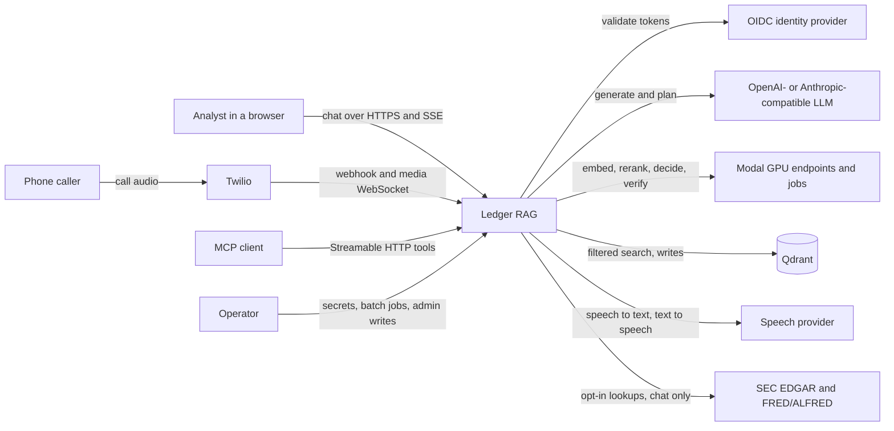

# Who uses Ledger RAG, and which external systems does it depend on?

## Question and scope

This page shows the system boundary: people, client programs and external services.
It excludes internal units. See [deployable units](containers.md).

## Summary

Ledger RAG answers financial-disclosure questions from authorized evidence for chat, phone and MCP clients.
It depends on an identity provider, model endpoints, a vector store and optional speech and public-data services.
No production deployment exists yet ([operations](../OPERATIONS.md#production-status)).

## Context diagram

Text equivalent: analysts, callers through Twilio, MCP clients and operators reach Ledger RAG.
Ledger RAG validates tokens with an OIDC provider and calls an LLM and Modal-hosted model endpoints.
It searches Qdrant and calls speech and public-data services when those features are enabled.

## Actors

| Actor | Goal | Interface | Evidence |
|---|---|---|---|
| Analyst | Ask cited questions about disclosures | Web workspace, `POST /v1/query/stream` | [CHAT_WORKSPACE.md](../CHAT_WORKSPACE.md), [api.ts](../../services/web/src/api.ts#L57-L75) |
| Phone caller | Ask a short question and hear a validated answer | Twilio number to `ledger-voice` | [ADR 0006](../adr/0006-voice-channel-service.md), [voice README](../../services/voice/README.md) |
| MCP client | Call read-only query and evidence tools | `/mcp`, opt-in with `LEDGER_MCP_ENABLED` | [MCP.md](../MCP.md) |
| Operator | Manage secrets, run Modal jobs and change documents | `ledgerctl`, Modal CLI, admin routes | [SECRETS.md](../SECRETS.md), [INGESTION.md](../INGESTION.md), [app.py](../../services/engine/src/ledger_rag/api/app.py#L230-L292) |

## External systems

| System | Use | Failure rule | Evidence |
|---|---|---|---|
| OIDC identity provider | Signs tokens with `tenant_id`, roles and groups | Unreachable JWKS returns 503 | [auth.py](../../services/engine/src/ledger_rag/security/auth.py#L20-L91) |
| LLM provider | Answers, rewrites and optional decomposition | Answer errors fail the request; rewrite and decomposition fall back with a logged event | [providers.py](../../services/engine/src/ledger_rag/generation/providers.py) |
| Modal endpoints | TEI embeddings and reranker, Qwen LLM, Laya decisions, LettuceDetect verifier | Embedding and reranker errors fail the request | [compute README](../../compute/README.md) |
| Modal batch jobs | GPU chunking, embedding and Qdrant upload; evaluation; training | Paid runs need explicit authorization | [INGESTION.md](../INGESTION.md), [AGENTS.md](../../AGENTS.md) |
| Qdrant | Dense and sparse vectors with tenant, group and date payloads | Readiness fails; queries fail | [qdrant.py](../../services/engine/src/ledger_rag/retrieval/qdrant.py) |
| Twilio | Webhook and Media Streams for calls | Not verified with live calls | [ADR 0006](../adr/0006-voice-channel-service.md) |
| Speech provider | ElevenLabs in `ledger-voice`; OpenAI-compatible in the engine gateway | Not verified with live calls | [voice README](../../services/voice/README.md), [speech.py](../../services/engine/src/ledger_rag/voice/speech.py) |
| SEC EDGAR, FRED/ALFRED | Point-in-time public evidence, chat only | Explicit outcomes: timeout, unavailable or error | [EXTERNAL_DATA.md](../EXTERNAL_DATA.md) |

## Boundary rules

- Clients never import engine internals. They test against the generated [contracts](../../contracts/README.md).
- The engine derives tenant, groups and roles from the token, never from the request body.
- Documents and tool results are untrusted data ([AGENTS.md](../../AGENTS.md)).

## Evidence and gaps

- **Implementation observed** in the linked source. The diagram shows code paths, not a deployed topology.
- **Unknown:** production regions, the chosen identity provider and system owners.

## Related pages

- Next: [deployable units](containers.md), then the [chat query journey](runtime/chat-query-stream.md).
