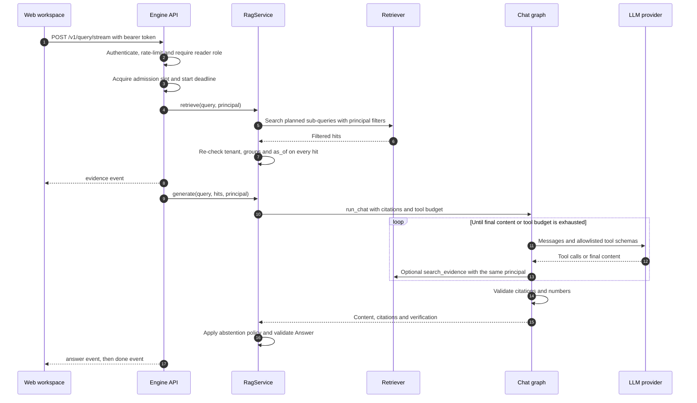

# What happens when an analyst asks a question in the chat workspace?

## Question and scope

This page traces one `POST /v1/query/stream` request with `profile=chat`.
It starts at the web workspace and ends at the final `done` or `error` event.
It excludes ingestion, the MCP adapter, the voice channel and SEC/FRED tool internals.
The [chat API contract](../../CHAT_API.md) defines every event field. This page does not repeat it.

## Summary

The engine derives tenant, groups and the publication cutoff from the authenticated principal before any search.
It streams safe `activity` events and one `evidence` event, then one validated answer or an explicit abstention, then `done`.
A failure after the stream starts produces one `error` event and no `answer` or `done`.

## Trigger, preconditions and outcome

| Item | Rule | Evidence |
|---|---|---|
| Trigger | The workspace sends `question`, `profile: "chat"`, `top_k: 5`, `history` and an optional `as_of`. | [`streamAnswer`](../../../services/web/src/api.ts#L57-L75) |
| Identity | Demo mode compares one bearer token. OIDC mode requires `sub`, `tenant_id`, `exp`, `iat`, `iss` and `aud`. | [`Authenticator`](../../../services/engine/src/ledger_rag/security/auth.py#L20-L91) |
| Permission | The principal must hold the `reader` role. | [`require_role`](../../../services/engine/src/ledger_rag/api/app.py#L162-L164) |
| Input bounds | The question has 1 to 4,000 characters. `top_k` is 1 to 10. History has at most 12 messages and 32,000 characters. | [`QueryRequest`](../../../services/engine/src/ledger_rag/core/models.py#L202-L215) |
| Startup gate | `LEDGER_ENVIRONMENT=production` refuses to start without OIDC, Qdrant, an explicit LLM and HTTPS endpoints. | [`validate_deployment`](../../../services/engine/src/ledger_rag/core/config.py#L305-L357) |
| Outcome | The client accepts an answer only after `done`. It rejects unknown shapes, duplicate answers and events after completion. | [`streamAnswer`](../../../services/web/src/api.ts#L100-L160) |

## Sequence

Text equivalent: the API checks identity, then capacity and a deadline.
`RagService` retrieves filtered evidence and re-checks authorization.
The API streams the evidence, then runs the chat graph.
The graph may call tools within a budget, then validates the draft.
`RagService` applies the abstention policy, and the API streams the answer and `done`.
The API also sends `activity` events at stage boundaries. The diagram omits them.

| Step | Component | Condition and action | Data or side effect | Source and test |
|---|---|---|---|---|
| 1 | Web workspace | Sends JSON with `credentials: "omit"` and an abort signal. | None | [api.ts](../../../services/web/src/api.ts#L57-L75) |
| 2 | Engine API | Rejects a missing or invalid token (401), unreachable JWKS (503), a missing role (403) or an exhausted limit (429). | Increments an in-process window per tenant and subject | [identity](../../../services/engine/src/ledger_rag/api/app.py#L152-L164), [RateLimiter](../../../services/engine/src/ledger_rag/security/auth.py#L94-L117); [test_resilience.py](../../../services/engine/tests/integration/test_resilience.py#L128-L170), [test_rate_limit](../../../services/engine/tests/integration/test_api.py#L112-L121) |
| 3 | Engine API | Waits at most 10 ms for one of `LEDGER_MAX_CONCURRENT_QUERIES` slots (default 32). Starts a deadline of `LEDGER_QUERY_DEADLINE_SECONDS` (default 25). | Holds a semaphore permit until the stream ends | [slot](../../../services/engine/src/ledger_rag/api/app.py#L173-L184), [default](../../../services/engine/src/ledger_rag/core/config.py#L95), [request_deadline](../../../services/engine/src/ledger_rag/core/retry.py#L73-L78); [capacity test](../../../services/engine/tests/integration/test_chat_stream.py#L403-L421) |
| 4-5 | RagService | Plans the query, then searches one or more sub-queries. Only `question` and an over-fetch `top_k` change between sub-queries. | Stores the plan in a request-scoped `ContextVar` | [retrieve, _planned_search](../../../services/engine/src/ledger_rag/orchestration/service.py#L78-L138); [planning rules](../../ARCHITECTURE.md#query-planning) |
| 5-6 | Retriever | Qdrant filters by `tenant_id`, `allowed_groups` (or none) and `published_day <= as_of` inside dense and sparse prefetch. It fuses with RRF and drops invalid or out-of-scope points. The optional TEI reranker scores bounded candidates and fails on bad output. | Reads Qdrant; calls the embedding and reranker endpoints | [_filter, _search](../../../services/engine/src/ledger_rag/retrieval/qdrant.py#L593-L702), [RerankingRetriever.search](../../../services/engine/src/ledger_rag/retrieval/reranking.py#L32-L80) |
| 7 | RagService | Raises an error when any hit fails `authorized()`. | Logs `retrieval_authorization_violation` | [authorized](../../../services/engine/src/ledger_rag/retrieval/memory.py#L14-L19), [service.py](../../../services/engine/src/ledger_rag/orchestration/service.py#L97-L99); [defense-in-depth test](../../../services/engine/tests/integration/test_resilience.py#L30-L41) |
| 8 | Engine API | Sends sources and citations clipped to response bounds. This event is not a final answer. | None | [evidence_event](../../../services/engine/src/ledger_rag/generation/evidence.py#L58-L65), [stream](../../../services/engine/src/ledger_rag/api/app.py#L313-L362) |
| 9-10 | RagService | Rejects unauthorized hits again, then builds a request-scoped graph state. | None durable | [generate](../../../services/engine/src/ledger_rag/orchestration/service.py#L140-L204) |
| 11-13 | Chat graph | Offers `calculator`, `search_evidence` and enabled external tools. Rejects unknown tools and invalid arguments as tool errors. A batch that exceeds `LEDGER_MAX_TOOL_ROUNDS` (default 3) ends with empty content. `search_evidence` keeps the original principal and `as_of`. | Adds at most 12 citations | [model, tools](../../../services/engine/src/ledger_rag/orchestration/chat.py#L116-L186), [execute_tool](../../../services/engine/src/ledger_rag/generation/chat_tools.py#L27-L98); [budget tests](../../../services/engine/tests/unit/test_chat_graph.py#L215-L250), [corrective search test](../../../services/engine/tests/integration/test_resilience.py#L43-L87) |
| 14-15 | Chat graph | Clears the draft when a marker is unknown, a paragraph lacks a marker or the text is too long. Checks each number against cited evidence or bound calculations. | None | [validation](../../../services/engine/src/ledger_rag/orchestration/chat.py#L212-L239), [validate_citations](../../../services/engine/src/ledger_rag/generation/evidence.py#L103-L119), [AnswerVerifier](../../../services/engine/src/ledger_rag/generation/verification.py#L292-L360) |
| 16 | RagService | Applies the abstention rules below. An abstention removes content, citations and calculations. | Records Prometheus timings and the abstention count | [generate](../../../services/engine/src/ledger_rag/orchestration/service.py#L228-L268), [decide](../../../services/engine/src/ledger_rag/generation/abstention.py#L42-L82), [observe](../../../services/engine/src/ledger_rag/api/app.py#L166-L171) |
| 17 | Engine API | Sends `answer`, then `done`, and releases the slot. | None | [stream](../../../services/engine/src/ledger_rag/api/app.py#L313-L362); [stream contract test](../../../services/engine/tests/integration/test_chat_stream.py#L36-L115) |

## Abstention rules

Rule 1 wins alone. Rules 2 to 6 accumulate reason codes. Any reason produces an abstention.
Default: the validated content becomes the answer.

| Priority | Condition | Result | Side effect | Source |
|---|---|---|---|---|
| 1 | The planner refused confidently, skipped retrieval and found no evidence | Abstain with `out_of_scope`; the graph skips the model | None | [plan node](../../../services/engine/src/ledger_rag/orchestration/chat.py#L80-L113), [decide](../../../services/engine/src/ledger_rag/generation/abstention.py#L66-L68) |
| 2 | Validated content is empty | Add `no_validated_answer` | None | [decide](../../../services/engine/src/ledger_rag/generation/abstention.py#L70-L71) |
| 3 | `LEDGER_VERIFICATION_MODE=enforce` (default) and a number is unsupported, or the optional verifier scores below its minimum | Add `verification_failed` | None | [_outcome](../../../services/engine/src/ledger_rag/generation/verification.py#L287-L290) |
| 4 | `LEDGER_ABSTAIN_MIN_TOP_SCORE` is set and the top score is lower or absent | Add `retrieval_score_below_threshold` | None | [decide](../../../services/engine/src/ledger_rag/generation/abstention.py#L74-L77) |
| 5 | Content exists and citation coverage is below `LEDGER_ABSTAIN_MIN_CITATION_COVERAGE` (default 0) | Add `citation_coverage_below_threshold` | None | [decide](../../../services/engine/src/ledger_rag/generation/abstention.py#L78-L79) |
| 6 | `LEDGER_ABSTAIN_MAX_TOOL_ERRORS` is set and tool errors exceed it | Add `tool_errors_above_threshold` | None | [decide](../../../services/engine/src/ledger_rag/generation/abstention.py#L80-L81) |

The thresholds are not calibrated ([abstention.py](../../../services/engine/src/ledger_rag/generation/abstention.py#L1-L12)).

Rule 6 uses a strict comparison, so `LEDGER_ABSTAIN_MAX_TOOL_ERRORS=1` tolerates one tool error and abstains on the second.
The setting accepts 0 ([config.py](../../../services/engine/src/ledger_rag/core/config.py#L150)). A value of 0 abstains on the first tool error ([test](../../../services/engine/tests/unit/test_verification.py#L331-L349)).
No test covers a count equal to a non-zero threshold.

## Failure behavior

| Failure | Observable outcome | Evidence |
|---|---|---|
| Authentication, role or rate limit | HTTP 401, 403 or 429 before the stream starts | [test_resilience.py](../../../services/engine/tests/integration/test_resilience.py#L128-L170) |
| Invalid body or a body over 2 MB | HTTP 422 or 413 before the stream starts | [test_query_validation_and_body_limit](../../../services/engine/tests/integration/test_api.py#L96-L110), [RequestMiddleware](../../../services/engine/src/ledger_rag/observability/telemetry.py#L90-L126) |
| No admission slot within 10 ms | One `error` event and no activity; `/v1/query` returns 503 | [capacity test](../../../services/engine/tests/integration/test_chat_stream.py#L403-L421) |
| Deadline exceeded | `error` event; the model call is cancelled; `/v1/query` returns 504 | [stream deadline test](../../../services/engine/tests/integration/test_chat_stream.py#L343-L363), [test_deadline_releases_capacity](../../../services/engine/tests/integration/test_resilience.py#L112-L126) |
| Retriever, reranker, embedding or provider failure | `error` event without `answer` or `done`; `/v1/query` returns 502 or 500 | [stream failure test](../../../services/engine/tests/integration/test_chat_stream.py#L178-L218), [exception handlers](../../../services/engine/src/ledger_rag/api/app.py#L186-L204) |
| Retriever returns unauthorized evidence | Error before generation; no evidence reaches the model | [service.py](../../../services/engine/src/ledger_rag/orchestration/service.py#L97-L99), [corrective search test](../../../services/engine/tests/integration/test_chat_stream.py#L221-L269) |
| Client disconnects | The producer task and graph are cancelled; the slot is released | [buffered_events](../../../services/engine/src/ledger_rag/api/streaming.py#L8-L33), [disconnect test](../../../services/engine/tests/integration/test_chat_stream.py#L270-L341) |
| Planner rewrite, decision or decomposition endpoint fails | Falls back to a deterministic step and logs a fixed event; a failed sub-query search still fails retrieval | [planning fallbacks](../../ARCHITECTURE.md#query-planning) |
| Optional groundedness verifier fails | Keeps the deterministic result and records `verifier_unavailable` | [verify_model](../../../services/engine/src/ledger_rag/generation/verification.py#L310-L360) |

Error responses and events carry sanitized text and the request ID.
Logs carry exception class names, not prompts, documents or credentials.

**Inferred:** capacity and deadline failures happen inside the stream body, after the 200 status is sent.
The workspace therefore shows its generic run-failure message, not its 503 or 504 messages.
Confirm with the owner whether this is intended ([api.ts](../../../services/web/src/api.ts#L76-L89)).

## State, retries and duplicates

- The query path makes no durable writes. It reads Qdrant and calls model endpoints.
- In-process state: rate-limit windows, the semaphore, the plan `ContextVar` and Prometheus metrics.
- Upstream retries run only inside the request deadline ([request_deadline](../../../services/engine/src/ledger_rag/core/retry.py#L73-L78)).
- The engine has no idempotency key. A retried request runs the whole pipeline again.
- The rate limiter and slots are per process. Shared quotas are a release gate for replicas ([ARCHITECTURE.md](../../ARCHITECTURE.md#6-release-and-scaling-constraints)).

## Observability and recovery

- `RequestMiddleware` sets an `X-Request-ID` header. The `answer` and `error` payloads repeat the ID.
- Spans: `rag.plan`, `rag.generate`, `rag.chat.plan`, `rag.chat.model`, `rag.chat.tools`, `rag.chat.validation` and `rag.verifier`.
- Metrics: retrieval and generation timings and abstentions by profile, plus rejected Qdrant points by reason.
- Recovery: see [health, capacity and failure handling](../../OPERATIONS.md#health-capacity-and-failure-handling).

## Voice profile differences

The voice profile shares this path with these changes ([service.py](../../../services/engine/src/ledger_rag/orchestration/service.py#L86-L227)):
`top_k` is at most 3, history is rejected, the reranker is bypassed, and no graph or tools run.
The planner skips LLM rewrite and decomposition. The deadline allows at most one upstream retry.

## Evidence and gaps

- **Implementation observed** in the linked source.
- **Test evidence:** the four linked test modules and `test_verification.py` pass locally with fake providers and the memory retriever.
- **Not exercised:** a real IdP, Qdrant, embedding endpoint, reranker or LLM on this path.
- **Unknown:** production latency, the deployed topology and the owner of this path.

## Related pages

- Next: [deployable units](../containers.md) and the [streaming decision](../../adr/0009-validated-answer-streaming.md).
- Contract: [SSE wire contract](../../CHAT_API.md#sse-wire-contract).
