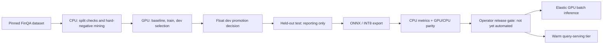

# Decision ledger: retrieval, compute and agent workflows

Reviewed 2026-10-31. This carries forward the earlier research without treating
vendor results or proposed features as project measurements. See the
[original dossier](../RESEARCH.md) for dataset/legal caveats and
[architecture](../ARCHITECTURE.md) for broader design. Newer observations below
supersede conflicting snapshot claims; they do not erase unresolved caveats.

## What exists vs what still needs evidence

| Area | Decision and reason | State / promotion gate |
|---|---|---|
| Service boundaries | Modular FastAPI service; external Qdrant/TEI; separate Modal compute jobs. Avoid needless network hops on the voice path. | Implemented reference, not a public production rollout. |
| Chunking | Preserve table rows/headers and title context; reuse production rendering in training. | Implemented. Compare against flat chunks on frozen dev evidence. |
| Retrieval | Dense + lexical sparse RRF, optional cross-encoder for chat; voice stays bounded. | Implemented. Hashed BM25 approximation is not exact corpus-wide BM25. Full FinQA ablations pending. |
| Vector compression | Optional scalar/binary with dense rescoring; `none` is explicit full precision. Never auto-migrate on readiness. | Unit and live Qdrant wire checks pass. Binary at 768 dimensions needs recall/latency/RAM evidence. |
| Model compression | CPU ONNX/INT8 versus GPU float serving. | Local base-model TEI works; fine-tuned artifact export/parity still requires remote validation. Distinct from vector quantization. |
| Training | FinQA train hard negatives, dev selection, held-out test reporting, lineage and metric gate. | Code/tests implemented. Remote fine-tunes not verified. Float dev promotion does not gate INT8 serving quality. |
| Voice | Generic PCM and Twilio Media Streams gateway, VAD and barge-in. | Synthetic wire/lifecycle tests only. Real calls, signed webhook token minting and end-to-end speech SLO remain open. |
| Control plane | GraphQL can aggregate admin documents/jobs/evals/models, not token/media traffic. | Proposed only; no GraphQL endpoint. First justify durable metadata, auth, pagination and query-cost limits. |
| Observability | OTel/Prometheus/structured logs; optional Langfuse sink without a second orchestration stack. | Base telemetry implemented; Langfuse/GenAI integration remains pending. |

## Ranked experiments and rejected shortcuts

| Option | Evidence / tradeoff | Decision and gate |
|---|---|---|
| Contextual retrieval | [Anthropic, 2024-09-19](https://www.anthropic.com/research/contextual-retrieval) reports lower retrieval failure with contextual dense + BM25 and reranking. These are vendor results, not our gains. | Experiment at ingestion. Preserve original citation text, version the context generator and compare dev evidence recall vs cost. Extra context can also increase retrieval/serving work; not literally free. |
| Late chunking / late interaction | [Late chunking](https://arxiv.org/abs/2409.04701) and [ColBERTv2](https://arxiv.org/abs/2112.01488) offer different context/interaction tradeoffs. Multivectors add index/storage complexity. | Defer until a reproducible table/evidence miss justifies them. Measure CPU latency and storage, not only a paper score. |
| Alternative encoders/rerankers | [Qwen3 embedding/reranking report](https://qwenlm.github.io/blog/qwen3-embedding/) is a candidate source, not a universal ranking. | Compare with current GTE ModernBERT on finance/dev, licenses, instruction format, ONNX/TEI compatibility and p95. No model swap based on MTEB alone. |
| Quantization variants | [Current Qdrant docs](https://qdrant.tech/documentation/manage-data/quantization/) now also describe TurboQuant (v1.18+). Rescoring can add disk I/O. | Preserve tested scalar/binary controls. Evaluate newer variants only after checking deployed server/client support; older claims of a universal speedup are not accepted. |
| Adaptive retrieval | [Adaptive-RAG](https://arxiv.org/abs/2403.14403) motivates query-dependent effort. Extra classifier/LLM hops have costs. | Defer until hard/easy slices show a reliable routing signal; bounded voice remains default. |
| Prompt caching | [Anthropic docs](https://platform.claude.com/docs/en/build-with-claude/prompt-caching) describe provider-specific cache controls. | Proposed for stable tool/system prefixes; verify compatible endpoints, token thresholds, hit metrics and privacy. Not an answer cache. |
| Answer caching | Restated filings and tenant-specific ACLs can invalidate semantically similar answers. | No cache until tenant/ACL/corpus/model/prompt/as-of identity and invalidation are explicit. TTL or similarity alone is insufficient. |
| Semantic turn detection | [LiveKit turn detection](https://docs.livekit.io/agents/build/turns/) and [Pipecat Smart Turn](https://github.com/pipecat-ai/smart-turn) are candidates beyond energy VAD. | Proposed; test noisy speech, mid-thought pauses, interruption accuracy and real mouth-to-ear latency. Vendor latency is not our SLO. |
| GraphRAG / hierarchy | Graph/hierarchical retrieval can help cross-document questions but adds extraction, storage and freshness costs. | Defer until a cross-filing slice beats hybrid+rerank under the same budget. Not rejected for all domains. |
| HyDE / web corrective fallback | Generated search text can invent financial quantities; web fallback changes trust, privacy and temporal scope. | No default numeric-query HyDE or unsupervised web fallback. Test a separately governed experiment if needed. |
| BM42 / learned sparse | [Qdrant's BM42 article](https://qdrant.tech/articles/bm42/) is a source to inspect critically, not proof it beats BM25 on finance. | Keep lexical baseline; require same-corpus comparison before adopting learned sparse. |
| JEPA / "JEV" / "OKF" | Terms in the original brief are ambiguous; vision/video JEPA results do not prove financial-text retrieval gains. | Keep unresolved unless a specific paper/model is supplied. Do not invent an expansion or claim no future text use is possible. |

## Framework choices

- **LangChain:** not required for the implemented protocol adapters and bounded
  tools. Adopt only if a concrete integration removes more maintenance than it adds.
  Do not claim its overhead without measuring the actual path.
- **LangGraph:** defer until durable, resumable, multi-step workflows are a real
  requirement. A graph abstraction alone does not improve retrieval accuracy.
- **LangSmith:** not required by the existing OTel design; evaluate governance,
  licensing and portability if hosted evaluation/workflows become necessary.
- **Langfuse:** preferred experiment as an optional OTel destination, not a
  replacement for service logs/metrics. [Current official integration docs](https://langfuse.com/integrations/native/opentelemetry)
  support OTLP/HTTP at `/api/public/otel`; trace-specific endpoint is
  `/api/public/otel/v1/traces`. Current docs include a v4 ingestion header, so older
  v3-only setup notes need checking against the target deployment. Authenticate
  via protected collector/exporter configuration; no prompt export by default.
- **GenAI semantic conventions:** the [old OTel page](https://opentelemetry.io/docs/specs/semconv/gen-ai/gen-ai-spans/)
  now points to a dedicated repository. Pin/verify the actual convention and sink
  mapping before adding attributes; do not assume an old spec's stability label.
- **GraphQL:** potential admin/control-plane interface; REST/SSE/WebSocket remain
  query/voice transports. No GraphQL runtime dependency until there is a concrete
  metadata/query contract and enforcement of depth, cost and authorization.

## Compute topology and release boundary

Default H100 training and L4/L40S inference are configurations, not proven optimal
hardware. Compare total billed GPU/CPU time, cold starts, transfer and failures.
An account balance or `timeout` is not a hard budget. Do not launch paid jobs or
deploy endpoints merely to validate agent instructions.

## Evaluation continuity

- Local dataset inspection: 2,789 pages, 8,611 chunks, 137 companies and 1,147 test
  questions at pinned FinQA revision `0f16e2867befa6840783e58be38c9efb9229d742`.
- Earlier mining inspection reported 20,774 triplets and 6,309 filtered potential
  false negatives. These are construction diagnostics, not quality scores; rerun
  after rendering/mining changes and retain the dataset fingerprint.
- The interrupted local ingest contained only 3,328 points when recovered, with
  no completed results artifact. It is not a benchmark baseline. The CLI has no
  ingest resume flag; a fresh complete run must be explicitly planned.
- Preserve the original license/pretraining-contamination caveats. FinQA's harness
  label of MIT does not resolve source-document rights or rehost-license differences.
- Remaining work: full retrieval ablations, oracle/retrieved answer evaluation,
  real voice measurements, remote training/parity, optional GenAI/Langfuse,
  a justified control plane, deployment/restore drills and production documentation.
  None is silently marked complete by the agent-skills work.

  ## Agent workflow and execution correction

  - Reduced eight skills to three: benchmark execution, project compute/release,
    and the unchanged upstream Modal reference. Component navigation stays in docs;
    project invariants stay in `AGENTS.md`. `.agents/skills` is canonical, with
    per-skill `.claude/skills` aliases. Fewer instructions are not proof of better
    reasoning; validate discovery and task behavior in the actual clients.
  - Confirmed with locked Modal 1.6.3 CLI/SDK documentation that token credentials
    support browser-free authentication, including direct `MODAL_TOKEN_ID` /
    `MODAL_TOKEN_SECRET` environment injection. Browser token creation is optional.
    Platform credentials and TEI endpoint keys serve different trust boundaries.
  - The attempted access check returned `Token missing`. No Modal job or deployment
    ran. Local bulk inference was an execution-placement mistake, not a Modal
    limitation: both benchmark model containers are now stopped. Qdrant data is
    retained; ingestion is incomplete and is not an accepted benchmark baseline.
  - Bulk embedding, benchmark inference and training are assigned to Modal.
    Authentication must be resolved explicitly before continuing; no automatic
    CPU fallback. A warm IVR query tier and bounded local tests/parity checks remain
    separate concerns. See [agent workflows](../AGENT_WORKFLOWS.md).

## Colocated ingestion implementation

- Modal access is now verified by successful read-only app/secret listing; the
    prior missing-token observation is superseded. No cloud job has been launched.
- Added a single-container GPU build: pinned input -> production chunks ->
    loopback TEI -> direct dense/sparse Qdrant uploads -> exact count -> committed
    manifest. A new-only destination prevents partial builds from silently
    replacing the serving index. Qdrant is external and persistent.
- Explicit schema-3 embedding-space identity decouples model/revision identity
    from endpoint location; schema-2 behavior remains unchanged by default.
    Ingestion and query endpoints must use compatible pinned rendering/model
    settings. An ID is not a substitute for serving parity.
- Read-only checks found no Modal database secret. GPU execution, actual
    throughput and database reachability remain unverified; see the
    [ingestion runbook](../INGESTION.md) for provisioning and release gates.
