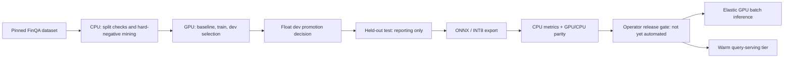

# Decision ledger: retrieval, compute and agent workflows

Reviewed 2026-10-31. This carries forward the earlier research without treating
vendor results or proposed features as project measurements. See the
[original dossier](../RESEARCH.md) for dataset/legal caveats and
[architecture](../ARCHITECTURE.md) for broader design. Newer observations below
supersede conflicting snapshot claims; they do not erase unresolved caveats.

## What exists vs what still needs evidence

| Area | Decision and reason | State / promotion gate |
|---|---|---|
| Service boundaries | Modular FastAPI service; external Qdrant/TEI; separate Modal compute jobs. Avoid needless network hops on the voice path. | Implemented reference, not a public production rollout. |
| Chunking | Preserve table rows/headers and title context; reuse production rendering in training. | Implemented. Compare against flat chunks on frozen dev evidence. |
| Retrieval | Dense + lexical sparse RRF, optional cross-encoder for chat; voice stays bounded. | Implemented. Hashed BM25 approximation is not exact corpus-wide BM25. Full FinQA ablations pending. |
| Vector compression | Optional scalar/binary with dense rescoring; `none` is explicit full precision. Never auto-migrate on readiness. | Unit and live Qdrant wire checks pass. Binary at 768 dimensions needs recall/latency/RAM evidence. |
| Model compression | CPU ONNX/INT8 versus GPU float serving. | Local base-model TEI works; fine-tuned artifact export/parity still requires remote validation. Distinct from vector quantization. |
| Training | FinQA train hard negatives, dev selection, held-out test reporting, lineage and metric gate. | Code/tests implemented. Remote fine-tunes not verified. Float dev promotion does not gate INT8 serving quality. |
| Voice | Generic PCM and Twilio Media Streams gateway, VAD and barge-in. | Synthetic wire/lifecycle tests only. Real calls, signed webhook token minting and end-to-end speech SLO remain open. |
| Control plane | GraphQL can aggregate admin documents/jobs/evals/models, not token/media traffic. | Proposed only; no GraphQL endpoint. First justify durable metadata, auth, pagination and query-cost limits. |
| Chat workspace | React/TypeScript static client, source/artifact inspectors and real execution events; typed request-scoped LangGraph for bounded tools. | Implemented with tab-memory history; no persistent chat/checkpointer or executed artifacts. |
| Observability | OTel/Prometheus/structured logs, safe graph-node spans; optional Langfuse sink without duplicated vendor tracing. | Base telemetry implemented; live Langfuse/GenAI token/cost integration remains pending. |

## Ranked experiments and rejected shortcuts

| Option | Evidence / tradeoff | Decision and gate |
|---|---|---|
| Contextual retrieval | [Anthropic, 2024-09-19](https://www.anthropic.com/research/contextual-retrieval) reports lower retrieval failure with contextual dense + BM25 and reranking. These are vendor results, not our gains. | Experiment at ingestion. Preserve original citation text, version the context generator and compare dev evidence recall vs cost. Extra context can also increase retrieval/serving work; not literally free. |
| Late chunking / late interaction | [Late chunking](https://arxiv.org/abs/2409.04701) and [ColBERTv2](https://arxiv.org/abs/2112.01488) offer different context/interaction tradeoffs. Multivectors add index/storage complexity. | Defer until a reproducible table/evidence miss justifies them. Measure CPU latency and storage, not only a paper score. |
| Alternative encoders/rerankers | [Qwen3 embedding/reranking report](https://qwenlm.github.io/blog/qwen3-embedding/) is a candidate source, not a universal ranking. | Compare with current GTE ModernBERT on finance/dev, licenses, instruction format, ONNX/TEI compatibility and p95. No model swap based on MTEB alone. |
| Quantization variants | [Current Qdrant docs](https://qdrant.tech/documentation/manage-data/quantization/) now also describe TurboQuant (v1.18+). Rescoring can add disk I/O. | Preserve tested scalar/binary controls. Evaluate newer variants only after checking deployed server/client support; older claims of a universal speedup are not accepted. |
| Adaptive retrieval | [Adaptive-RAG](https://arxiv.org/abs/2403.14403) motivates query-dependent effort. Extra classifier/LLM hops have costs. | Defer until hard/easy slices show a reliable routing signal; bounded voice remains default. |
| Prompt caching | [Anthropic docs](https://platform.claude.com/docs/en/build-with-claude/prompt-caching) describe provider-specific cache controls. | Proposed for stable tool/system prefixes; verify compatible endpoints, token thresholds, hit metrics and privacy. Not an answer cache. |
| Answer caching | Restated filings and tenant-specific ACLs can invalidate semantically similar answers. | No cache until tenant/ACL/corpus/model/prompt/as-of identity and invalidation are explicit. TTL or similarity alone is insufficient. |
| Semantic turn detection | [LiveKit turn detection](https://docs.livekit.io/agents/build/turns/) and [Pipecat Smart Turn](https://github.com/pipecat-ai/smart-turn) are candidates beyond energy VAD. | Proposed; test noisy speech, mid-thought pauses, interruption accuracy and real mouth-to-ear latency. Vendor latency is not our SLO. |
| GraphRAG / hierarchy | Graph/hierarchical retrieval can help cross-document questions but adds extraction, storage and freshness costs. | Defer until a cross-filing slice beats hybrid+rerank under the same budget. Not rejected for all domains. |
| HyDE / web corrective fallback | Generated search text can invent financial quantities; web fallback changes trust, privacy and temporal scope. | No default numeric-query HyDE or unsupervised web fallback. Test a separately governed experiment if needed. |
| BM42 / learned sparse | [Qdrant's BM42 article](https://qdrant.tech/articles/bm42/) is a source to inspect critically, not proof it beats BM25 on finance. | Keep lexical baseline; require same-corpus comparison before adopting learned sparse. |
| JEPA / "JEV" / "OKF" | Terms in the original brief are ambiguous; vision/video JEPA results do not prove financial-text retrieval gains. | Keep unresolved unless a specific paper/model is supplied. Do not invent an expansion or claim no future text use is possible. |

## Framework choices

- **LangChain:** not required for the implemented protocol adapters and bounded
  tools. Adopt only if a concrete integration removes more maintenance than it adds.
  Do not claim its overhead without measuring the actual path.
- **LangGraph:** adopted for the requested chatbot's explicit model, bounded-tool
  and validation flow with real stage observability. This supersedes the earlier
  deferral; it is not a durable workflow/checkpointer or an accuracy improvement
  by itself. Voice stays direct. See [the chat contract](../CHAT_API.md).
- **LangSmith:** a transitive LangGraph dependency, not an enabled integration.
  Automatic export is explicitly disabled, including tracing environment flags.
  Evaluate governance, licensing and portability before enabling a separate sink.
- **Langfuse:** preferred experiment as an optional OTel destination, not a
  replacement for service logs/metrics. [Current official integration docs](https://langfuse.com/integrations/native/opentelemetry)
  support OTLP/HTTP at `/api/public/otel`; trace-specific endpoint is
  `/api/public/otel/v1/traces`. Current docs include a v4 ingestion header, so older
  v3-only setup notes need checking against the target deployment. Authenticate
  via protected collector/exporter configuration; no prompt export by default.
- **GenAI semantic conventions:** the [old OTel page](https://opentelemetry.io/docs/specs/semconv/gen-ai/gen-ai-spans/)
  now points to a dedicated repository. Pin/verify the actual convention and sink
  mapping before adding attributes; do not assume an old spec's stability label.
- **GraphQL:** potential admin/control-plane interface; REST/SSE/WebSocket remain
  query/voice transports. No GraphQL runtime dependency until there is a concrete
  metadata/query contract and enforcement of depth, cost and authorization.

## Compute topology and release boundary

Default H100 training and L4/L40S inference are configurations, not proven optimal
hardware. Compare total billed GPU/CPU time, cold starts, transfer and failures.
An account balance or `timeout` is not a hard budget. Do not launch paid jobs or
deploy endpoints merely to validate agent instructions.

## Evaluation continuity

- Local dataset inspection: 2,789 pages, 8,611 chunks, 137 companies and 1,147 test
  questions at pinned FinQA revision `0f16e2867befa6840783e58be38c9efb9229d742`.
- Earlier mining inspection reported 20,774 triplets and 6,309 filtered potential
  false negatives. These are construction diagnostics, not quality scores; rerun
  after rendering/mining changes and retain the dataset fingerprint.
- The interrupted local ingest contained only 3,328 points when recovered, with
  no completed results artifact. It is not a benchmark baseline. The CLI has no
  ingest resume flag; a fresh complete run must be explicitly planned.
- Preserve the original license/pretraining-contamination caveats. FinQA's harness
  label of MIT does not resolve source-document rights or rehost-license differences.
- Remaining work: full retrieval ablations, oracle/retrieved answer evaluation,
  real voice measurements, remote training/parity, optional GenAI/Langfuse,
  a justified control plane, deployment/restore drills and production documentation.
  None is silently marked complete by the agent-skills work.

  ## Agent workflow and execution correction

  - Reduced eight skills to three: benchmark execution, project compute/release,
    and the unchanged upstream Modal reference. Component navigation stays in docs;
    project invariants stay in `AGENTS.md`. `.agents/skills` is canonical, with
    per-skill `.claude/skills` aliases. Fewer instructions are not proof of better
    reasoning; validate discovery and task behavior in the actual clients.
  - Confirmed with locked Modal 1.6.3 CLI/SDK documentation that token credentials
    support browser-free authentication, including direct `MODAL_TOKEN_ID` /
    `MODAL_TOKEN_SECRET` environment injection. Browser token creation is optional.
    Platform credentials and TEI endpoint keys serve different trust boundaries.
  - The attempted access check returned `Token missing`. No Modal job or deployment
    ran. Local bulk inference was an execution-placement mistake, not a Modal
    limitation: both benchmark model containers are now stopped. Qdrant data is
    retained; ingestion is incomplete and is not an accepted benchmark baseline.
  - Bulk embedding, benchmark inference and training are assigned to Modal.
    Authentication must be resolved explicitly before continuing; no automatic
    CPU fallback. A warm IVR query tier and bounded local tests/parity checks remain
    separate concerns. See [agent workflows](../AGENT_WORKFLOWS.md).

## Colocated ingestion implementation

- Modal access is now verified by successful read-only app/secret listing; the
    prior missing-token observation is superseded. No cloud job has been launched.
- Added a single-container GPU build: pinned input -> production chunks ->
    loopback TEI -> direct dense/sparse Qdrant uploads -> exact count -> committed
    manifest. A new-only destination prevents partial builds from silently
    replacing the serving index. Qdrant is external and persistent.
- Explicit schema-3 embedding-space identity decouples model/revision identity
    from endpoint location; schema-2 behavior remains unchanged by default.
    Ingestion and query endpoints must use compatible pinned rendering/model
    settings. An ID is not a substitute for serving parity.
- Read-only checks found no Modal database secret. A later authenticated HTTPS
    preflight reached Qdrant 1.20.0 and listed zero collections, without writes.
    Reachability from a Modal worker, GPU execution and actual throughput remain
    unverified; see the
    [ingestion runbook](../INGESTION.md) for provisioning and release gates.

## Architecture choice review

**Decision: retain a conditional baseline, not declare a universal winner.**
An independent source review plus inspection of the current request, ingestion,
voice and telemetry paths informed this comparison. "All possible approaches"
is not an enumerable or testable claim. We compare credible alternatives under
explicit constraints, preserve rejected options, and change course when evidence
warrants it.

Current facts: 2,789 FinQA pages produce 8,611 chunks; the development split has
883 questions and the held-out test split 1,147. That is a useful correctness
benchmark, not evidence of large-scale capacity. There is **no existing Postgres
or transactional outbox** in this repository. Cloud authentication works, but
real GPU ingestion, full-corpus answer quality and voice latency remain unverified.

### Compute placement

| Approach | Why / when it fits | Cost or correctness tradeoff | Decision |
|---|---|---|---|
| Colocated Modal worker + TEI + direct database writes | One controlled, reproducible bulk build; no vectors relayed through the caller; aligns batch and serving TEI behavior | GPU allocation includes download, CPU preparation and database waits; not inherently cheapest | Current implementation, pending cloud measurements |
| CPU preparation/upload workers + shared GPU endpoint | Continuous ingestion or several tenants can share a saturated model service | Additional transport, queues, admission control and failure boundaries; writes still bottleneck at the database | Compare if profiling shows material GPU idle time or ongoing multi-producer demand |
| Direct in-process encoder instead of loopback TEI | Can remove HTTP serialization and simplify very small jobs | Must independently match pooling, normalization, dtype, batching and tokenization with query serving | Candidate ablation, not assumed faster or equivalent |
| Remote CPU / ONNX encoder | Small or infrequent jobs may not amortize GPU startup and reservation | Throughput and numerical parity must be measured; CPU is not automatically cheaper per completed build | Include as a Modal-hosted comparator, not a silent local fallback |
| Durable vector artifacts + separate import | Expensive embeddings can be reused across repeated index builds; separates model work from database availability | Adds artifact schema, storage, manifests and lifecycle/ACL handling | Prefer when repeated rebuilds justify durable intermediate vectors |
| Qdrant managed inference | Fewer separately managed embedding components for supported models/deployments | Changes model availability, residency, operational ownership and cost; custom fine-tune/parity needs may not fit | Valid alternative to benchmark, not adopted by assumption |
| Database inside the ephemeral GPU job | Fewer network boundaries during a toy experiment | Couples database uptime/storage to disposable compute and GPU cost; unsafe production default | Reject for persistent serving storage |

[Qdrant's inference documentation](https://qdrant.tech/documentation/inference/)
distinguishes client-side FastEmbed, in-cluster sparse BM25, managed Cloud
Inference and externally hosted providers. FastEmbed does **not** mean arbitrary
dense models run inside a self-hosted Qdrant server. A portable vector artifact
is also not a Qdrant snapshot: snapshot restore is a database recovery operation,
not a generic incremental vector merge.

Before changing placement, record cold start/download, preparation, embedding,
upload, indexing and verification time **separately**, plus GPU utilization,
peak memory, completed points, failures, billed resource time and total cost.
The current ingestion `seconds` field excludes preparation/model startup; it
cannot alone establish the cheapest design. Measure end-to-end completed-build
cost, not only warm embedding throughput.

### Retrieval and persistence

| Choice | Strongest reason to choose it | Reason not to assume it wins here | Revisit trigger |
|---|---|---|---|
| Current Qdrant dense + sparse RRF | Existing tested adapters, payload isolation, vector-specific indexes and explicit model identity | Hashed lexical scoring is approximate; no real-data superiority or capacity result yet | Evidence/identifier misses or an operational requirement the current store cannot meet |
| Native Qdrant full-text BM25 / sparse BM25 | Could improve lexical semantics while retaining one search store and less custom scoring code | Exact feature/API support must match the deployed server/client; ranking differs from the current approximation | **Priority ablation** before adding a second search cluster |
| Postgres + pgvector + full-text search | Attractive when transactional source rows, relational queries and RLS are already needed; exact search is a valid small-corpus baseline | Postgres is not already deployed; migration and ANN/filter behavior still need testing | Durable metadata/ACL/outbox requirements justify Postgres, or it wins the same workload's cost/quality test |
| OpenSearch hybrid search | Mature lexical/analyzer/structured search needs plus vector retrieval | Adds cluster, shard, memory and index-lifecycle operations; engine choice alone does not fix financial reasoning | Exact-identifier or lexical slices justify its capabilities after simpler alternatives are measured |
| Contextual retrieval / late chunking / ColBERT-style interaction | May address specific context-loss or multi-hop evidence failures | More ingestion/model/storage work; reported gains on other datasets are not this project's gains | Reproducible dev failure slices improve without unacceptable latency, rights or operating cost |

Primary references:
[Qdrant inference and BM25 options](https://qdrant.tech/documentation/inference/),
[pgvector exact/approximate search](https://github.com/pgvector/pgvector),
[Postgres full-text search](https://www.postgresql.org/docs/current/textsearch.html),
[OpenSearch hybrid search](https://docs.opensearch.org/latest/vector-search/ai-search/hybrid-search/index/),
[contextual retrieval](https://www.anthropic.com/research/contextual-retrieval),
[ColBERTv2](https://aclanthology.org/2022.naacl-main.272/).

Ticker/filing identifiers should have explicit normalized fields and exact-match
tests where needed; neither vector similarity nor a keyword payload index is a
ranked lexical engine. ACL enforcement must be specified end to end, including
who may use database credentials directly. Adding a relational policy does not
automatically coordinate ACL changes with a separately indexed copy.

### Service and workflow boundaries

| Approach | Decision and trigger |
|---|---|
| Modular monolith + independent batch compute | Keep the synchronous query path simple. Do not add network services solely to appear sophisticated. The small-write API still shares query capacity; bulk builds use Modal instead. |
| Durable metadata, outbox and coordinated writes | Required before continuous multi-writer updates, robust ACL/deletion propagation or automated repair. This is a missing capability, not something current Modal retries provide. |
| LangGraph | Now implemented for explicit bounded chat stages and safe activity instrumentation. Persistence and resumable approval remain future requirements; no checkpointer or cross-system transaction is implied. |
| Temporal | Candidate for durable ingestion/release orchestration and recovery once those workflows justify its infrastructure. Activities and side effects still need idempotency; automatic retries can otherwise duplicate external work. |
| GraphQL | Consider only for a real admin/control-plane metadata surface. Keep REST/SSE/WebSocket for current query and media traffic. |

Primary references:
[LangGraph persistence](https://docs.langchain.com/oss/python/langgraph/persistence),
[Temporal activity idempotency](https://docs.temporal.io/activity-definition#idempotency).
Framework choice follows the recovery/state requirement, not a service-count
rule or a claim that orchestration increases answer accuracy.

### Review outcomes and next experiment order

1. **Fixed now:** stale diagrams/status claims about voice, OIDC, log shipping,
     synchronous ingestion and optional stores. The diagrams distinguish shipped
     paths, manual release gates and missing integrations.
2. **Fixed now:** the FinQA CLI previously exposed only test questions despite
     the loader supporting other splits. `--split dev` now enables selection
     without consuming the held-out test set; reports distinguish available and
     selected questions. The legacy default/report field remains compatible.
3. **Next: real baseline**, once Vault/Modal database-secret provisioning and
     an explicit paid-job budget are configured.
     Measure completed GPU builds and the current dense/sparse/hybrid/rerank arms
     on dev before adding new components. Use the same data, scopes and identity.
4. **Next: simplest retrieval challengers.** Compare exact/native lexical scoring,
     fusion and candidate counts first, then encoders, contextual/late interaction
     only for identified misses. Preserve original source text and numeric units.
5. **Next: operational release gates.** Export/runtime parity, durable recovery,
     log forwarding, GenAI span semantics and real telephony tests remain
     uncompleted work. Do not claim they were solved by this review.

For each experiment, preregister the primary metric and acceptable cost/latency
budget. Keep ACL/date/failure regressions as hard gates. Use paired comparisons
and uncertainty on dev, report failures and slice regressions, and only then
freeze a candidate for held-out reporting. An architecture change needs a
measured benefit or a required capability, not merely a new publication.

### Inputs needed before deployment and meaningful optimization

The supplied Qdrant endpoint passed TLS-verified authenticated `GET /` and
`GET /collections` checks (HTTP 200, version 1.20.0, zero collections). This was
read-only: it did not test write permissions or network access from Modal.
Modal's secret list remained empty and the local Vault CLI was unavailable.
See the [validation record](../VALIDATION.md#read-only-database-preflight);
endpoint discovery is no longer the blocker, but provisioning and paid-job
authorization remain outstanding.

| Input | What it unlocks |
|---|---|
| Provision the supplied Qdrant connection through Vault/Modal secrets; verify scoped write permissions and worker reachability | Actual cloud ingestion and persistent retrieval |
| Per-run and monthly budget, allowed region and data residency | Responsible GPU selection, concurrency and deployment choices |
| Corpus size/growth, update frequency, languages and expected concurrent queries/calls | Whether batch, continuous ingestion, extra stores or shared inference are justified |
| Required voice/chat latency and availability targets | Measurable warm-capacity, routing and failure budgets |
| Compatible LLM endpoint/model and credentials; STT/TTS and telephony test configuration | Answer correctness, cost and real end-to-end voice evaluation |
| Intended portfolio/data usage and dataset/source rights | Which corpora may be indexed, evaluated or redistributed |

Provide non-secret requirements directly; provision credentials through the
secret manager rather than pasting them into chat. A free-credit balance is not
a hard per-run spending limit.
